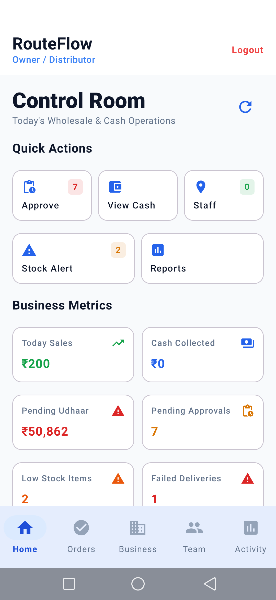
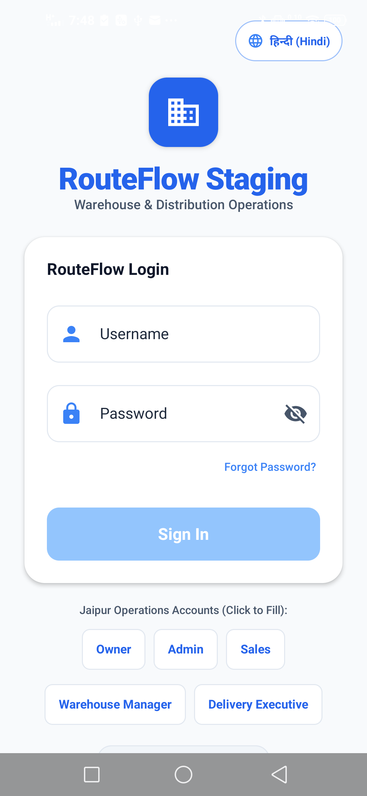
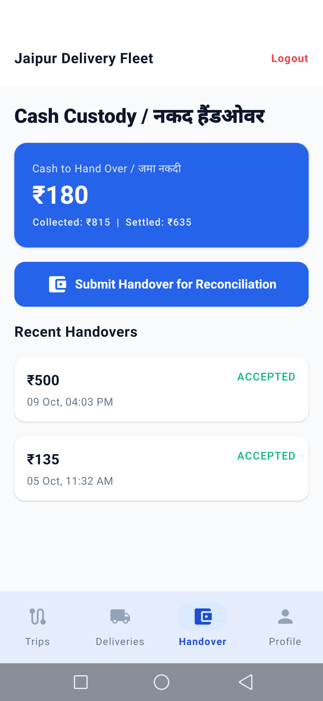

# RouteFlow

RouteFlow is a pilot-ready B2B distributor operating system for Indian kirana/FMCG wholesalers.

> **[View full screenshot gallery](docs/SCREENSHOT_GALLERY.md)** (49 verified mobile & web proof screens)

Unified dual-platform system connecting real-world field operations with central business control:
- **Native Android App**: Field sales beat navigation, offline caching, warehouse FEFO picking & packing, server OTP delivery verification, and physical COD cash custody.
- **Next.js Web Management Console**: Central office control for live inventory, credit exposure, beat routing, and driver cash reconciliation ([Live Web Console](https://appdashboardadmin.vercel.app)).
- **Cloudflare Serverless Engine**: Workers + D1 database providing atomic stock reservations, tamper-evident audit logs, and zero-downtime serverless scaling.

---

## What It Does

```
Sales order ──> Owner approval ──> Godown picking/packing ──> Delivery OTP ──> Cash collection ──> Cash settlement ──> Owner live status
```

1. **Sales Visit & GPS Onboarding:** Sales executive starts duty, visits mapped kirana stores on beat (`BEAT-04`), logs GPS check-in, and books orders with wholesale tiered pricing.
2. **Owner Verification & Approval:** Owner reviews retailer credit limits and godown stock availability; single-tap approval atomically reserves physical inventory in Cloudflare D1.
3. **Warehouse Picking & Carton Packing:** Godown manager fulfills approved orders using item checklists and carton packing manifests.
4. **Driver Dispatch & OTP Delivery:** Delivery executive navigates route stops, confirms physical delivery using a tamper-proof 6-digit server OTP, and collects cash on delivery.
5. **Cash Reconciliation & Depot Settlement:** Driver delivers collected cash to the distributor depot; Owner verifies and settles driver balance down to ₹0.00.
6. **Live Business Visibility:** Owner monitors real-time sales revenue, warehouse inventory levels, outstanding customer udhaar, and staff duty from phone or web.

---

## Roles

| Role | Field Operations (Android App) | Office & Control (Web Dashboard) |
|---|---|---|
| **Owner** | Instant order approvals, credit limits, daily cash reconciliation, live metrics | Comprehensive KPIs, financial ledgers, staff access control, business reports |
| **Sales Executive** | Beat route navigation, GPS retailer check-in, catalog order booking, field collections | Retailer list, assigned beat directory, personal order history |
| **Warehouse Manager** | Approved picking queue, barcode scanning, carton boxing, dispatch manifests, returns | Live godown inventory counts, threshold reorder alerts, inward GRN |
| **Delivery Executive** | Stop sequencing, 6-digit server OTP delivery confirmation, cash custody ledger | Assigned route trips, delivery confirmation history, depot cash handovers |

---

## Product Screens

All mobile screens captured directly from physical **Vivo 1935** running the RouteFlow Android staging build:

| 1. Authentication (B2B Multi-Language) | 2. Owner Control Room Dashboard | 3. Field Sales Beat Operations |
|:---:|:---:|:---:|
| <br><b>Login & Language</b><br>Clean B2B login with English/Hindi localization | <br><b>Executive Dashboard</b><br>Real-time wholesale sales, stock & cash KPIs | <br><b>Sales Beat (BEAT-04)</b><br>Beat stores, daily target, and GPS visit tracker |

| 4. Warehouse & Godown Operations | 5. Delivery Route & Stops | 6. Physical Cash Handover Settlement |
|:---:|:---:|:---:|
| <br><b>Godown Fulfillment</b><br>Picking queue, carton packing & low-stock alerts | <br><b>Delivery Route</b><br>Assigned stops, navigation & server OTP verification | <br><b>Cash Custody & Settlement</b><br>COD handover to depot settling balance to ₹0.00 |

> Full screenshot gallery: [docs/SCREENSHOT_GALLERY.md](docs/SCREENSHOT_GALLERY.md)

---

## Verification & Documentation

| Document | Purpose |
|---|---|
| 📋 **[Physical Device Hardcore QA Report](docs/DEVICE_HARDCORE_QA_REPORT.md)** | Full 30-screen runtime verification pass on Vivo 1935 physical device with zero bugs. |
| 🖼️ **[Complete Screenshot Gallery](docs/SCREENSHOT_GALLERY.md)** | High-resolution visual gallery of mobile role flows and web management console. |
| 🎯 **[Canonical Client Demo Script](FINAL_CLIENT_DEMO_SCRIPT.md)** | Step-by-step distributor pilot walkthrough (Ramesh Ji → Rakesh → Manoj → Suresh). |
| 📦 **[Google Play Store Listing Package](PLAY_STORE_LISTING_PACKAGE.md)** | Production release metadata, short/full descriptions, and Data Safety disclosures. |
| 🏗️ **[Project Architecture & Engineering Guide](PROJECT_GUIDE.md)** | Complete technical manual covering Android Room DB, Cloudflare D1 schema, and APIs. |

---

## Web Management Console

Access the central distributor operations console:
- **Live URL:** [https://appdashboardadmin.vercel.app](https://appdashboardadmin.vercel.app)
- **Features:** Order approval hub, retailer directory with GPS mapping, godown SKU stock levels, driver cash handover audit ledger, and CSV/JSON data backup.

---

## Tech Stack & Architecture

- **Android App:** Native Kotlin, Jetpack Compose, Material 3, Room Database (offline-first), Hilt DI, Retrofit/OkHttp, WorkManager.
- **Web Dashboard:** Next.js 16 (App Router), React 19, Tailwind CSS, Vercel edge deployment.
- **Backend API:** Cloudflare Workers running the lightweight Hono framework with sub-50ms latency.
- **Database:** Cloudflare D1 (Serverless SQLite with atomic ACID transaction guarantees).

---

## Quick Start Commands

### Backend Verification
```bash
cd backend
npm test                                                                # Run unit & integration tests
node --dns-result-order=ipv4first test/test-hardcore-empty-business.mjs # 16-step hardcore business lifecycle
```

### Web Dashboard
```bash
cd web
npm install
npm run dev    # Local development at http://localhost:3000
npm run build  # Production build verification
```

### Android Native App / Flutter Mobile
```bash
cd flutter_distributor
flutter analyze --no-pub # 0 issues found
flutter test             # 275 of 275 tests passed (100%)
flutter build apk --debug
```

---

## Client Release Summary: Sales & Inventory Suites

### 1. Field Sales Representative Suite (फील्ड सेल्स एग्जीक्यूटिव)
- **Live Google Maps & Eager Gesture Navigation**: Seamless embedded Google Maps directly beneath the top navigation bar. Includes `EagerGestureRecognizer` for fluid pan, pinch-to-zoom, and map rotation without page scroll interference.
- **Sequential Beat Route Management**: Sardarpura & Nai Sadak route with live assigned stops (`Points A -> B -> C -> D`).
- **In-Map Shop CRUD Operations**:
  - **Create**: Add new kirana shops directly from the map location with geotagging.
  - **Read**: Visual shop pins, shop cards, owner contact details, and address breakdowns.
  - **Update**: Edit shop name, owner name, phone number, and street address directly from the beat.
  - **Delete**: Soft-delete or remove shop from today's beat route.
- **High-Velocity Order Booking**: Multi-unit selector supporting Box, Strip (Ladi), and Loose Piece combo bookings with wholesale pricing.
- **Role Isolation**: Accounting and GST summary buttons are strictly hidden from Sales reps to protect business margins.
- **Real-Time Beat Analytics**: Live tracking of booked orders, booked turnover, beat coverage percentage, average order value (AOV), and visit strike rate.
- **4-Language Support**: Instant switching across English, Hinglish, Hindi (हिंदी), and Gujarati (ગુજરાતી).

---

### 2. Godown & Inventory Management Suite (गोदाम व इन्वेंट्री प्रबंधन - 1 Role, 3 Core Features)
The Inventory role is architected around 3 essential operational features:

#### Feature 1: Central Godown Inventory & Two-Stock Architecture (सेंट्रल गोदाम स्टॉक व टू-स्टॉक व्यू)
- **Two-Stock Switcher (Two Stock View)**:
  - **🏬 Central Godown Stock**: View and manage central warehouse depot inventory with full SKU catalog, valuation, and threshold alerts.
  - **🚚 Truck Fleet Stock**: View loaded inventory across mobile delivery vehicles with vehicle fleet selector (`Tata Ace`, `Bolero Maxi`, `Eicher Pro`).
- **Manual In-App SKU Intake & CRUD (`+ Add SKU`)**:
  - Add new products and stock batches directly from the mobile app without requiring backoffice intervention.
  - Multi-tier wholesale pricing inputs for **Piece (प्रति पीस)**, **Strip (प्रति लड़ी)**, and **Box / Carton (प्रति पेटी)** with instant Auto-Fill rate calculator.
  - Batch number tagging, expiry datepicker with quick presets (`+3M`, `+6M`, `+1Y`), and reorder alert thresholds.
  - Full CRUD: In-app Edit (pencil), Delete/Archive (trash with dialog), and Stock Audit (`Adjust Stock`) with variance reasons.
- **Automated Expiry Radar (एक्सपायरी ट्रैकर)**:
  - Categorizes batches into `Expired`, `Expiring in <60 days`, and `Fresh / Safe`.
  - Prominent countdown badges (e.g. `22 days left`), clearance sale flagging, and expired stock disposal write-offs.
- **Godown Financial Analytics (इन्वेंट्री एनालिटिक्स)**:
  - Live total stock valuation in ₹ and Lakhs.
  - Category-wise valuation distribution and carton volume breakdown.

#### Feature 2: Sales Orders Pick & Dispatch Queue (बिक्री ऑर्डर पिकिंग व पैकिंग)
- **Live Sales Order Intake**: Automatically streams in booked orders placed by field Sales Representatives (`stage: booking`).
- **Shop & Order Detail Breakdown**: Retailer shop name, phone, beat route address, payment terms (COD / Credit), and order timestamp.
- **Interactive Shelf-Picking Checklist**: Staff check off items line-by-line (`[x] 2 x Box Kurkure (192 pcs)`) as items are picked from godown racks.
- **Stock Availability Verification**: Live pill indicator showing available Godown stock for each ordered SKU.
- **Truck Assignment & Staging**: Select target delivery vehicle from the fleet and tap **"Mark Packed & Ready"** to move the order to the loading dock.

#### Feature 3: Multi-Truck Fleet Stock & Loading Dock (ट्रक स्टॉक व मल्टी-ट्रक लोडिंग)
- **Multi-Truck Fleet Management**: Supports multiple delivery vehicles in the warehouse fleet:
  - `RJ-19-GB-4021`: Tata Ace Gold (Driver: Ramesh Choudhary)
  - `RJ-19-GA-8822`: Mahindra Bolero Maxi (Driver: Suresh Gehlot)
  - `RJ-19-GC-1104`: Eicher Pro 2049 (Driver: Vikas Bhati)
- **Dynamic Stock Transfer Math**:
  - **Load to Truck**: Loading $X$ boxes automatically **deducts from Godown stock** ($S_{godown} - X$) and **adds to Truck stock** ($S_{truck} + X$). Quick actions: `+1 Box`, `+5 Boxes`, `Custom Qty`.
  - **Unload to Godown**: Unloading $X$ boxes returns stock back to Central Godown ($S_{truck} - X$, $S_{godown} + X$).
  - Full audit trail recorded in local stock movement ledger.
- **Truck Capacity Gauge**: Visual progress bar showing loaded boxes vs vehicle box limit with capacity percentage.
- **Assigned Delivery Orders & Route Dispatch**: Displays all orders staged on the active truck with one-click **"Dispatch on Route"** to send the truck out for delivery.

