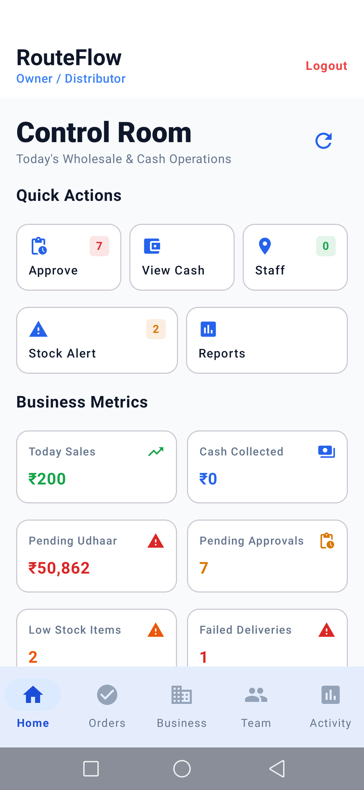
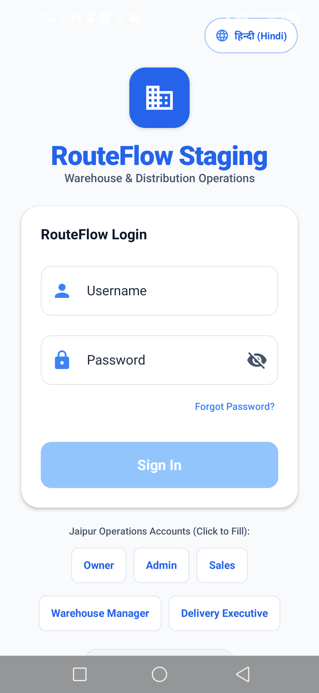

# RouteFlow

RouteFlow is a pilot-ready B2B distributor operating system for Indian kirana/FMCG wholesalers.

Unified dual-platform system connecting real-world field operations with central business control:
- **Native Android App**: Field sales beat navigation, offline caching, warehouse FEFO picking & packing, server OTP delivery verification, and physical COD cash custody.
- **Next.js Web Management Console**: Central office control for live inventory, credit exposure, beat routing, and driver cash reconciliation ([Live Web Console](https://appdashboardadmin.vercel.app)).
- **Cloudflare Serverless Engine**: Workers + D1 database providing atomic stock reservations, tamper-evident audit logs, and zero-downtime serverless scaling.

---

## What It Does

```
Sales order ──> Owner approval ──> Godown picking/packing ──> Delivery OTP ──> Cash collection ──> Cash settlement ──> Owner live status
```

1. **Sales Visit & GPS Onboarding:** Sales executive starts duty, visits mapped kirana stores on beat (`BEAT-04`), logs GPS check-in, and books orders with wholesale tiered pricing.
2. **Owner Verification & Approval:** Owner reviews retailer credit limits and godown stock availability; single-tap approval atomically reserves physical inventory in Cloudflare D1.
3. **Warehouse Picking & Carton Packing:** Godown manager fulfills approved orders using item checklists and carton packing manifests.
4. **Driver Dispatch & OTP Delivery:** Delivery executive navigates route stops, confirms physical delivery using a tamper-proof 6-digit server OTP, and collects cash on delivery.
5. **Cash Reconciliation & Depot Settlement:** Driver delivers collected cash to the distributor depot; Owner verifies and settles driver balance down to ₹0.00.
6. **Live Business Visibility:** Owner monitors real-time sales revenue, warehouse inventory levels, outstanding customer udhaar, and staff duty from phone or web.

---

## Roles

| Role | Field Operations (Android App) | Office & Control (Web Dashboard) |
|---|---|---|
| **Owner** | Instant order approvals, credit limits, daily cash reconciliation, live metrics | Comprehensive KPIs, financial ledgers, staff access control, business reports |
| **Sales Executive** | Beat route navigation, GPS retailer check-in, catalog order booking, field collections | Retailer list, assigned beat directory, personal order history |
| **Warehouse Manager** | Approved picking queue, barcode scanning, carton boxing, dispatch manifests, returns | Live godown inventory counts, threshold reorder alerts, inward GRN |
| **Delivery Executive** | Stop sequencing, 6-digit server OTP delivery confirmation, cash custody ledger | Assigned route trips, delivery confirmation history, depot cash handovers |

---

## Product Screens

All mobile screens captured directly from physical **Vivo 1935** running the RouteFlow Android staging build:

| 1. Authentication (B2B Multi-Language) | 2. Owner Control Room Dashboard | 3. Field Sales Beat Operations |
|:---:|:---:|:---:|
| <br><b>Login & Language</b><br>Clean B2B login with English/Hindi localization | <br><b>Executive Dashboard</b><br>Real-time wholesale sales, stock & cash KPIs | <br><b>Sales Beat (BEAT-04)</b><br>Beat stores, daily target, and GPS visit tracker |

| 4. Warehouse & Godown Operations | 5. Delivery Route & Stops | 6. Physical Cash Handover Settlement |
|:---:|:---:|:---:|
| <br><b>Godown Fulfillment</b><br>Picking queue, carton packing & low-stock alerts | <br><b>Delivery Route</b><br>Assigned stops, navigation & server OTP verification | <br><b>Cash Custody & Settlement</b><br>COD handover to depot settling balance to ₹0.00 |

> Full screenshot gallery: [docs/SCREENSHOT_GALLERY.md](docs/SCREENSHOT_GALLERY.md)

---

## Verification & Documentation

| Document | Purpose |
|---|---|
| 📋 **[Physical Device Hardcore QA Report](docs/DEVICE_HARDCORE_QA_REPORT.md)** | Full 30-screen runtime verification pass on Vivo 1935 physical device with zero bugs. |
| 🖼️ **[Complete Screenshot Gallery](docs/SCREENSHOT_GALLERY.md)** | High-resolution visual gallery of mobile role flows and web management console. |
| 🎯 **[Canonical Client Demo Script](FINAL_CLIENT_DEMO_SCRIPT.md)** | Step-by-step distributor pilot walkthrough (Ramesh Ji → Rakesh → Manoj → Suresh). |
| 📦 **[Google Play Store Listing Package](PLAY_STORE_LISTING_PACKAGE.md)** | Production release metadata, short/full descriptions, and Data Safety disclosures. |
| 🏗️ **[Project Architecture & Engineering Guide](PROJECT_GUIDE.md)** | Complete technical manual covering Android Room DB, Cloudflare D1 schema, and APIs. |

---

## Web Management Console

Access the central distributor operations console:
- **Live URL:** [https://appdashboardadmin.vercel.app](https://appdashboardadmin.vercel.app)
- **Features:** Order approval hub, retailer directory with GPS mapping, godown SKU stock levels, driver cash handover audit ledger, and CSV/JSON data backup.

---

## Tech Stack & Architecture

- **Android App:** Native Kotlin, Jetpack Compose, Material 3, Room Database (offline-first), Hilt DI, Retrofit/OkHttp, WorkManager.
- **Web Dashboard:** Next.js 16 (App Router), React 19, Tailwind CSS, Vercel edge deployment.
- **Backend API:** Cloudflare Workers running the lightweight Hono framework with sub-50ms latency.
- **Database:** Cloudflare D1 (Serverless SQLite with atomic ACID transaction guarantees).

---

## Quick Start Commands

### Backend Verification
```bash
cd backend
npm test                                                                # Run unit & integration tests
node --dns-result-order=ipv4first test/test-hardcore-empty-business.mjs # 16-step hardcore business lifecycle
```

### Web Dashboard
```bash
cd web
npm install
npm run dev    # Local development at http://localhost:3000
npm run build  # Production build verification
```

### Android Native App
```bash
# Run unit tests
.\gradlew.bat testStagingUnitTest --no-daemon

# Build Staging APK
.\gradlew.bat assembleStaging --no-daemon

# Build Release App Bundle (AAB)
.\gradlew.bat bundleRelease --no-daemon
```
