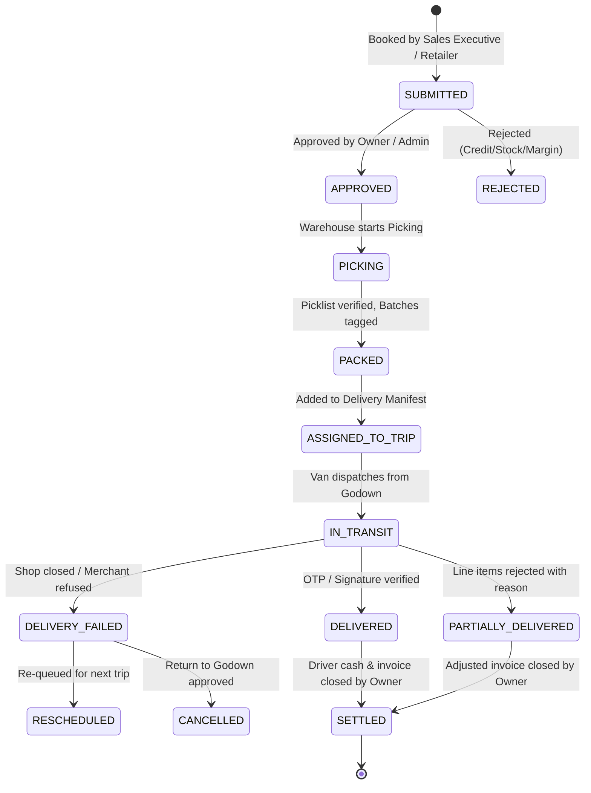
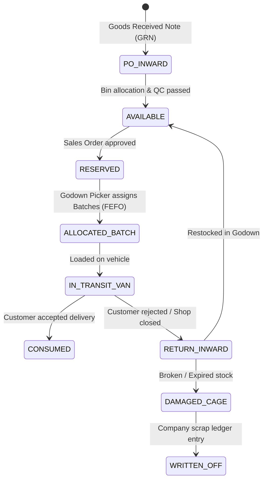

# RouteFlow — Business State Machines & Invariants Specification
**Document Version:** 1.0.0  
**Enforcement Engine:** SQLite Constraints & Edge Business Transactions  

---

## 1. Order Lifecycle State Machine



### Invariants & Transition Guards:
- **T1 (SUBMITTED → APPROVED)**: Requires validation that retailer does not exceed credit limit and has no overdue unpaid invoices past 30 days. Stock is immediately marked `RESERVED`.
- **T2 (APPROVED → PACKED)**: Warehouse operator must scan or assign specific batches matching or exceeding ordered quantities. Cannot bypass picking.
- **T3 (PACKED → IN_TRANSIT)**: Order must be linked to a valid `delivery_trips` entry. Loading manifest must be confirmed.
- **T4 (IN_TRANSIT → DELIVERED)**: Requires either valid 4-digit OTP generated by backend or digital signature image and GPS geo-coordinate capture within 200m of shop.
- **T5 (DELIVERED → SETTLED)**: Collected cash must be handed over to the cashier and matched against driver cash log.

---

## 2. Inventory & Stock Allocation State Machine



### Invariants:
- `AVAILABLE_STOCK = TOTAL_PHYSICAL_STOCK - RESERVED_STOCK - QUARANTINE_STOCK`.
- At no point may `AVAILABLE_STOCK` become negative.
- Every state change MUST emit an immutable line into `inventory_ledger`.

---

## 3. Delivery Trip State Machine

```
[PLANNED] ──(Driver Assigned & Orders Manifested)──> [STAGED]
                                                        │
                                          (Vehicle Load Verified)
                                                        ▼
                                                  [IN_TRANSIT]
                                                        │
                                           (All Drops Executed)
                                                        ▼
                                                  [COMPLETED]
                                                        │
                                            (Cash & Unsold Handover)
                                                        ▼
                                                   [SETTLED]
```

### Invariants:
- A trip cannot be marked `IN_TRANSIT` if any order in its manifest is still in `SUBMITTED` or `APPROVED` (must all be `PACKED`).
- A trip cannot be marked `SETTLED` until physical cash collected matches verified cashier deposit, and undelivered items are physically restocked in the warehouse ledger.
