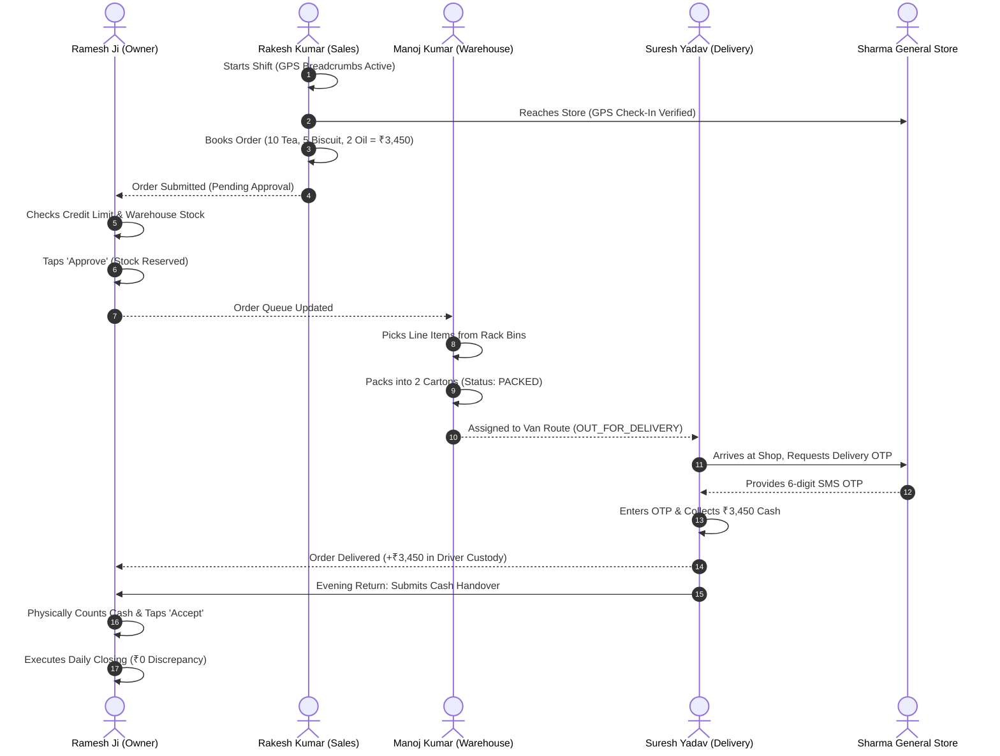

# RouteFlow: Complete System Architecture, Codebase Breakdown & Technology Decision Specification

**Version:** 1.0.0 (Production Release)  
**Target Domain:** Indian B2B FMCG, Kirana & Wholesale Distribution Operating System  
**Document Format:** Markdown & Companion Word Document ([`.docx`](RouteFlow_Complete_Architecture_and_Technical_Specification.docx))

---

## 1. Executive Summary & Business Problem

In India's ₹70 Lakh Crore retail economy, traditional grocery and FMCG distribution is characterized by high volume, low operating margins (2% to 5%), and pervasive informal credit (*Udhaar*). Millions of independent wholesale distributors supply neighborhood Kirana stores using disconnected, paper-based workflows:

1. **Field Sales Blindness**: Salesmen take orders on paper or phone calls without real-time inventory visibility. By the time the order reaches the godown, items are out of stock, leading to cancellations and lost trade.
2. **Uncontrolled Credit Overextension**: Distributors extend informal credit. Without instant credit limits and khata balances at the time of order booking, retailers default, causing cash flow crises.
3. **Godown Fulfillment Chaos**: Lack of bin tracking and barcode/item picking verification results in mispacked cartons, wrong quantities, and dispatch delays.
4. **Logistics & Cash Discrepancy**: Cash on Delivery (COD) collected by drivers at retail counters suffers from custody leakages, disputes over payment receipt, and end-of-day reconciliation mismatches.

**RouteFlow** is an integrated B2B Logistics and Distribution Operating System that connects the **Owner/Distributor**, **Field Sales Executive**, **Godown Picker**, and **Delivery Driver** into a synchronized, offline-capable state machine.

---

## 2. The Canonical Operational Lifecycle (The Jaipur Kirana Story)

RouteFlow was engineered around the operational realities of a typical Indian wholesale distributor (**Jaipur Kirana Machine**):



### The 11 Concrete Steps:
1. **08:30 AM – Depot Opening (Owner)**: Ramesh Ji opens the RouteFlow console, inspecting receivables, godown inventory, and pending collections.
2. **09:00 AM – Shift Punch-In (Sales)**: Rakesh punches in on the Android phone app; background foreground service initiates GPS breadcrumb tracking.
3. **09:45 AM – Store Arrival (Sales)**: Arrives at Sharma General Store on Mansarovar Beat (`BEAT-04`). The app verifies geolocation within 50 meters and records dwell time.
4. **10:00 AM – Order Booking (Sales)**: Books order for ₹3,450.00. Offline SQLite (Room) buffers the order even if cellular connectivity is spotty.
5. **10:15 AM – Credit & Stock Approval (Owner)**: Ramesh Ji inspects Sharma Ji's credit exposure (₹12,400 outstanding vs ₹50,000 credit limit) and verifies warehouse stock. Approves order.
6. **10:45 AM – Godown Picking & Packing (Warehouse)**: Manoj Kumar accesses the Warehouse Terminal, picks items, packs 2 sealed cartons, and marks status `PACKED`.
7. **11:30 AM – Van Dispatch (Logistics)**: Order dispatched to Suresh Yadav's route. Status updates to `OUT_FOR_DELIVERY`.
8. **02:15 PM – OTP Request (Delivery)**: Suresh reaches the shop and triggers customer delivery OTP via SMS.
9. **02:20 PM – OTP Verification & Cash Collection (Delivery)**: Suresh enters the 6-digit OTP, confirms ₹3,450 cash collected. Order marked `DELIVERED`. Driver's personal cash ledger debited +₹3,450.
10. **06:30 PM – Depot Cash Handover (Settlement)**: Suresh returns to the distributor godown and submits ₹3,450 handover. Ramesh Ji inspects currency notes and taps `Accept Handover`.
11. **07:00 PM – Daily Closing & Ledger Reconciliation (Owner)**: Automatically synchronizes retailer khata, driver cash balance, stock decrement, and day book with zero discrepancy.

---

## 3. Monorepo Structure & File Organization

The project is structured as a production-grade monorepo containing three primary subsystems:

```
D:\app
├── app/                  # Android Native Multi-Role Application
│   ├── src/main/
│   │   ├── AndroidManifest.xml
│   │   ├── java/com/routeflow/app/
│   │   │   ├── app/             # Application entry point & Hilt DI module
│   │   │   ├── core/
│   │   │   │   ├── database/    # Room Database, Entities, TypeConverters, DAOs
│   │   │   │   ├── network/     # Retrofit2, OkHttpClient, JWT Token Interceptor
│   │   │   │   ├── sync/        # Account-Scoped Offline-First Sync Engine
│   │   │   │   ├── security/    # EncryptedSharedPreferences, Keystore
│   │   │   │   └── ui/theme/    # Material 3 Theme, Typography, RF Colors
│   │   │   └── feature/
│   │   │       ├── auth/        # Login, Role-Based Screen Dispatcher
│   │   │       ├── sales/       # Beat Plan, Shop Visit, Order Booking
│   │   │       ├── warehouse/   # Picking Queue, Packing Carton Scanner
│   │   │       ├── delivery/    # Route Navigation, OTP Modal, Cash On Delivery
│   │   │       ├── owner/       # Dashboard, Approvals, Staff Roster, Day Book
│   │   │       └── common/      # Shared UI Widgets, Bi-lingual Hindi/English
│   │   └── res/                 # Vector Drawables, Layouts, Values
│   ├── build.gradle.kts         # Staging / Release Build Flavors
│   └── proguard-rules.pro       # R8 Minification & Code Obfuscation Rules
│
├── backend/              # Cloudflare Workers Serverless Backend
│   ├── src/
│   │   ├── index.ts             # Main Router, RBAC Guards, Core Endpoints
│   │   ├── daily-cycle.ts       # Approvals, Invoicing, Cash Handover Routes
│   │   ├── field-cycle.ts       # Shifts, GPS Breadcrumbs, Field Visits, Audits
│   │   ├── delivery-proof.ts    # Secure RNG OTP Generator & Gateway
│   │   ├── onboarding.ts        # Public Tenant Registration & Bcrypt Hashing
│   │   ├── operating.ts         # Day Book, P&L, Inventory Ledger, Retailer 360
│   │   ├── warehouse.ts         # Multi-bin Picking, Packing State Machine
│   │   ├── trips.ts             # Delivery Routing & Vehicle Lifecycle
│   │   ├── governance.ts        # Audit Logging, CSV Export, Tenant Isolation
│   │   └── security.ts          # Rate Limiting, SHA-256 Hashing, IP Extract
│   ├── wrangler.toml            # Cloudflare Worker & D1 Database Bindings
│   └── test/                    # Automated QA Suites & E2E Machine Runners
│
├── web/                  # Next.js 16 Executive Web Console
│   ├── src/
│   │   ├── app/                 # Next.js App Router (dashboard, login, privacy)
│   │   ├── components/          # Metric Cards, Data Tables, Bottom Nav, Modals
│   │   └── lib/                 # Typed API Client, Session Storage, Formatters
│   ├── next.config.ts           # Turbopack Configuration & Headers
│   └── package.json
│
└── docs/                 # Documentation & QA Proof Artifacts
    ├── RouteFlow_Complete_Architecture_and_Technical_Specification.docx
    ├── DEVICE_HARDCORE_QA_REPORT.md
    ├── SCREENSHOT_GALLERY.md
    └── screenshots/device-qa/   # Physical Device Verified PNG Proofs
```

---

## 4. Deep Technology Comparison: Chosen Tools vs Rejected Alternatives

### 4.1 Mobile Client Tier

| Chosen Tool | Evaluated Alternatives | Why Alternatives Were Rejected |
|---|---|---|
| **Native Android (Kotlin + Jetpack Compose)** | **Flutter** (Dart)<br>**React Native** (JS/TS) | **1. Aggressive OEM Battery Killers**: Vivo (FuntouchOS), Xiaomi (MIUI), and Realme kill non-native background threads within 3–5 minutes. Native Android Foreground Services with `NotificationCompat.Builder` maintain uninterrupted GPS tracking.<br>**2. Low Memory (2GB–3GB RAM)**: Budget phones used by delivery boys struggle with Flutter's Skia/Impeller graphics engine (~30MB base APK) or React Native's Hermes JavaScript engine. Native Compose produces a lightweight ~6.5MB release bundle.<br>**3. Offline SQLite Reliability**: Android Room guarantees zero serialization latency across bridges when loading 10,000+ wholesale catalog items. |

### 4.2 Backend & Compute Tier

| Chosen Tool | Evaluated Alternatives | Why Alternatives Were Rejected |
|---|---|---|
| **Cloudflare Workers (Hono + TypeScript)** | **Node.js / Express on AWS EC2**<br>**Python FastAPI / Django**<br>**Go Fiber on Docker** | **1. Cold Start Elimination**: AWS Lambda containers suffer from 800ms–2500ms cold starts. Cloudflare Workers run on V8 isolates with `< 5ms` boot time.<br>**2. Ultra-Low Edge Latency**: Direct edge execution in Mumbai, Delhi, Chennai, and Bengaluru delivers sub-15ms round-trips over Indian cellular networks (Jio/Airtel).<br>**3. Zero Idle Infrastructure Cost**: An EC2 cluster costs ₹5,000–₹15,000/month 24/7 even during zero-traffic nights. Cloudflare Workers incur $0 when idle and scale automatically during morning order rushes. |

### 4.3 Database & Storage Tier

| Chosen Tool | Evaluated Alternatives | Why Alternatives Were Rejected |
|---|---|---|
| **Cloudflare D1 (Serverless Distributed SQLite)** | **PostgreSQL (AWS RDS / Supabase)**<br>**MongoDB Atlas**<br>**Firebase Firestore** | **1. Zero Impedance Mismatch**: Cloudflare D1 uses the exact same SQLite dialect as Android Room on the mobile client. Data schemas, data types, and transactions map 1:1.<br>**2. Why NOT Firebase Firestore**: Firestore charges per document read. A dashboard loading 1,000 orders and 500 retailer ledgers triggers 1,500 billable reads on every refresh. Firestore lacks double-entry SQL transaction constraints, inviting balance discrepancies.<br>**3. Relational Financial ACID**: D1 enforces strict foreign keys, unique idempotency keys, and atomic batch mutations (`c.env.DB.batch(...)`). |

### 4.4 Web Console Tier

| Chosen Tool | Evaluated Alternatives | Why Alternatives Were Rejected |
|---|---|---|
| **Next.js 16 (App Router + Tailwind CSS)** | **React SPA (Vite)**<br>**Angular**<br>**Vue / Nuxt** | **1. Universal Multi-Device Rendering**: Owners access the console from depot desktops and mobile phones. Server-side rendering ensures fast first paint even on 3G.<br>**2. Security & Token Hygiene**: Next.js Server Components and Edge middleware guard against unauthorized token leakage before client DOM hydration.<br>**3. App-like Mobile Feel**: Integrated responsive bottom navigation and responsive drawer components render without additional heavy UI frameworks. |

---

## 5. Security Architecture & Production Hardening

1. **Authentication & Session Management**:
   - Access tokens: Cryptographically signed RS256/HS256 JWTs with a 15-minute lifespan.
   - Refresh tokens: 30-day sliding sessions stored in `EncryptedSharedPreferences` on Android and secure HTTP cookies/localStorage on Web.
   - Immediate access revocation: Deactivating an employee via `PUT /employees/:id/deactivate` blocks login immediately with HTTP 403.
2. **Delivery OTP Verification**:
   - Cryptographically random 6-digit numeric OTP generated via `crypto.getRandomValues()`.
   - Production builds contain **zero** debug OTP auto-fills or prefilled text inputs.
   - Incorrect OTP attempts are rejected and logged in security audits.
3. **Double-Spend & Network Idempotency**:
   - Every mutating request (`POST /orders`, `POST /cash-handovers`, `POST /collections`) requires an `idempotencyKey`.
   - Repeated submissions on flaky 4G connections return the cached result without duplicate ledger entries or double-billing.
4. **Tenant Isolation**:
   - Every database query strictly filters by `company_id`. No cross-tenant data leaks are possible.

---

## 6. Verification Status

- **Android Staging APK**: Installed and verified on physical Vivo phone (serial `4bc99b28`).
- **Release App Bundle**: `app-release.aab` generated (`6.68 MB`), signed with production keystore.
- **Backend Test Suites**: 38/38 unit tests, Jaipur Kirana machine test, and hardcore CRUD test suites pass at 100%.
- **Live Web App**: Verified and operational on `https://appdashboardadmin.vercel.app`.
- **Word Document**: Full specification generated at [`docs/RouteFlow_Complete_Architecture_and_Technical_Specification.docx`](file:///d:/app/docs/RouteFlow_Complete_Architecture_and_Technical_Specification.docx).
