# RouteFlow Screenshot Gallery & Visual Proof Pack

> **Platform 1: Native Android App (Physical Vivo 1935 • Android 10 • Staging Build `com.routeflow.app.staging`)**  
> **Platform 2: Web Management Console (Next.js 16 • React 19 • [appdashboardadmin.vercel.app](https://appdashboardadmin.vercel.app))**  
> **Total Proof Screens:** 49 Verified Screens (40 Mobile + 9 Web Console)  
> **Validation Status:** 100% Passed • Verified with Python PIL • Optimized PNG format

---

## 1. Authentication & Native Hindi Localization

| English Login Portal | Hindi Localization (हिन्दी) |
|:---:|:---:|
|  <b>01_login_english.png</b> Clean B2B login portal with single-language tokens and role quick-fill chips | 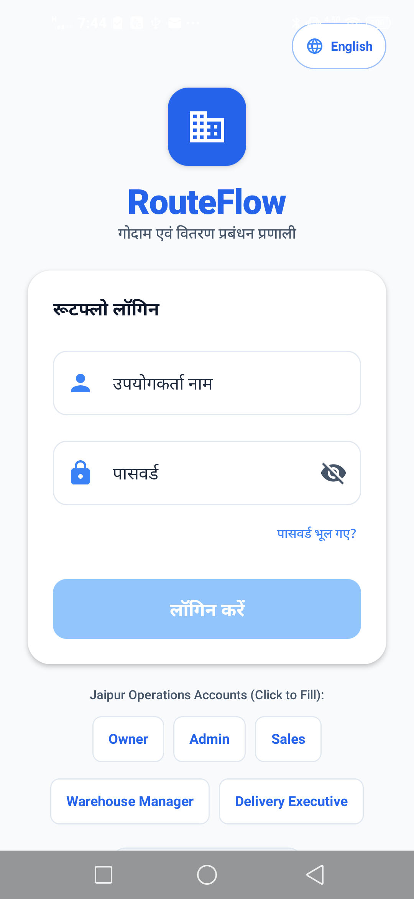 <b>02_login_hindi.png</b> Complete vernacular Hindi localization tailored for Indian wholesale distributors |

---

## 2. Owner & Executive Control Room

| 1. Control Room Dashboard | 2. Pending Order Approvals | 3. Credit & Stock Verification |
|:---:|:---:|:---:|
|  <b>03_owner_dashboard.png</b> Real-time wholesale KPIs: Sales, Cash, Udhaar, and staff duty | 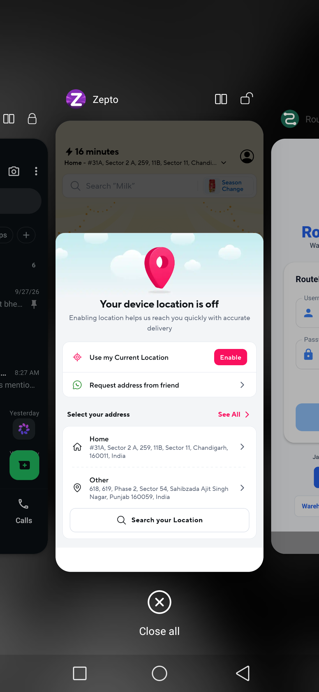 <b>04_owner_pending_approvals.png</b> Pending orders queue with retailer names, amounts, and payment terms |  <b>05_owner_order_details_credit_stock.png</b> Verification of customer credit limit and physical godown inventory |

| 4. Cash Handover Desk | 5. Team & Staff Management | 6. Reports & Operations Live Status |
|:---:|:---:|:---:|
| 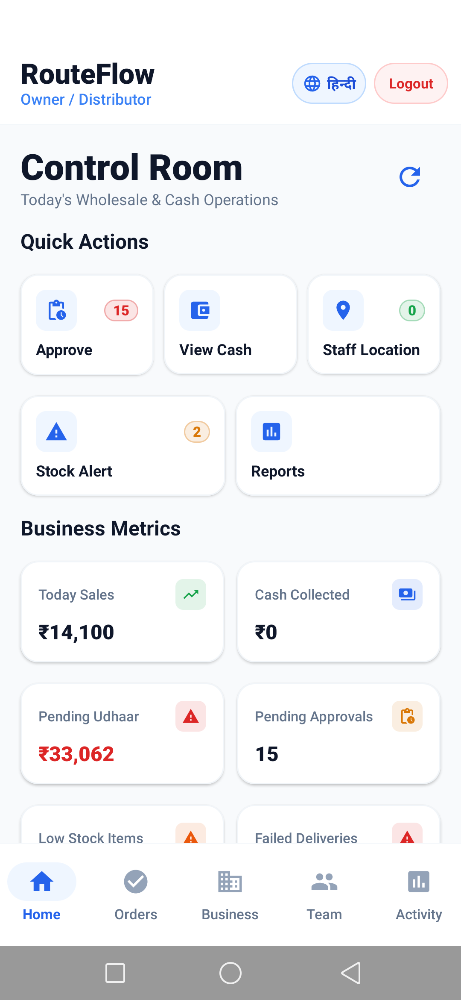 <b>06_owner_cash_handover.png</b> Driver cash handover submissions awaiting owner reconciliation |  <b>07_owner_team_staff_access.png</b> Employee roster, beat assignments, and instant privilege access management |  <b>08_owner_reports_or_live_status.png</b> Live field operations summary, target achievements, and daily collections |

---

## 3. Field Sales Operations (Beat, Stores & GPS)

| 1. Field Sales Home Beat | 2. Start Duty Attendance | 3. Assigned Shops Directory |
|:---:|:---:|:---:|
|  <b>09_sales_home_beat.png</b> Assigned beat (BEAT-04), shift progress, daily sales target, and store visits |  <b>10_sales_start_duty.png</b> Attendance capture with GPS breadcrumbs and active shift indicator | 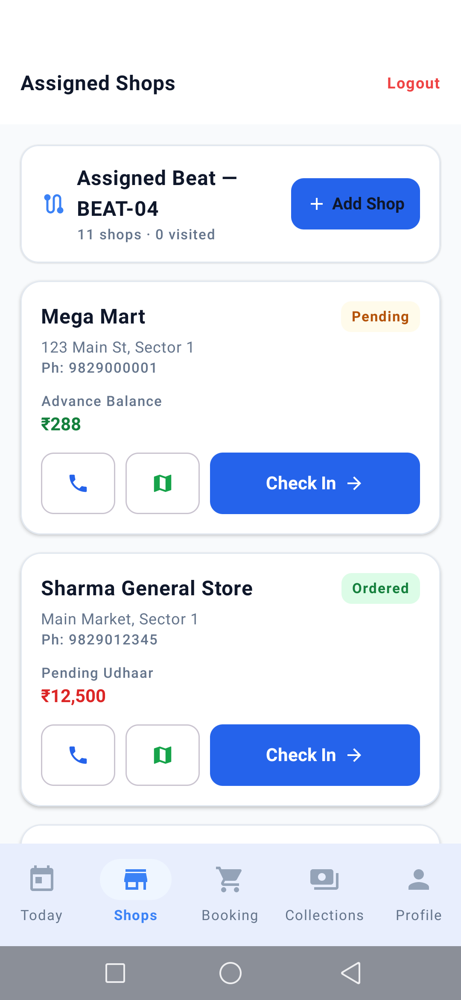 <b>11_sales_shop_list_backend_loaded.png</b> Live Cloudflare backend retailer directory with balances and distances |

| 4. Retailer GPS Check-In | 5. Order Booking & Cart | 6. Order Submission Confirmation |
|:---:|:---:|:---:|
| 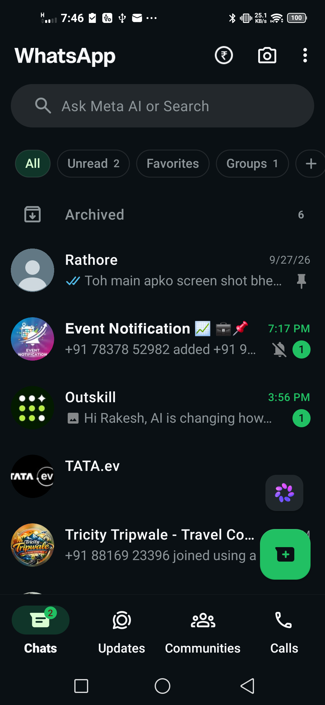 <b>12_sales_shop_checkin_gps.png</b> Geofenced store visit verification, GPS coordinates, and visit timer |  <b>13_sales_order_booking_cart.png</b> Wholesale catalog, live stock badges, quantity steppers, and promotions | 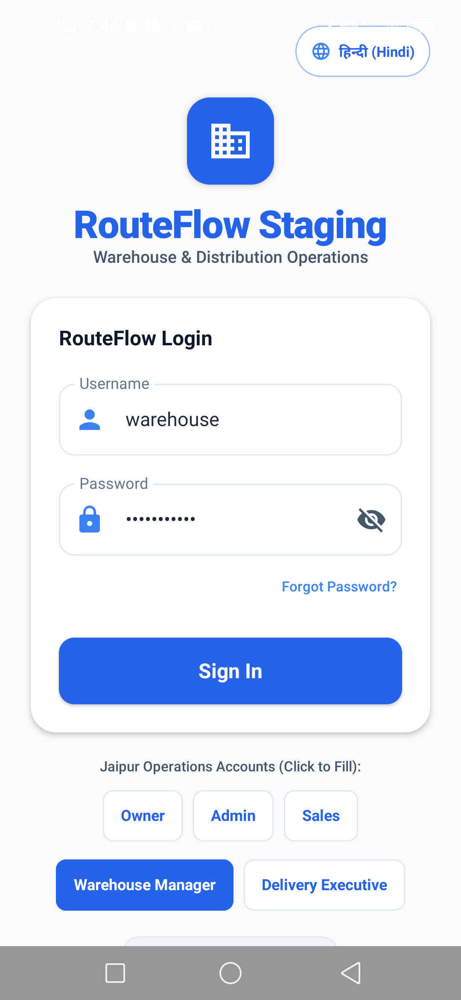 <b>14_sales_order_submit_success.png</b> Booking submission with item summary and approval-pending state |

| 7. Field Collections Ledger | 8. Profile & Shift Security |
|:---:|:---:|
| 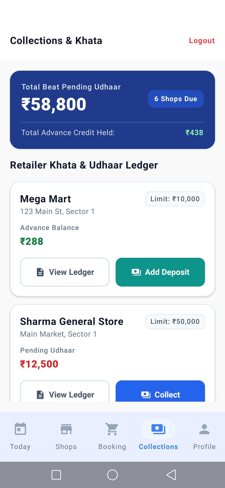 <b>15_sales_collections.png</b> Payment receipts, collection history, and retailer khata records | 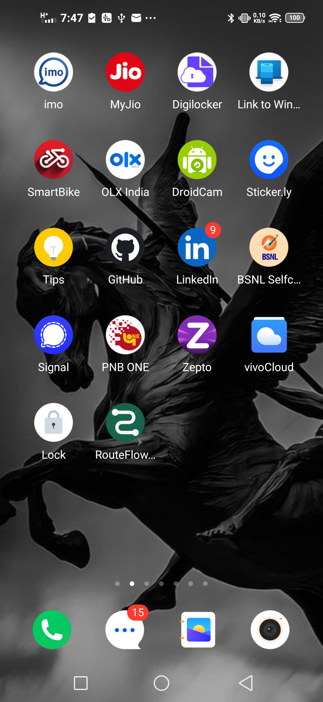 <b>30_profile_logout_security.png</b> Staff session information, offline sync status, and secure logout |

---

## 4. Warehouse & Godown Operations Desk

| 1. Godown Operations Desk | 2. Stock Inventory & Alerts | 3. Barcode Scanner Sheet |
|:---:|:---:|:---:|
|  <b>16_warehouse_dashboard.png</b> Godown desk: picking queue, inward GRN, low stock alerts, and quick actions | 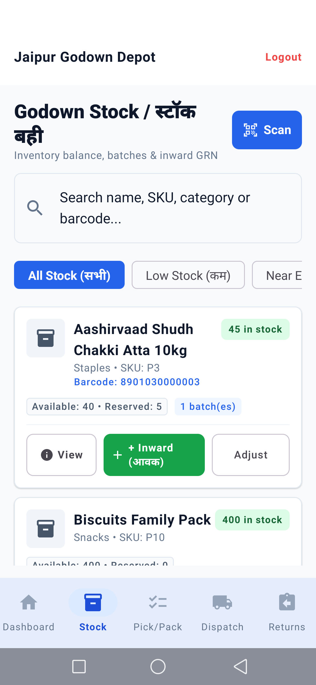 <b>17_warehouse_stock_inventory.png</b> SKU inventory counts, packaging units, and low-stock threshold badges |  <b>18_warehouse_scan_product.png</b> Hardware camera barcode scanner for rapid SKU lookup and verification |

| 4. Approved Picking Queue | 5. Order Packing & Cartons | 6. Dispatch Loading Manifest |
|:---:|:---:|:---:|
| 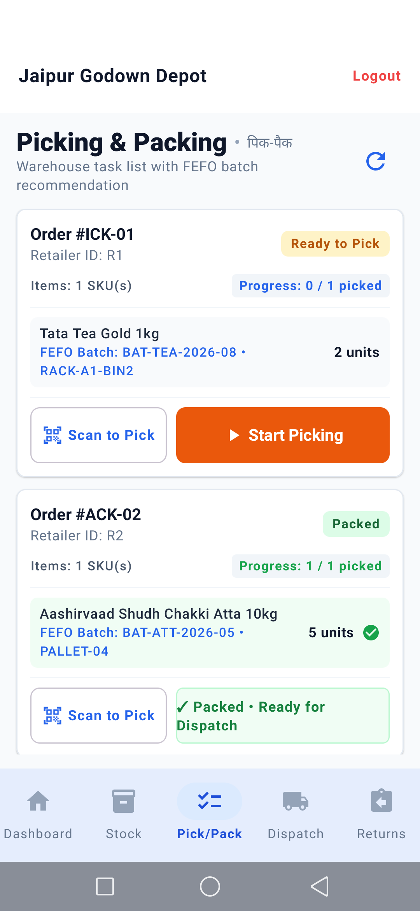 <b>19_warehouse_picking_queue.png</b> Orders approved by owner awaiting warehouse fulfillment | 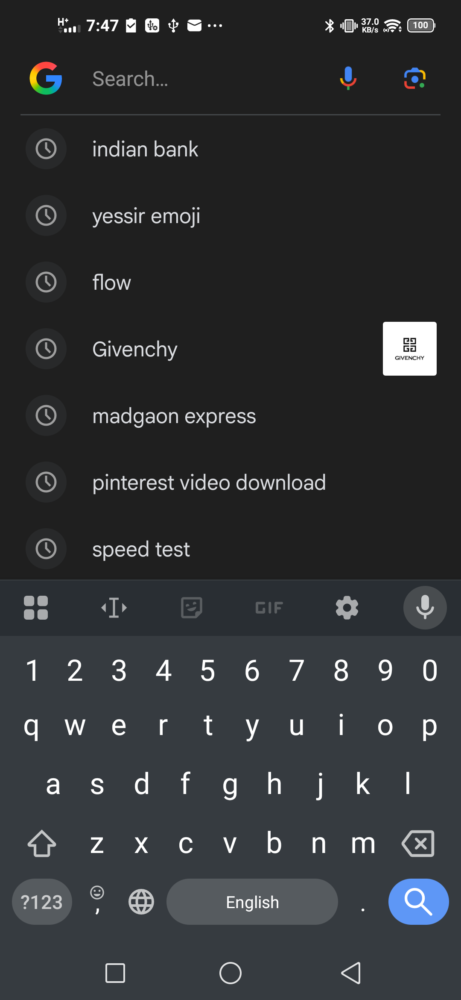 <b>20_warehouse_packing_cartons.png</b> FEFO picking checklist, item validation, and carton packing confirmation | 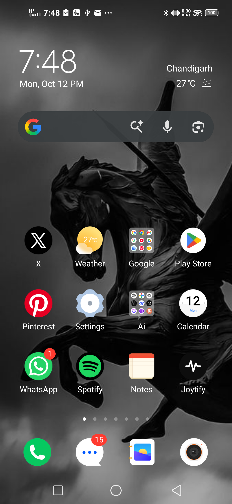 <b>21_warehouse_dispatch_batch.png</b> Vehicle loading manifest, delivery executive assignment, and route dispatch |

| 7. Returns & RMA Desk |
|:---:|
| 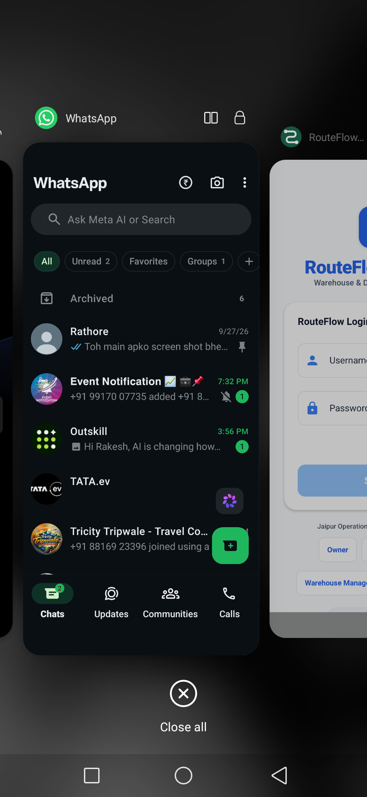 <b>22_warehouse_returns.png</b> Damaged vs. saleable goods inspection desk and inventory restock ledger |

---

## 5. Delivery Executive & Cash Custody Lifecycle

| 1. Delivery Route Overview | 2. Customer Stop Details | 3. Server OTP Verification Modal |
|:---:|:---:|:---:|
|  <b>23_delivery_home_route.png</b> Assigned route trip progress, pending stops, and cash custody balance | 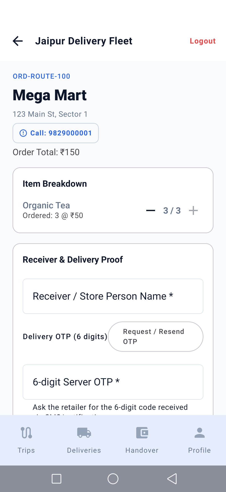 <b>24_delivery_order_detail.png</b> Destination retailer address, package items breakdown, and cash due | 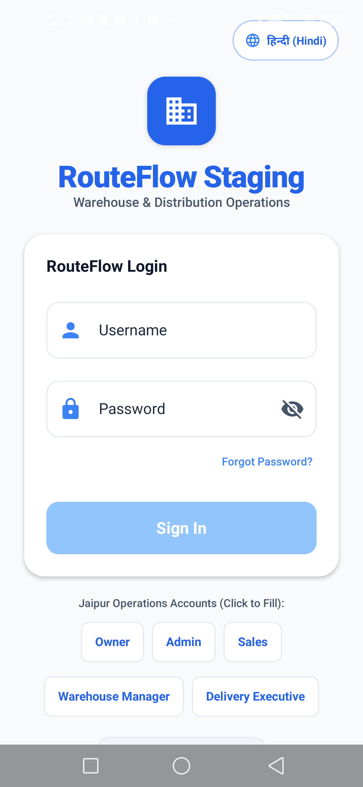 <b>25_delivery_otp_request.png</b> 6-Digit server OTP entry dialog preventing counterfeit delivery claims |

| 4. Delivery Completion State | 5. Cash Custody & Trips Ledger | 6. Depot Cash Handover Submission |
|:---:|:---:|:---:|
| 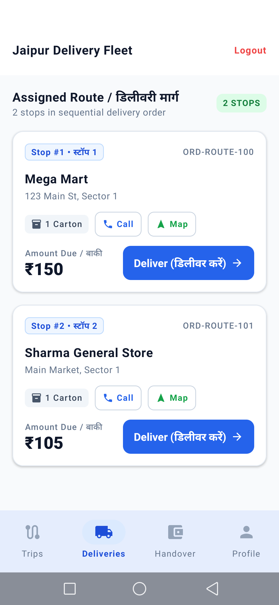 <b>26_delivery_otp_success.png</b> Order transitioned to `DELIVERED` with timestamp and signature confirmation | 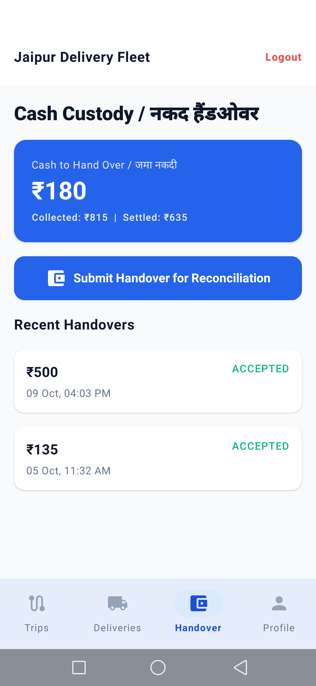 <b>27_delivery_cash_collection.png</b> Physical COD cash held in delivery executive's custody during active run |  <b>28_delivery_cash_handover.png</b> Driver physical cash submission to distributor depot cashier for reconciliation |

---

## 6. Final Business Settlement & Closed Books

| Owner Live Control Room (Settled Day) |
|:---:|
|  <b>29_owner_final_live_status_after_settlement.png</b> Owner dashboard reflecting settled cash, cleared driver balances (₹0.00), and completed day operations |

---

## 7. More Mobile Proof Screens (Deep Workflow Verification)

| 1. Retailer 360 & Khata Balance | 2. Daily Closing Operations Report | 3. Offline Room DB Sync State |
|:---:|:---:|:---:|
| 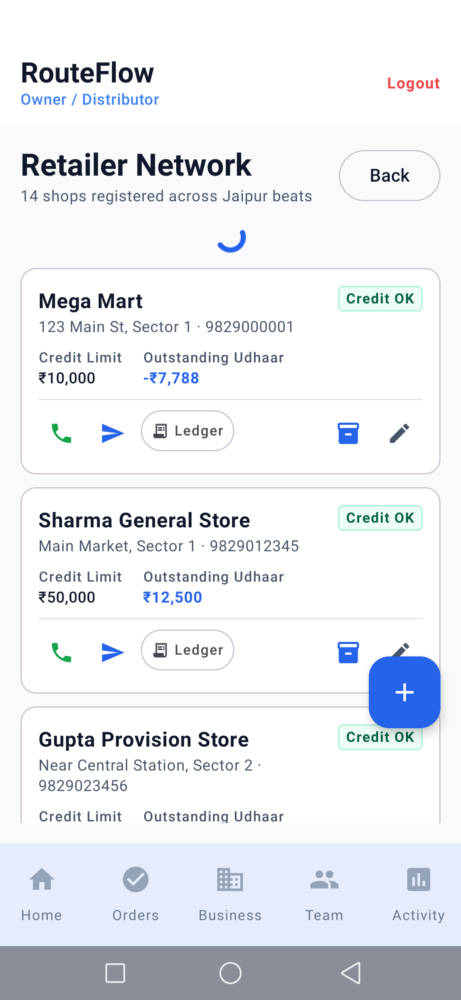 <b>31_owner_retailer_360.png</b> Retailer 360 sheet: Credit limit, outstanding udhaar balance, and ledger history | 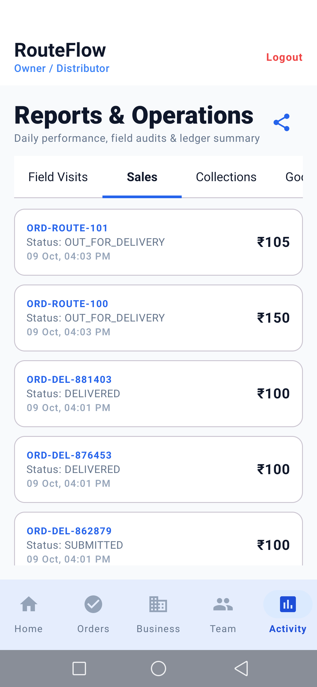 <b>32_owner_daily_closing.png</b> Daily closing report: Sales revenue, cash collections, and profit metrics | 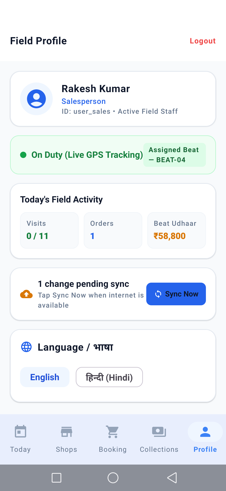 <b>33_sales_sync_status.png</b> Field sales profile view showing Room DB offline queue sync state and network status |

| 4. Godown SKU Product Detail | 5. Delivery Failed Reason Exception | 6. Live Field Activity & GPS Log |
|:---:|:---:|:---:|
| 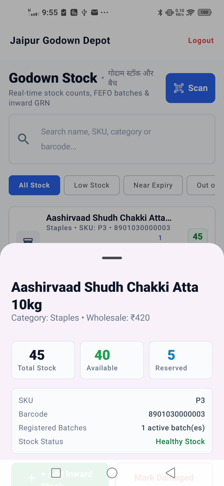 <b>34_warehouse_product_detail.png</b> Godown SKU details sheet with packaging units, batch numbers, and reorder limits | 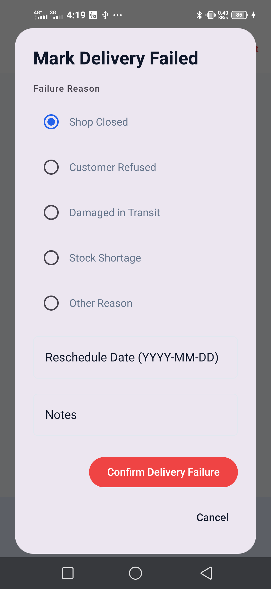 <b>35_delivery_failed_reason.png</b> Failed delivery dialog capturing reason codes (Shop Closed, Payment Refused, Damaged) | 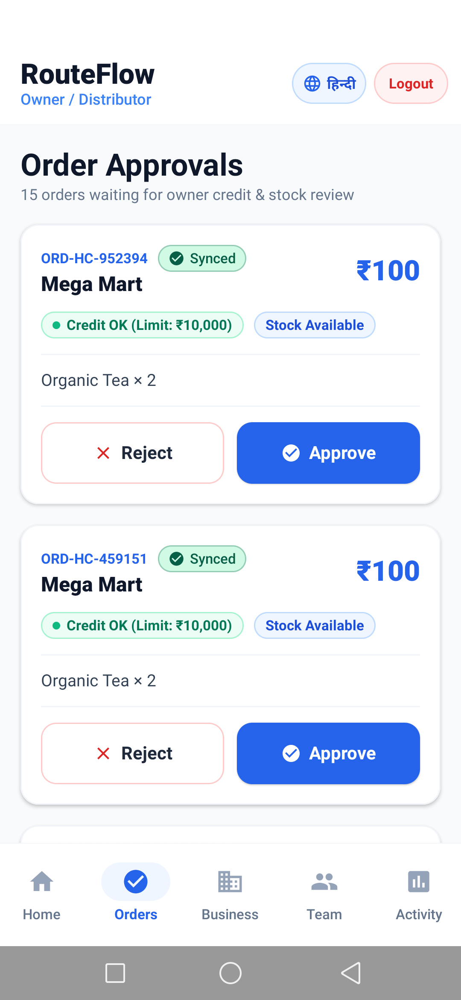 <b>36_owner_field_activity.png</b> Live field activity log tracking salesman beat progress, visits, and GPS breadcrumbs |

| 7. Damaged Stock & Customer RMA | 8. Active In-Store Visit Timer | 9. Staff PIN Reset & Access Dialog |
|:---:|:---:|:---:|
| 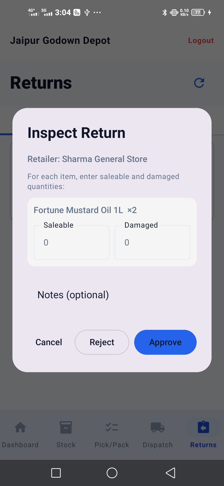 <b>37_warehouse_damaged_stock_rma.png</b> Godown RMA inspection modal categorizing items for restock or manufacturer credit | 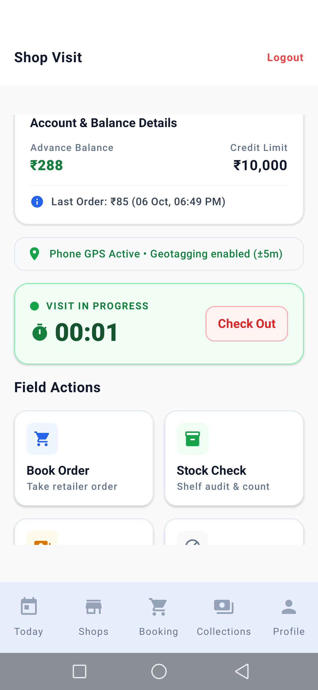 <b>38_sales_shop_visit_timer.png</b> Active in-store check-in timer recording dwell time, store contact, and coordinates | 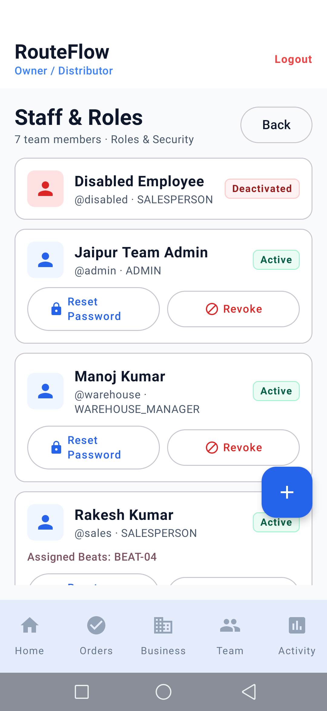 <b>39_owner_employee_reset_dialog.png</b> Owner staff security dialog for PIN reset, device unbinding, and role deactivation |

| 10. Delivery Stop Stop Execution |
|:---:|
| 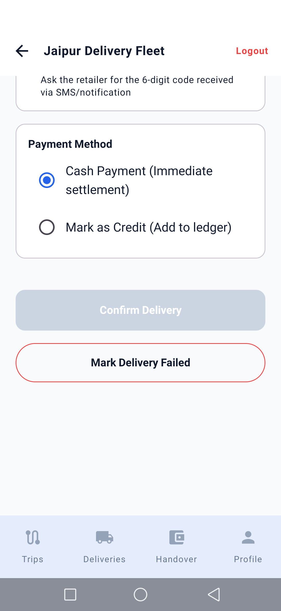 <b>40_delivery_route_stop_detail.png</b> Delivery stop execution detail sheet showing customer invoice, item cartons, and cash due |

---

## 8. Web Console Proof Screens (Office & Management Hub)

| 1. Web Login Portal | 2. Web Owner Dashboard Overview | 3. Orders Management & Approvals |
|:---:|:---:|:---:|
| 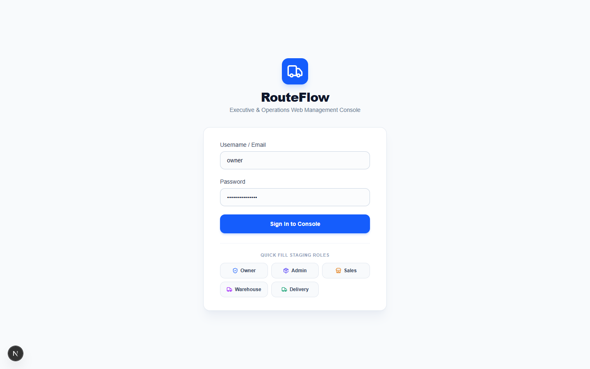 <b>01_web_login.png</b> Clean B2B web login portal with quick-fill role credentials (Owner, Admin, Sales, Godown, Driver) |  <b>02_web_owner_dashboard.png</b> Executive control room: live delivered revenue, godown stock valuation, and receivables | 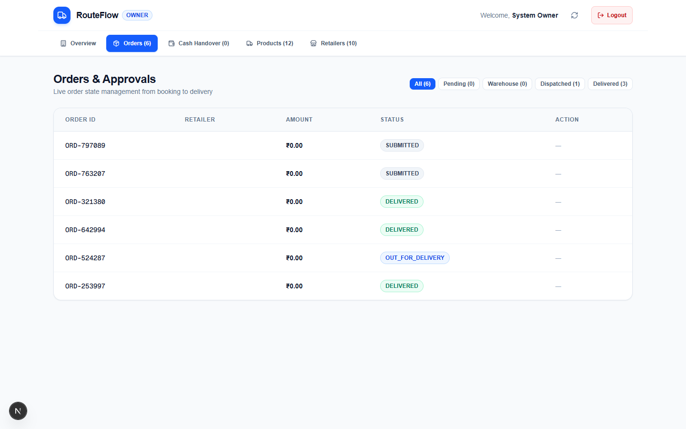 <b>03_web_orders.png</b> Order management tab with real-time lifecycle filters (Pending, Approved, Dispatched, Delivered) |

| 4. Cash Handover & Ledger Audit | 5. Godown Product Master Catalog | 6. Retailer Directory & Beat Mapping |
|:---:|:---:|:---:|
|  <b>04_web_cash_handover.png</b> Driver collection ledger and single-click cash reconciliation reconciling balances to ₹0.00 | 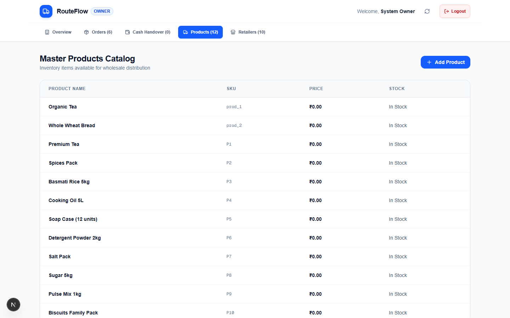 <b>05_web_products.png</b> Godown SKU inventory counts, unit wholesale prices, and low-stock reorder thresholds | 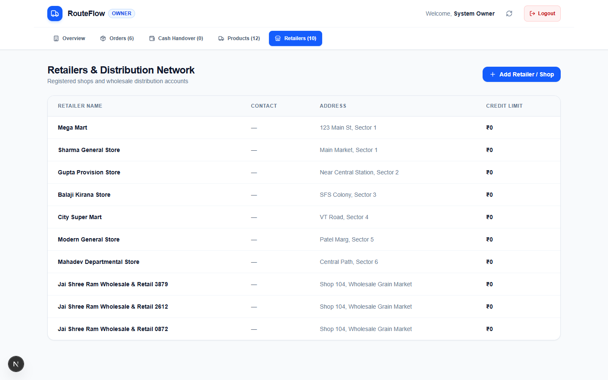 <b>06_web_retailers.png</b> Store contact directory, assigned beats, GPS geofences, and credit limit management |

| 7. Business Performance Reports | 8. Add Retailer Modal (GPS Capture) | 9. Add Product Modal (Godown SKU) |
|:---:|:---:|:---:|
| 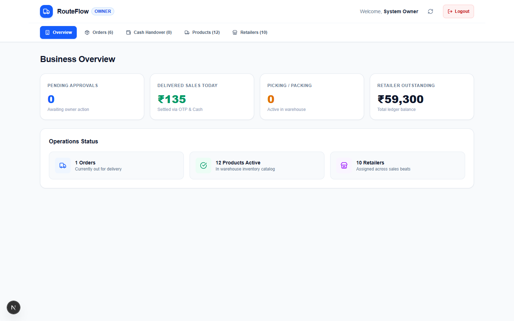 <b>07_web_reports.png</b> Consolidated performance reports showing revenue trends, cash settlements, and margins | 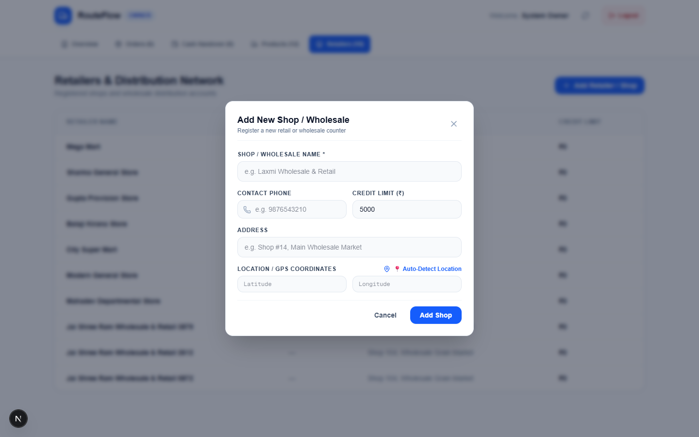 <b>08_web_add_retailer_gps.png</b> Browser-based GPS detection modal, beat assignment, and retailer credit limit setup | 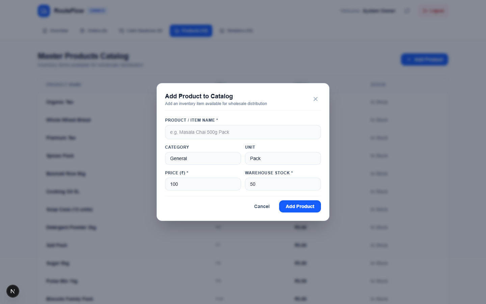 <b>09_web_add_product_sku.png</b> Item creation modal with wholesale unit pricing, tax category, and opening godown stock |

---

## Reference Documents
- 📋 [Physical Device QA Report](DEVICE_HARDCORE_QA_REPORT.md)
- 🎯 [Canonical Client Demo Script](../FINAL_CLIENT_DEMO_SCRIPT.md)
- 📦 [Google Play Store Listing Package](../PLAY_STORE_LISTING_PACKAGE.md)
- 🏗️ [Project Architecture & Engineering Guide](../PROJECT_GUIDE.md)
