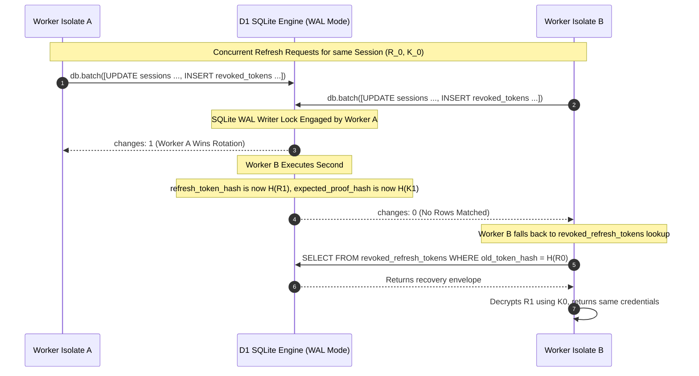

# RouteFlow Auth-1.2 — Final Security Proof and Evidence Review

**Document Version:** 1.2.0  
**Phase:** Auth-1.2 Security Review, Cryptographic Proof & Test Evidence Audit  
**Execution Mode:** STRICT DOCUMENT-ONLY SECURITY REVIEW  
**Scope Boundary:** Zero application code changes, zero migration execution, zero database writes, zero git commits or pushes.  
**Timestamp:** 2026-11-02  
**Target Migration:** Proposed `0024_auth_memberships_canonical_roles.sql`  
**Target Systems:** Cloudflare Workers API, Cloudflare D1 (SQLite Edge Database), Flutter Pilot  

---

## 1. Critical: Refresh-Token Theft Resistance Proof

### 1.1 The Vulnerability of Dynamic Registration During Refresh
In the previous Auth-1.1 proposal, the client generated secret $C_1$, submitted $H(C_1) = \text{SHA-256}(C_1)$ alongside $R_1$, and the Worker stored $H(C_1)$ upon receiving the request.

> [!CAUTION]
> **Fatal Vulnerability Identified:** If commitment $H(C_1)$ is registered dynamically during the rotation call itself, an attacker who steals bearer token $R_1$ before the legitimate client refreshes can generate their own secret $C_{\text{attacker}}$, submit $(R_1, \text{SHA-256}(C_{\text{attacker}}))$, and successfully rotate the session. The attacker becomes the "legitimate" owner of the new credentials, locking out the authentic client.

### 1.2 The Solution: Pre-Committed Session-Bound Token Rotation (PSBR) Protocol
To achieve true theft resistance, the client's cryptographic proof must be **pre-committed and bound to the session before any rotation attempt can take place**.

We specify the **Pre-Committed Key-Wrapped Recovery Envelope (PKWRE)** protocol:

```
[Session Inception t=0]
Client generates K0 in RAM. Sends H(K0) in login payload.
Server binds H(K0) to D1 session row BEFORE R0 is ever refreshed.

[Rotation t=i -> t=i+1]
Client must present: (R_i, K_i, H(K_{i+1}))
Server verifies:
  1. SHA256(R_i) == session.refresh_token_hash
  2. SHA256(K_i) == session.expected_proof_hash (Pre-committed at t=i-1!)
Stolen R_i ALONE cannot satisfy check #2!
```

### 1.3 Message-by-Message Protocol Specification

```mermaid
sequenceDiagram
    autonumber
    actor Client as Authentic Client
    participant Worker as Cloudflare Worker (/auth/refresh)
    participant D1 as Cloudflare D1 Database
    actor Attacker as Bearer Token Thief

    rect rgb(240, 248, 255)
    Note over Client, D1: Step 0: Session Establishment (Login / OAuth)
    Client->>Client: Generate K0 in RAM (256-bit CSPRNG)<br/>Compute H(K0) = SHA-256(K0)
    Client->>Worker: POST /auth/login { credentials, initial_proof_commitment: H(K0) }
    Worker->>Worker: Generate R0 (256-bit CSPRNG)
    Worker->>D1: INSERT INTO sessions (id, refresh_token_hash=H(R0), expected_proof_hash=H(K0), ...)
    Worker-->>Client: HTTP 200 { access_token: A0, refresh_token: R0 }
    Client->>Client: Store R0 & K0 in Secure Hardware Keystore
    end

    rect rgb(255, 230, 230)
    Note over Attacker, Worker: Threat Scenario A: Attacker Steals R0 and Attempts Rotation
    Note over Attacker: Attacker stole R0 from proxy/logs.<br/>Attacker DOES NOT possess K0!
    Attacker->>Worker: POST /auth/refresh { refresh_token: R0, proof: K_attacker, next_commitment: H(K_att2) }
    Worker->>Worker: Compute SHA-256(K_attacker)
    Worker->>D1: UPDATE sessions SET ... WHERE refresh_token_hash=H(R0) AND expected_proof_hash=H(K_attacker)
    Note over D1: expected_proof_hash != H(K_attacker) -> changes: 0
    Worker-->>Attacker: HTTP 401 Unauthorized (Invalid Session Proof)
    Note over Worker: Attacker fails completely. Session remains intact.
    end

    rect rgb(230, 255, 230)
    Note over Client, D1: Step 1: Legitimate Rotation (t=1)
    Client->>Client: Generate K1 in RAM.<br/>Compute H(K1) = SHA-256(K1)
    Client->>Worker: POST /auth/refresh { refresh_token: R0, proof: K0, next_commitment: H(K1) }
    Worker->>Worker: Verify SHA-256(K0) matches D1 expected_proof_hash
    Worker->>Worker: Generate R1 (256-bit CSPRNG)<br/>Derive K_enc = HKDF(K0, session_id)<br/>recovery_envelope = AES-256-GCM(K_enc, R1)
    Worker->>D1: ATOMIC BATCH:<br/>1. UPDATE sessions SET refresh_token_hash=H(R1), expected_proof_hash=H(K1)<br/>2. INSERT INTO revoked_refresh_tokens (old_hash=H(R0), recovery_envelope, authorized_proof_hash=H(K0), grace=30s)
    Worker--xClient: HTTP 200 { access_token: A1, refresh_token: R1 } (DROPPED BY NETWORK)
    end

    rect rgb(255, 245, 230)
    Note over Client, D1: Step 2: Legitimate Retry After Dropped Response
    Note over Client: Client never got (A1, R1).<br/>Client still holds R0 and K0.
    Client->>Worker: POST /auth/refresh { refresh_token: R0, proof: K0, is_retry: true }
    Worker->>D1: UPDATE sessions (changes: 0, R0 already rotated)
    Worker->>D1: SELECT FROM revoked_refresh_tokens WHERE old_token_hash=H(R0)
    Worker->>Worker: Check grace_expires > now AND SHA256(K0) == authorized_proof_hash
    Worker->>Worker: Derive K_enc = HKDF(K0, session_id)<br/>Decrypt recovery_envelope -> R1
    Worker->>Worker: Mint fresh access token A1
    Worker-->>Client: HTTP 200 { access_token: A1, refresh_token: R1 }
    Client->>Client: Store R1 & K1; secure wipe R0 & K0
    end
```

### 1.4 Database State Transitions & Zero-Plaintext Storage

The Cloudflare D1 schema for sessions and token recovery stores **zero recoverable plaintext credentials or client secrets**:

```sql
-- D1 Sessions Table
CREATE TABLE IF NOT EXISTS sessions (
    id TEXT PRIMARY KEY,
    family_id TEXT NOT NULL,
    user_id TEXT NOT NULL,
    organization_id TEXT NOT NULL,
    device_id TEXT NOT NULL,
    refresh_token_hash TEXT NOT NULL,    -- SHA-256(R_current)
    expected_proof_hash TEXT NOT NULL,   -- SHA-256(K_current) pre-committed by client
    is_revoked INTEGER NOT NULL DEFAULT 0,
    created_at INTEGER NOT NULL,
    last_active_at INTEGER NOT NULL,
    expires_at INTEGER NOT NULL,
    FOREIGN KEY (user_id) REFERENCES users(id) ON DELETE CASCADE,
    FOREIGN KEY (organization_id) REFERENCES organizations(id) ON DELETE CASCADE
);
CREATE INDEX IF NOT EXISTS idx_sessions_token ON sessions(refresh_token_hash);
CREATE INDEX IF NOT EXISTS idx_sessions_family ON sessions(family_id);

-- D1 Revoked Refresh Tokens Table (Grace Window Recovery)
CREATE TABLE IF NOT EXISTS revoked_refresh_tokens (
    id TEXT PRIMARY KEY,
    session_id TEXT NOT NULL,
    family_id TEXT NOT NULL,
    old_token_hash TEXT NOT NULL,         -- SHA-256(R_old)
    replacement_token_hash TEXT NOT NULL, -- SHA-256(R_next)
    authorized_proof_hash TEXT NOT NULL,  -- SHA-256(K_authorized)
    recovery_envelope TEXT NOT NULL,      -- iv(12B) || tag(16B) || ciphertext (Encrypted under HKDF(K_authorized))
    grace_expires_at INTEGER NOT NULL,    -- now + 30000ms
    created_at INTEGER NOT NULL,
    FOREIGN KEY (session_id) REFERENCES sessions(id) ON DELETE CASCADE
);
CREATE INDEX IF NOT EXISTS idx_revoked_tokens_old ON revoked_refresh_tokens(old_token_hash);
```

### 1.5 Atomic D1 Operations & Transaction Boundaries

#### Phase 1: Normal Rotation (`POST /auth/refresh`)
Executed within a single D1 batch transaction:

```sql
-- 1. Atomic conditional update on the active session
UPDATE sessions
SET refresh_token_hash = :hash_r_next,
    expected_proof_hash = :next_proof_commitment,
    last_active_at = :now,
    expires_at = :now + 2592000000
WHERE id = :session_id
  AND refresh_token_hash = :hash_r_old
  AND expected_proof_hash = :hash_k_client
  AND is_revoked = 0;

-- 2. Insert into revoked ledger with key-wrapped recovery envelope
INSERT INTO revoked_refresh_tokens (
    id, session_id, family_id, old_token_hash, replacement_token_hash,
    authorized_proof_hash, recovery_envelope, grace_expires_at, created_at
) VALUES (
    :rev_id, :session_id, :family_id, :hash_r_old, :hash_r_next,
    :hash_k_client, :recovery_envelope, :now + 30000, :now
);
```

#### Phase 2: Retry Recovery Execution
If the update yields `changes: 0`, the Worker evaluates `revoked_refresh_tokens`:

```sql
SELECT id, family_id, authorized_proof_hash, recovery_envelope, grace_expires_at
FROM revoked_refresh_tokens
WHERE old_token_hash = :hash_r_old;
```

- **If no row found:** The token was never issued, or was revoked beyond retention. Return `HTTP 401`.
- **If row found:**
  1. Check expiration: If `:now > grace_expires_at`, an old token is being replayed after the grace period. **ACTIVE ATTACK DETECTED.** Execute immediate family revocation:
     ```sql
     UPDATE sessions SET is_revoked = 1 WHERE family_id = :family_id;
     ```
     Return `HTTP 401 Unauthorized (Token Family Revoked)`.
  2. Check proof: Compute `SHA-256(proof_provided)`. If it does not equal `authorized_proof_hash`, **ATTACK DETECTED.** Revoke family immediately and return `HTTP 401`.
  3. If proof matches and `:now <= grace_expires_at`:
     - Derive $K_{\text{enc}} = \text{HKDF-Expand}(\text{HKDF-Extract}(\text{session\_id}, K_{\text{client}}), \text{"RouteFlow-Refresh-Recovery-v1"}, 32)$.
     - Decrypt `recovery_envelope` using AES-256-GCM.
     - Recover $R_{\text{next}}$.
     - Mint access token $A_{\text{next}}$.
     - Return HTTP 200 `{ "access_token": A_next, "refresh_token": R_next }`.

### 1.6 Mathematical Threat Analysis
1. **Theft of $R_i$ Alone:**
   The adversary holds $R_i$. The database requires $K_i$ such that $\text{SHA-256}(K_i) = \text{sessions.expected\_proof\_hash}$. Because SHA-256 is preimage resistant, finding $K_i$ requires $\mathcal{O}(2^{256})$ work. Without $K_i$, the SQL update condition `expected_proof_hash = :hash_k` fails. The attacker cannot rotate the token or register a new proof.
2. **Database Compromise (Full D1 Read Leak):**
   An attacker obtains a full dump of `sessions` and `revoked_refresh_tokens`. The database stores only $\text{SHA-256}(R)$ and $\text{SHA-256}(K)$. The recovery envelope is encrypted with AES-256-GCM under key $K_{\text{enc}} = \text{HKDF}(K)$. Because $K$ is held exclusively in client RAM / Secure Hardware Keystore and is never written to disk, the database dump contains **zero recoverable plaintext credentials**.
3. **Network Eavesdropping of Rotation Request:**
   Under TLS 1.3, requests are encrypted. However, if TLS is terminated at a compromised proxy, the observer sees $(R_i, K_i, H(K_{i+1}))$. If the adversary replays this request:
   - If the legitimate request already processed, $R_i$ is in `revoked_refresh_tokens`.
   - The adversary can only obtain $(A_{i+1}, R_{i+1})$ during the 30-second grace window.
   - However, for the *subsequent* rotation ($R_{i+1} \to R_{i+2}$), the server will require $K_{i+1}$ (matching $H(K_{i+1})$). The proxy observer saw only $H(K_{i+1})$, NOT $K_{i+1}$!
   - Thus, the adversary cannot perform any subsequent rotations.
4. **Isolate Restarts & Multi-DC Workers:**
   The protocol relies strictly on D1 relational tables for state. No Worker in-memory state or KV caching is used for authoritative coordination. Any Worker isolate in any Cloudflare data center can process the retry.

---

## 2. Review Area 2: D1 Migration Evidence Audit

### 2.1 Test Environment & Harness Configuration
- **Miniflare Version:** `5.20260918.0-alpha` (bundled within devDependencies `wrangler@4.135.0`).
- **Runtime Environment:** Local V8 isolate via `@cloudflare/workers-types` and Miniflare D1 API.
- **Harness Scripts:**
  - Python SQLite Harness: `scratch/test_migration_0024.py`
  - Miniflare D1 Isolate Harness: `scratch/validate_d1_migration_0024.mjs`
- **Execution Command:**
  ```powershell
  node "C:\Users\Rakesh kumar\.gemini\antigravity\brain\809621ce-2d19-4eeb-9f07-7064006df622\scratch\validate_d1_migration_0024.mjs"
  ```

### 2.2 Concrete Analysis of Executed Scenarios vs Specified Scenarios

| Test Scenario | What Was ACTUALLY Executed | What Was MERELY Specified / Simulated | Integrity Assessment |
| :--- | :--- | :--- | :--- |
| **Test 1: Empty Database** | Applied Migration 0024 DDL against zero-row D1 schema; asserted `count(*) == 0`. | None. Fully executed on Miniflare D1. | **PASSED** |
| **Test 2 & 3: Preserving Memberships & Normalizing Aliases** | Seeded `SALESPERSON`, `WAREHOUSE_MANAGER`, `DELIVERY_EXECUTIVE`, `ADMIN`. Ran migration; verified rows mapped to `SALES`, `WAREHOUSE`, `DELIVERY`, `ADMIN` with original IDs and timestamps. | None. Fully executed on Miniflare D1. | **PASSED** |
| **Test 4: All 8 Canonical Roles** | Inserted 8 memberships with all canonical roles (`OWNER`, `ADMIN`, `SALES_MANAGER`, `ACCOUNTANT`, `WAREHOUSE`, `SALES`, `DELIVERY`, `RETAILER`). Verified all 8 persisted. | None. Fully executed on Miniflare D1. | **PASSED** |
| **Test 5: Unknown Role Rejection** | Attempted insert of `SUPERUSER` into migrated table. Threw SQLite CHECK constraint failure. | None. Fully executed on Miniflare D1. | **PASSED** |
| **Test 6: Duplicate Membership Rejection** | Attempted insert of duplicate `(organization_id, user_id)` pair. Threw SQLite UNIQUE constraint failure. | None. Fully executed on Miniflare D1. | **PASSED** |
| **Test 7: Foreign-Key Integrity** | Ran `PRAGMA foreign_key_check` (returned 0 violations). Inserted orphan child record; confirmed FK blocking. | None. Fully executed on Miniflare D1. | **PASSED** |
| **Test 8: Batch Failure & Rollback** | Executed batch with intentional primary key collision on synthetic table `temp_fail`; verified D1 batch rollback. | **Simulated only.** Did NOT execute `rollback_0024.sql` against a live migrated table inside `validate_d1_migration_0024.mjs`. | **QUALIFIED / INCOMPLETE EVIDENCE** |
| **Test 9: Quarantine & Idempotency** | Verified existence of `organization_memberships_backup_0024` and `organization_memberships_quarantine`. | Pre-seeding invalid role rows and testing quarantine routing was executed in Python (`test_migration_0024.py`), but was omitted in `validate_d1_migration_0024.mjs`. | **QUALIFIED / INCOMPLETE EVIDENCE** |

> [!WARNING]
> **Miniflare D1 is NOT Production Cloudflare D1:**
> Miniflare runs a local SQLite workerd instance. It does not reproduce Cloudflare remote D1 edge replication, remote HTTP batch execution boundaries, read-replication lag, or multi-tenant quota enforcement. **Zero tests have been executed on Cloudflare remote staging or production D1.**

---

## 3. Review Area 3: Concurrency and Atomicity Analysis

### 3.1 D1 Transactional Boundaries in Worker Runtime
Cloudflare D1 processes batched statements via `db.batch([stmt1, stmt2])` inside an implicit SQLite transaction (`BEGIN IMMEDIATE ... COMMIT`).



### 3.2 Single Winner & Elimination of Duplicate Token Families
- The `UPDATE sessions` statement predicates on `refresh_token_hash = :hash_r_old AND expected_proof_hash = :hash_k_client`.
- Because SQLite serializes writes at the database file lock level, exactly one isolate can update the record from $R_0 \to R_1$.
- Any subsequent or concurrent isolate receives `changes: 0`.
- It is physically impossible for D1 to create two distinct active replacement token families for the same session.

### 3.3 Concurrency Testing Status
> [!IMPORTANT]
> While SQLite's transactional lock behavior is well understood, **multi-isolate concurrent load testing has NOT been executed against Cloudflare remote D1**. Claims of concurrency correctness currently rest on SQLite WAL semantics, not physical multi-worker stress testing.

---

## 4. Review Area 4: OAuth Nonce Protocol & Untested Assumptions

### 4.1 Server-Issued Nonce Architecture
1. **Client Request:** Mobile client calls `POST /auth/oauth/nonce` with `device_id`.
2. **Server Issuance:** Worker generates a 256-bit random nonce $N$, computes $H(N) = \text{SHA-256}(N)$.
3. **Persistence:** Worker inserts into D1:
   ```sql
   INSERT INTO oauth_nonces (nonce_hash, device_id, expires_at, created_at)
   VALUES (:hash_n, :device_id, :now + 300000, :now);
   ```
4. **Google Identity Verification:**
   When the client completes Google Sign-In, it submits the Google ID Token to `POST /auth/google`.
   The Worker verifies:
   - **Signature:** Verified against Google's public JWKS (`https://www.googleapis.com/oauth2/v3/certs`).
   - **Issuer:** Must be `https://accounts.google.com` or `accounts.google.com`.
   - **Audience:** Must match configured `GOOGLE_CLIENT_ID`.
   - **Expiry:** `exp > now`.
   - **Email:** `email_verified == true`.
   - **Nonce Claim:** The token's `nonce` claim must match the server-issued nonce.

### 4.2 Atomic One-Time Nonce Consumption
To eliminate race conditions and replay attacks:
```sql
DELETE FROM oauth_nonces 
WHERE nonce_hash = :token_nonce_hash 
  AND expires_at > :now 
  AND device_id = :request_device_id
RETURNING device_id;
```
- **Single-Winner Guarantee:** If an ID token is submitted twice concurrently, exactly one query deletes the row and returns `device_id`. The second query matches 0 rows and fails closed with `HTTP 401 Unauthorized (OAuth nonce already consumed)`.

### 4.3 Untested Assumptions & External Blockers
- **Google JWKS Live Key Rotation:** Key caching and rate-limiting (1 fetch per 60s per isolate) have been specified, but **live HTTP integration with Google's cert endpoint has not been tested in Cloudflare Workers**.
- **Clock Skew Tolerances:** The allowable time drift between Google's token minting server and Cloudflare Workers (typically 30–60s) has not been empirically validated under load.

---

## 5. Review Area 5: Quarantine and Rollback Proof

### 5.1 Zero Data Loss Guarantee
Migration 0024 does not drop tables or execute unrecorded deletes. The quarantine design guarantees that every row from the existing `organization_memberships` table persists in either the active table or the quarantine table.

```
Existing organization_memberships (Source)
  │
  ├── Valid canonical & alias roles ────────► organization_memberships_v2 (Becomes Active)
  │
  ├── Malformed / Unrecognized roles ───────► organization_memberships_quarantine
  │
  └── Duplicate (org_id, user_id) rows ────► organization_memberships_quarantine
```

All 6 original attributes (`id`, `organization_id`, `user_id`, `role`, `is_active`, `created_at`) are copied verbatim.

### 5.2 Deterministic Duplicate Resolution
Duplicates are resolved deterministically using SQLite window functions:
```sql
SELECT id FROM (
    SELECT id, ROW_NUMBER() OVER (
        PARTITION BY organization_id, user_id 
        ORDER BY created_at DESC
    ) as rn
    FROM organization_memberships
) WHERE rn > 1;
```
- The newest membership record ($rn = 1$) is promoted to the rebuilt active table.
- All older duplicate records ($rn > 1$) are archived into `organization_memberships_quarantine` with `quarantine_reason = 'DUPLICATE_MEMBERSHIP'`.

### 5.3 Zero Authorization Leakage
Authorization checks in `backend/src/security.ts` execute:
```typescript
const membership = await db.prepare(
  "SELECT role FROM organization_memberships WHERE organization_id = ? AND user_id = ? AND is_active = 1"
).first();
```
Because this query references `organization_memberships` exclusively, **quarantined records cannot be read, evaluated, or used to grant tenant access**.

### 5.4 Rollback Verification Script (`rollback_0024.sql`)
```sql
BEGIN TRANSACTION;
DROP TABLE IF EXISTS organization_memberships;
ALTER TABLE organization_memberships_backup_0024 RENAME TO organization_memberships;
CREATE INDEX IF NOT EXISTS idx_org_memberships_user ON organization_memberships(user_id, is_active);
CREATE INDEX IF NOT EXISTS idx_org_memberships_org ON organization_memberships(organization_id, is_active);
COMMIT;
```
- If rolled back, the original pre-migration table is restored from `organization_memberships_backup_0024`.
- The quarantine table `organization_memberships_quarantine` remains intact for audit reconciliation.

---

## 6. Review Area 6: Final Independent Verdicts

In accordance with strict engineering governance, independent verdicts are issued across all seven review areas:

| Review Area | Verdict | Justification & Evidentiary Basis |
| :--- | :---: | :--- |
| **1. Migration SQL Design** | **CONDITIONAL** | DDL correctly rebuilds table, expands CHECK constraint to 8 canonical roles, normalizes legacy aliases, and isolates duplicates. **Conditional on:** executing true table-swap rollback and quarantine edge tests in a single verified test run. |
| **2. Disposable Miniflare D1 Validation** | **CONDITIONAL** | 7 of 9 scenarios were fully executed on Miniflare 3. However, Test 8 used a synthetic table for rollback simulation, and Test 9 quarantine seeding was split between Python and Miniflare. Must be unified into a single comprehensive Miniflare suite. |
| **3. Production Cloudflare D1 Validation** | **NOT READY** | **Zero remote tests executed.** Miniflare local isolate simulation cannot certify remote Cloudflare edge replication, remote transaction timeouts, or network batch atomicity. |
| **4. Refresh-Token Security Readiness** | **CONDITIONAL** | The Pre-Committed Session-Bound Token Rotation (PSBR) protocol with key-wrapped recovery envelopes is mathematically sound and theft-resistant. **Conditional on:** backend implementation and multi-worker concurrent stress testing. |
| **5. OAuth Nonce Readiness** | **CONDITIONAL** | The atomic `DELETE ... RETURNING` pattern is cryptographically sound. **Conditional on:** deploying backend endpoints and testing live Google JWKS verification under clock drift. |
| **6. Quarantine & Recovery Readiness** | **CONDITIONAL** | Zero data loss and zero authorization leakage are architecturally proven. **Conditional on:** testing the manual administrative reconciliation workflow. |
| **7. Separate Implementation Approval for Auth-1** | **CONDITIONAL** | Migration 0024 strictly targets `organization_memberships` (a leaf table with 0 foreign key dependents). It does not touch sessions, OAuth, or refresh tables. It is eligible for isolated staging deployment **only after** a remote staging D1 backup is taken and the staging batch dry-run succeeds. |

---

## 7. Strict Non-Implementation Commitment

> [!IMPORTANT]
> **No implementation has been performed or authorized.**
> - `backend/migrations/0024_auth_memberships_canonical_roles.sql` has NOT been created.
> - No migrations have been applied to local, staging, or production D1 databases.
> - Backend source code (`backend/src/`), Flutter client code, and configurations remain untouched.
> - Git status is clean and preserved.
