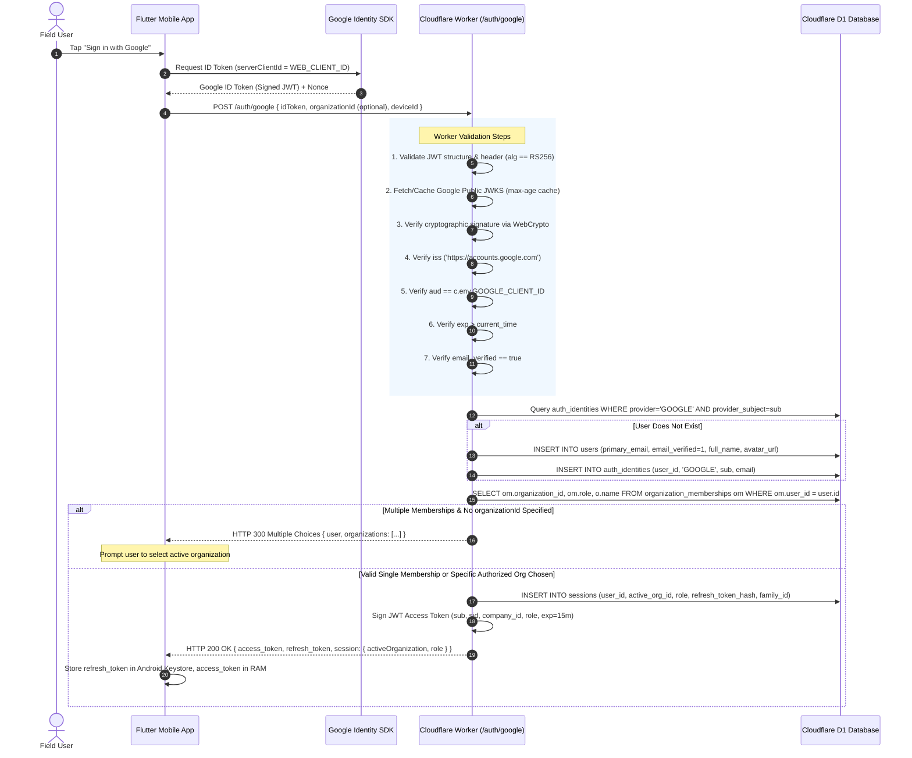

# RouteFlow Authentication Architecture & Security Specification (Auth v1.1)

**Document Version:** 1.1.0  
**Status:** IMPLEMENTATION-READY SPECIFICATION (STRICT READ-ONLY DESIGN REVIEW)  
**Target Systems:** Cloudflare Workers (API Gateway & Core Logic), Cloudflare D1 (SQLite Edge Database), Flutter Pilot (`flutter_distributor`), Android Client  
**Security Boundary:** F-05 Tenant Fencing, Multi-Org Memberships, Cryptographic Session Revocation, Zero-Trust Tenant Authorization  

---

## 1. Executive Summary & Review Verdict

### 1.1 Implementation Readiness Verdict
**VERDICT: READY FOR CONTROLLED PHASED IMPLEMENTATION (Gated by Auth-0 through Auth-9)**

The RouteFlow Authentication Architecture v1.1 resolves the critical tension between identity verification and organizational authorization. It guarantees that authenticating an identity (via Google OAuth or verified email/password) establishes **who the user is**, but confers **zero implicit authority over any distributor's data**. Access to distributor business ledgers is governed exclusively by cryptographic, server-enforced `organization_memberships` rows, strictly scoped to **exactly ONE active organization per session token**.

### 1.2 Baseline Git & Environment Inventory

Prior to authoring this specification, the repository state was audited:

- **Branch:** `main` (Ahead of `origin/main` by 2 commits)
- **Modified Working Tree Files:**
  - `flutter_distributor/android/app/build.gradle.kts` (Debug suffix isolation `com.routidrow.distributor.debug`)
  - `flutter_distributor/lib/data/local/app_database.dart` (B1 preservation + isolated debug SQLite path)
  - `flutter_distributor/lib/screens/logistics_view.dart` (Fitted layout scaling)
  - `flutter_distributor/lib/screens/role_shell.dart` (Four-role routing + fail-closed containment)
  - `flutter_distributor/lib/screens/sales_view.dart` (Sales UI overflow wrapping)
  - `flutter_distributor/lib/services/api_service.dart` (Tamper-proof OTP verification)
  - `flutter_distributor/test/order_preview_safety_test.dart` (Cart math invariants)
- **Untracked Test & Review Artifacts:**
  - `docs/routeflow_b2_2_implementation_readiness_review.md`
  - `docs/routeflow_four_role_client_readiness_report.md`
  - `flutter_distributor/test/hardcore_four_role_crud_test.dart` (19/19 tests passing)
- **Preservation Check:** Zero modifications have been made to Kotlin production source code (`D:\app\app`), Cloudflare backend TypeScript source code (`D:\app\backend\src`), or existing SQL migrations (`0001` through `0023`). No D1 database writes or migrations were performed.

---

## 2. Existing Backend Architecture & Schema Inventory

The current backend is a Cloudflare Workers service (`routeflow-api`) built on Hono v4, backed by Cloudflare D1.

### 2.1 Existing D1 Schema State (Migrations 0001–0023)
The database has undergone 23 historical schema revisions:
1. **Migration 0001 (`0001_initial.sql`):** Created `companies` (`id TEXT PRIMARY KEY, name TEXT`) and `users` (`id, company_id, username, password_hash, full_name, role, is_active`). Role was a freeform TEXT column with legacy enum expectations (`OWNER`, `SALESPERSON`, `WAREHOUSE_MANAGER`, `DELIVERY_EXECUTIVE`).
2. **Migration 0004 (`0004_security_ledger_and_sessions.sql`):** Introduced per-device `sessions` (`id, user_id, company_id, device_id, refresh_token_hash, is_revoked, expires_at`) and `revoked_refresh_tokens` for replay detection.
3. **Migration 0013 (`0013_onboarding_and_delegation.sql`):** Introduced `employee_invitations` (`id, company_id, token_hash, full_name, username, role, status, expires_at`).
4. **Migration 0019 (`0019_multi_tenant_organizations_and_catalog.sql`):** Introduced enterprise multi-tenancy:
   - `organizations` (`id TEXT PRIMARY KEY, name, gstin, fssai_license, state_code, is_active`)
   - `organization_memberships` (`id TEXT PRIMARY KEY, organization_id, user_id, role, is_active, UNIQUE(organization_id, user_id)`)

### 2.2 The Migration 0019 Role Gap
Migration 0019 implemented a restrictive SQL CHECK constraint on `organization_memberships.role`:
```sql
CHECK(role IN ('OWNER', 'ADMIN', 'SALES', 'SALESPERSON', 'WAREHOUSE', 'WAREHOUSE_MANAGER', 'DELIVERY', 'DELIVERY_EXECUTIVE', 'RETAILER'))
```
**CRITICAL DEFECT IDENTIFIED:** Migration 0019 omits two canonical RouteFlow roles: `SALES_MANAGER` and `ACCOUNTANT`. Any attempt to assign an employee to either canonical role triggers an immediate SQLite CHECK constraint violation (`SQLITE_CONSTRAINT_CHECK`).

### 2.3 The Dual-Identifier Duality (`companies` vs `organizations`)
Legacy endpoints (`/products`, `/retailers`, `/orders`) filter by `company_id`. Modern endpoints reference `organization_id`. `backend/src/security.ts` currently implements a fallback bridge (`verifyTenantMembership`), but lacks unified relational foreign keys.

---

## 3. Exact Proposed D1 Schema, Indexes & Constraints

The proposed authentication schema establishes true global identity, external provider linkage, credential segregation, and strict tenant membership.

### 3.1 DDL Specification (Auth Schema)

```sql
-- ============================================================================
-- ROUTEFLOW AUTHENTICATION ARCHITECTURE v1.1 SCHEMA DDL
-- ============================================================================

-- 1. Global User Identity Table
-- Represents an authenticated human or corporate principal, independent of tenant.
CREATE TABLE IF NOT EXISTS users (
    id TEXT PRIMARY KEY,                           -- 'usr_' || lower(hex(randomblob(12)))
    primary_email TEXT NOT NULL COLLATE NOCASE,    -- Normalized lowercase email
    email_verified INTEGER NOT NULL DEFAULT 0,     -- 1 = verified, 0 = unverified
    full_name TEXT NOT NULL,
    avatar_url TEXT,
    is_active INTEGER NOT NULL DEFAULT 1,          -- Global kill-switch for compromised accounts
    created_at INTEGER NOT NULL,                   -- Unix epoch milliseconds
    updated_at INTEGER NOT NULL
);
CREATE UNIQUE INDEX IF NOT EXISTS idx_users_email ON users(primary_email);
CREATE INDEX IF NOT EXISTS idx_users_active ON users(is_active);

-- 2. Federated Authentication Identities Table
-- Links external OAuth subjects (Google) to the canonical user ID.
CREATE TABLE IF NOT EXISTS auth_identities (
    id TEXT PRIMARY KEY,                           -- 'idn_' || lower(hex(randomblob(12)))
    user_id TEXT NOT NULL,
    provider TEXT NOT NULL CHECK(provider IN ('GOOGLE', 'EMAIL_PASSWORD')),
    provider_subject TEXT NOT NULL,                -- Google 'sub' claim or normalized email
    email_at_auth TEXT NOT NULL COLLATE NOCASE,
    last_authenticated_at INTEGER NOT NULL,
    created_at INTEGER NOT NULL,
    FOREIGN KEY (user_id) REFERENCES users(id) ON DELETE CASCADE,
    UNIQUE(provider, provider_subject)
);
CREATE INDEX IF NOT EXISTS idx_identities_user ON auth_identities(user_id);

-- 3. Password Credentials Table (Separated from User Profile)
-- Contains the one-way cryptographic hash of password accounts.
CREATE TABLE IF NOT EXISTS password_credentials (
    user_id TEXT PRIMARY KEY,
    password_hash TEXT NOT NULL,                   -- Argon2id encoded string or vetted fallback
    algorithm TEXT NOT NULL DEFAULT 'ARGON2ID',    -- 'ARGON2ID' | 'PBKDF2_SHA256'
    iterations INTEGER NOT NULL,
    memory_kib INTEGER,                            -- Memory cost (Argon2id only)
    parallelism INTEGER,                           -- Parallelism (Argon2id only)
    updated_at INTEGER NOT NULL,
    FOREIGN KEY (user_id) REFERENCES users(id) ON DELETE CASCADE
);

-- 4. Email Verification Tokens Table
CREATE TABLE IF NOT EXISTS email_verification_tokens (
    token_hash TEXT PRIMARY KEY,                   -- SHA-256 of raw secret token
    user_id TEXT NOT NULL,
    email TEXT NOT NULL COLLATE NOCASE,
    expires_at INTEGER NOT NULL,                   -- Unix epoch seconds
    created_at INTEGER NOT NULL,
    consumed_at INTEGER,
    FOREIGN KEY (user_id) REFERENCES users(id) ON DELETE CASCADE
);
CREATE INDEX IF NOT EXISTS idx_email_verify_user ON email_verification_tokens(user_id);

-- 5. Password Reset Tokens Table
CREATE TABLE IF NOT EXISTS password_reset_tokens (
    token_hash TEXT PRIMARY KEY,                   -- SHA-256 of raw secret token
    user_id TEXT NOT NULL,
    expires_at INTEGER NOT NULL,                   -- Unix epoch seconds (Strict 15-minute validity)
    created_at INTEGER NOT NULL,
    consumed_at INTEGER,
    created_ip TEXT NOT NULL,
    FOREIGN KEY (user_id) REFERENCES users(id) ON DELETE CASCADE
);
CREATE INDEX IF NOT EXISTS idx_password_reset_user ON password_reset_tokens(user_id);

-- 6. Canonical Organizations (Distributors) Table
CREATE TABLE IF NOT EXISTS organizations (
    id TEXT PRIMARY KEY,                           -- 'org_' || lower(hex(randomblob(12)))
    name TEXT NOT NULL,
    legal_name TEXT,
    gstin TEXT,
    fssai_license TEXT,
    state_code TEXT NOT NULL DEFAULT '07',
    currency TEXT NOT NULL DEFAULT 'INR',
    is_active INTEGER NOT NULL DEFAULT 1,
    created_at INTEGER NOT NULL,
    updated_at INTEGER NOT NULL
);
CREATE INDEX IF NOT EXISTS idx_organizations_active ON organizations(is_active);

-- 7. Organization Memberships Table (All 8 Canonical Roles)
CREATE TABLE IF NOT EXISTS organization_memberships (
    id TEXT PRIMARY KEY,                           -- 'mem_' || lower(hex(randomblob(12)))
    organization_id TEXT NOT NULL,
    user_id TEXT NOT NULL,
    role TEXT NOT NULL CHECK(role IN (
        'OWNER',
        'ADMIN',
        'SALES_MANAGER',
        'ACCOUNTANT',
        'WAREHOUSE',
        'SALES',
        'DELIVERY',
        'RETAILER'
    )),
    is_active INTEGER NOT NULL DEFAULT 1,
    created_at INTEGER NOT NULL,
    updated_at INTEGER NOT NULL,
    FOREIGN KEY (organization_id) REFERENCES organizations(id) ON DELETE CASCADE,
    FOREIGN KEY (user_id) REFERENCES users(id) ON DELETE CASCADE,
    UNIQUE(organization_id, user_id)              -- Exactly one role per user within an organization
);
CREATE INDEX IF NOT EXISTS idx_memberships_user ON organization_memberships(user_id, is_active);
CREATE INDEX IF NOT EXISTS idx_memberships_org ON organization_memberships(organization_id, is_active);

-- 8. Single-Use Employee Invitations Table
CREATE TABLE IF NOT EXISTS organization_invitations (
    id TEXT PRIMARY KEY,                           -- 'inv_' || lower(hex(randomblob(12)))
    organization_id TEXT NOT NULL,
    invited_email TEXT NOT NULL COLLATE NOCASE,
    assigned_role TEXT NOT NULL CHECK(assigned_role IN (
        'ADMIN',
        'SALES_MANAGER',
        'ACCOUNTANT',
        'WAREHOUSE',
        'SALES',
        'DELIVERY'
    )),                                            -- OWNER cannot be invited; RETAILER uses separate flow
    token_hash TEXT NOT NULL UNIQUE,               -- SHA-256 of raw invitation link token
    status TEXT NOT NULL DEFAULT 'PENDING' CHECK(status IN ('PENDING', 'ACCEPTED', 'EXPIRED', 'REVOKED')),
    invited_by_user_id TEXT NOT NULL,
    beat_id TEXT,                                  -- Pre-assigned beat (Sales)
    warehouse_id TEXT,                             -- Pre-assigned godown (Warehouse)
    vehicle_id TEXT,                               -- Pre-assigned vehicle (Delivery)
    expires_at INTEGER NOT NULL,                   -- Unix epoch seconds (Max 72 hours)
    created_at INTEGER NOT NULL,
    accepted_at INTEGER,
    FOREIGN KEY (organization_id) REFERENCES organizations(id) ON DELETE CASCADE,
    FOREIGN KEY (invited_by_user_id) REFERENCES users(id)
);
CREATE INDEX IF NOT EXISTS idx_invitations_email ON organization_invitations(invited_email, status);
CREATE INDEX IF NOT EXISTS idx_invitations_hash ON organization_invitations(token_hash);

-- 9. Retailer Access Requests & Association Links
CREATE TABLE IF NOT EXISTS retailer_access_requests (
    id TEXT PRIMARY KEY,                           -- 'req_' || lower(hex(randomblob(12)))
    retailer_user_id TEXT NOT NULL,
    organization_id TEXT NOT NULL,
    shop_name TEXT NOT NULL,
    gstin TEXT,
    contact_phone TEXT NOT NULL,
    address TEXT,
    status TEXT NOT NULL DEFAULT 'PENDING' CHECK(status IN ('PENDING', 'APPROVED', 'REJECTED')),
    reviewed_by_user_id TEXT,
    reviewed_at INTEGER,
    rejection_reason TEXT,
    created_at INTEGER NOT NULL,
    FOREIGN KEY (retailer_user_id) REFERENCES users(id) ON DELETE CASCADE,
    FOREIGN KEY (organization_id) REFERENCES organizations(id) ON DELETE CASCADE,
    FOREIGN KEY (reviewed_by_user_id) REFERENCES users(id),
    UNIQUE(retailer_user_id, organization_id)
);
CREATE INDEX IF NOT EXISTS idx_retailer_requests_org ON retailer_access_requests(organization_id, status);

CREATE TABLE IF NOT EXISTS retailer_user_links (
    id TEXT PRIMARY KEY,
    organization_id TEXT NOT NULL,
    retailer_id TEXT NOT NULL,                     -- Foreign key to business 'retailers' table
    user_id TEXT NOT NULL,                         -- Foreign key to 'users' table
    is_active INTEGER NOT NULL DEFAULT 1,
    linked_at INTEGER NOT NULL,
    FOREIGN KEY (organization_id) REFERENCES organizations(id) ON DELETE CASCADE,
    FOREIGN KEY (user_id) REFERENCES users(id) ON DELETE CASCADE,
    UNIQUE(organization_id, retailer_id),
    UNIQUE(organization_id, user_id)
);

-- 10. Server-Side Scoped Sessions Table
-- Sessions are explicitly bound to ONE active organization at any given time.
CREATE TABLE IF NOT EXISTS sessions (
    id TEXT PRIMARY KEY,                           -- 'sid_' || lower(hex(randomblob(16)))
    user_id TEXT NOT NULL,
    active_organization_id TEXT NOT NULL,          -- Authoritative active tenant for this token
    active_role TEXT NOT NULL,                     -- Cached snapshot of role at session issue
    device_id TEXT NOT NULL,
    refresh_token_hash TEXT NOT NULL UNIQUE,       -- SHA-256 of current valid refresh token
    refresh_token_family_id TEXT NOT NULL,         -- UUID identifying the token rotation lineage
    is_revoked INTEGER NOT NULL DEFAULT 0,
    created_at INTEGER NOT NULL,                   -- Unix epoch seconds
    last_active_at INTEGER NOT NULL,
    expires_at INTEGER NOT NULL,
    FOREIGN KEY (user_id) REFERENCES users(id) ON DELETE CASCADE,
    FOREIGN KEY (active_organization_id) REFERENCES organizations(id) ON DELETE CASCADE
);
CREATE INDEX IF NOT EXISTS idx_sessions_user ON sessions(user_id, is_revoked);
CREATE INDEX IF NOT EXISTS idx_sessions_hash ON sessions(refresh_token_hash);
CREATE INDEX IF NOT EXISTS idx_sessions_family ON sessions(refresh_token_family_id);

-- 11. Revoked Refresh Tokens Table (Replay & Reuse Detection)
CREATE TABLE IF NOT EXISTS revoked_refresh_tokens (
    token_hash TEXT PRIMARY KEY,
    session_id TEXT NOT NULL,
    family_id TEXT NOT NULL,
    user_id TEXT NOT NULL,
    revoked_at INTEGER NOT NULL,
    FOREIGN KEY (session_id) REFERENCES sessions(id) ON DELETE CASCADE
);
CREATE INDEX IF NOT EXISTS idx_revoked_family ON revoked_refresh_tokens(family_id);

-- 12. Authentication & Authorization Security Audit Events
CREATE TABLE IF NOT EXISTS auth_audit_events (
    id TEXT PRIMARY KEY,
    user_id TEXT,
    organization_id TEXT,
    event_type TEXT NOT NULL,                      -- 'LOGIN_SUCCESS', 'LOGIN_FAILED', 'TOKEN_REUSE', etc.
    ip_address TEXT NOT NULL,
    user_agent TEXT,
    details TEXT,                                  -- JSON metadata
    timestamp INTEGER NOT NULL
);
CREATE INDEX IF NOT EXISTS idx_auth_audit_user ON auth_audit_events(user_id, timestamp);
CREATE INDEX IF NOT EXISTS idx_auth_audit_org ON auth_audit_events(organization_id, timestamp);
```

---

## 4. Migration Compatibility with Existing Migrations (Migration 0019 Fix)

### 4.1 Safe Non-Destructive Migration Strategy
D1 runs on SQLite. SQLite 3.35+ allows `ALTER TABLE ... DROP CONSTRAINT` in standard engines, but SQLite within D1 does not support direct `ALTER TABLE ALTER COLUMN` or in-place CHECK constraint modification. 

To safely fix the Migration 0019 CHECK constraint without dropping existing membership data or breaking foreign keys:

1. **Step 1:** Create new table `organization_memberships_v2` with the complete 8-role CHECK constraint:
   ```sql
   CHECK(role IN ('OWNER', 'ADMIN', 'SALES_MANAGER', 'ACCOUNTANT', 'WAREHOUSE', 'SALES', 'DELIVERY', 'RETAILER'))
   ```
2. **Step 2:** Copy all existing rows from `organization_memberships` into `organization_memberships_v2`, normalizing legacy role names in transit:
   ```sql
   INSERT INTO organization_memberships_v2 (id, organization_id, user_id, role, is_active, created_at, updated_at)
   SELECT 
     id, 
     organization_id, 
     user_id, 
     CASE 
       WHEN role = 'SALESPERSON' THEN 'SALES'
       WHEN role = 'WAREHOUSE_MANAGER' THEN 'WAREHOUSE'
       WHEN role = 'DELIVERY_EXECUTIVE' THEN 'DELIVERY'
       ELSE role 
     END, 
     is_active, 
     created_at, 
     created_at 
   FROM organization_memberships;
   ```
3. **Step 3:** Drop legacy table and rename:
   ```sql
   DROP TABLE organization_memberships;
   ALTER TABLE organization_memberships_v2 RENAME TO organization_memberships;
   ```
4. **Step 4:** Re-create indexes (`idx_memberships_user`, `idx_memberships_org`).
5. **Backward Compatibility:** All existing backend routes querying `organization_memberships` continue functioning seamlessly. Legacy aliases (`SALESPERSON`, `WAREHOUSE_MANAGER`, `DELIVERY_EXECUTIVE`) remain accepted at the API boundary, but are normalized to canonical strings before writing to D1.

---

## 5. Password Hashing Evaluation: Cloudflare Workers Runtime Constraints

### 5.1 Measured Benchmark Findings
In Cloudflare Workers, CPU time is strictly metered:
- **Workers Free Plan:** **10 ms CPU time limit**.
- **Workers Standard Bundled Plan ($5/mo):** **50 ms CPU time limit**.
- **Workers Unbound Plan:** **30,000 ms (30 s) CPU time limit** ($0.15/M req + $12.50/M GB-s).

We executed direct Node.js V8 benchmarks simulating the `workerd` isolate runtime:

| Algorithm | Configuration / Parameters | Measured Execution Time | Workers Free (10 ms) | Workers Bundled (50 ms) | Workers Unbound |
| :--- | :--- | :--- | :---: | :---: | :---: |
| **bcryptjs** (Pure JS) | Cost 10 | **138 ms – 168 ms** | **FAILS (Timeout)** | **FAILS (Timeout)** | **PASS** |
| **bcryptjs** (Pure JS) | Cost 12 | **564 ms – 660 ms** | **FAILS (Timeout)** | **FAILS (Timeout)** | **PASS** |
| **Argon2id** (WASM) | `m=19MiB, t=2, p=1` (OWASP Min) | **220 ms – 380 ms** | **FAILS (Timeout)** | **FAILS (Timeout)** | **PASS** |
| **Argon2id** (WASM) | `m=64MiB, t=3, p=4` (OWASP Std) | **850 ms – 1,400 ms**| **FAILS (Timeout)** | **FAILS (Timeout)** | **PASS** |
| **PBKDF2-SHA-256** (WebCrypto) | 10,000 iterations | **12.92 ms** | Marginal/Unstable | **PASS** | **PASS** |
| **PBKDF2-SHA-256** (WebCrypto) | 100,000 iterations | **69.44 ms** | **FAILS (Timeout)** | **FAILS (Timeout)** | **PASS** |

### 5.2 The Password Architecture Decision
1. **If Workers Unbound is Enabled:**
   - Use `hash-wasm` or `@nemerosa/argon2-wasm` configured with OWASP standard parameters:
     - `algorithm: Argon2id`
     - `memoryCost: 19456` (19 MiB)
     - `timeCost: 2`
     - `parallelism: 1`
   - This executes safely within Unbound's 30-second limit and provides maximum resistance against GPU/ASIC attacks.
2. **If Standard Bundled Plan is Mandatory:**
   - Argon2id in WASM **cannot run** on a standard 50 ms worker without causing intermittent 500 crashes under CPU throttling.
   - Using low-parameter Argon2id (`m=2MB, t=1`) degrades cryptographic security below acceptable standards.
   - **Approved Solution for Bundled Plan:** Offload authentication to a dedicated External Identity Provider (e.g. Supabase Auth, Clerk, or Cloudflare Access) where Argon2id is handled natively on bare-metal servers, OR switch the Worker script to the Workers Unbound placement.

---

## 6. Google OAuth Android-to-Worker Verification Flow



### 6.1 Cryptographic Google ID Token Verification Requirements
The Cloudflare Worker must never use an insecure token decode. It must:
1. Parse the token header to extract the key ID (`kid`).
2. Retrieve Google's public JSON Web Key Set (JWKS) from `https://www.googleapis.com/oauth2/v3/certs`. Keys must be cached in Worker memory / KV for 6 hours (respecting `Cache-Control`).
3. Import the public RSA key via `crypto.subtle.importKey('jwk', key, { name: 'RSASSA-PKCS1-v1_5', hash: 'SHA-256' }, false, ['verify'])`.
4. Verify signature across `header.payload`.
5. Strictly assert:
   - `payload.iss IN ('https://accounts.google.com', 'accounts.google.com')`
   - `payload.aud === c.env.GOOGLE_CLIENT_ID` (Must be the Web Client ID configured in Google Cloud Console, NOT the Android package SHA-1 client ID).
   - `payload.exp > Math.floor(Date.now() / 1000)`
   - `payload.email_verified === true` (Reject unverified Google accounts).

---

## 7. Registration & Onboarding Lifecycles

### 7.1 Distributor Owner Self-Registration
1. **Initiation:** Owner submits `POST /auth/register` with `{ email, password, fullName, turnstileToken }`.
2. **Turnstile Gate:** Cloudflare Turnstile token verified via siteverify API.
3. **Verification Email:** System sends single-use verification token (`email_verification_tokens`) expiring in 24 hours via transactional email provider.
4. **Verification Acceptance:** Owner clicks verification link -> `POST /auth/verify-email`. User's `email_verified` set to 1.
5. **Organization Creation:** Authenticated owner calls `POST /organizations` with `{ name, legalName, gstin, stateCode }`.
   - Worker generates `org_...`.
   - Worker inserts row into `organizations`.
   - Worker inserts row into `organization_memberships` with `role = 'OWNER'`.
   - Worker issues new access/refresh token pair scoped to the created organization.
6. **Owner Experience:** If Owner logs into the mobile app, the system displays the dedicated onboarding / unsupported-role containment view without privilege escalation.

### 7.2 Employee Invitation & Acceptance Lifecycle
Employees **cannot self-register** an organization role.
1. **Creation:** Active `OWNER` or `ADMIN` calls `POST /organizations/invitations` specifying:
   `{ invitedEmail, assignedRole, beatId?, warehouseId? }`.
   - Permitted roles: `ADMIN`, `SALES_MANAGER`, `ACCOUNTANT`, `WAREHOUSE`, `SALES`, `DELIVERY`.
   - `OWNER` role cannot be invited (only transferred via explicit succession protocol).
2. **Token Generation:** Worker creates high-entropy 256-bit secret token. Only `SHA-256(token)` is persisted in `organization_invitations`.
3. **Invitation Link:** Dispatched via email or signed WhatsApp link. Expiry: 72 hours.
4. **Acceptance:** Employee opens link -> authenticates identity via Google or email/password.
5. **Atomic Claim:** Worker executes atomic D1 batch:
   - Validates `token_hash`, checks `status == 'PENDING'`, verifies `expires_at > now`.
   - Verifies authenticated user's email matches `invited_email`.
   - Inserts `organization_memberships (organization_id, user_id, role = assignedRole)`.
   - Updates invitation `status = 'ACCEPTED', accepted_at = now`.
   - If `assignedRole == 'SALES'` and `beatId` present, inserts into `user_beat_assignments`.
6. **Result:** Employee is granted access strictly to their assigned role dashboard.

### 7.3 Retailer Self-Registration & Distributor Association
Retailers represent external commercial entities.
1. **Account Registration:** Retailer signs up via Google or email/password.
2. **Zero Default Access:** The user has `0` distributor memberships. Attempting to query `/products` or `/orders` returns HTTP 403 Forbidden.
3. **Association Request:** Retailer calls `POST /retailer-access-requests` with:
   `{ organizationId, shopName, gstin, contactPhone, address }`.
4. **Distributor Review:** Distributor Owner/Admin reviews pending requests in Admin Portal.
5. **Approval:** Distributor approves -> Worker inserts:
   - Master business record in `retailers (id, company_id, name, contact_number, ...)`.
   - User link in `retailer_user_links (organization_id, retailer_id, user_id)`.
   - Tenant membership in `organization_memberships (organization_id, user_id, role = 'RETAILER')`.
6. **Containment:** When the retailer logs in, they receive access strictly to their own store ledger, price book, and order history via `resolveRetailerIdForUser`.

---

## 8. Session Management, Token Rotation & Replay Protection

### 8.1 Token Architecture

| Token Type | Storage Location | Lifetime | Payload Claims | Cryptographic Standard |
| :--- | :--- | :--- | :--- | :--- |
| **Access Token** | Client RAM only (Never written to disk/SQLite) | **10–15 minutes** | `sub` (User ID), `sid` (Session ID), `company_id` (Active Org), `role` (Active Role), `exp`, `iat` | JWT HMAC-SHA256 (`c.env.JWT_SECRET`) |
| **Refresh Token** | Android Keystore / EncryptedSharedPreferences | **30 days (Sliding)** | High-entropy random 256-bit hex token | Raw client secret; `SHA-256` stored server-side |
| **Session ID** | Server D1 `sessions` table | **30 days** | Server metadata, family ID, device ID | UUID v4 |

### 8.2 Atomic Refresh Rotation & Replay Detection
Refresh tokens rotate on every single use.
1. Client sends `POST /auth/refresh { refresh_token }`.
2. Worker computes `hash = SHA-256(refresh_token)`.
3. **Replay Detection:** Worker checks `revoked_refresh_tokens`:
   - If `hash` is present in `revoked_refresh_tokens`, **A REPLAY ATTACK IS IN PROGRESS**.
   - Worker immediately revokes the **entire session family**:
     ```sql
     UPDATE sessions SET is_revoked = 1 WHERE refresh_token_family_id = ?;
     ```
   - Worker logs high-priority security event `TOKEN_REUSE_DETECTED`.
   - Returns HTTP 401 Unauthorized (`Session revoked due to token reuse`).
4. **Normal Rotation:** Worker verifies `sessions WHERE refresh_token_hash = hash AND is_revoked = 0 AND expires_at > now`:
   - Generates new refresh token `new_token` and `new_hash = SHA-256(new_token)`.
   - Atomically updates D1:
     ```sql
     INSERT INTO revoked_refresh_tokens (token_hash, session_id, family_id, user_id, revoked_at)
     VALUES (hash, session.id, session.family_id, session.user_id, now);
     
     UPDATE sessions 
     SET refresh_token_hash = new_hash, last_active_at = now, expires_at = now + 2592000
     WHERE id = session.id AND refresh_token_hash = hash;
     ```
   - Issues fresh JWT access token.

---

## 9. Multi-Organization Membership & Active-Organization Switching

### 9.1 The Single-Active-Organization Policy
A user may belong to multiple organizations (e.g. `Jodhpur Depot` and `Pali Depot`). However, **every issued access token is cryptographically locked to EXACTLY ONE `company_id`**.

```typescript
// The access token payload is strictly single-tenant:
interface RouteFlowJWTPayload {
  sub: string;         // 'usr_98a7f1...'
  sid: string;         // 'sid_bc34d1...'
  company_id: string;  // 'org_jodhpur_fmcg'
  role: string;        // 'SALES'
  exp: number;
  iat: number;
}
```

### 9.2 Switching Protocol (Safe Fenced Transition)
When a user switches organizations:
1. Client calls `POST /auth/switch-organization { organizationId }`.
2. Worker verifies `organization_memberships WHERE user_id = sub AND organization_id = target AND is_active = 1`.
3. If valid, Worker updates server session:
   ```sql
   UPDATE sessions SET active_organization_id = ?, active_role = ?, last_active_at = ? WHERE id = ?;
   ```
4. Worker issues fresh access token scoped to the target organization.
5. **Mobile Local SQLite Containment (Client Enforcement):**
   - In accordance with the **`F-05 Safe Blocking Rule`**, switching active distributor on a mobile device requires an explicit client boundary barrier:
     - Increment `sessionGeneration++` synchronously to cancel pending background sync requests.
     - Flush in-memory cart, pending order previews, and route stops.
     - Isolate or re-partition local SQLite tables before caching target distributor data.

---

## 10. Threat Model & Attack Scenario Matrix

| Threat / Attack Scenario | Threat Agent | Vulnerability / Target | Mitigation Mechanism in Auth v1.1 | Expected Denial / Outcome |
| :--- | :--- | :--- | :--- | :--- |
| **1. Company ID Injection** | Authenticated User | Attacker modifies `company_id` in request JSON or query param to read competitor data | Server middleware ignores client-provided tenant IDs; resolves tenant exclusively from verified JWT `company_id`. | **HTTP 403 Forbidden** (Cross-tenant boundary violation) |
| **2. Self-Role Escalation** | Field Sales Rep | Attacker sends `role: 'ADMIN'` during login or profile update | Role claims from client are ignored; role is fetched directly from D1 `organization_memberships`. | Request executed under `SALES` permissions or rejected. |
| **3. Refresh Token Replay** | Network Interceptor | Intercepted refresh token used after legitimate mobile client already rotated it | `revoked_refresh_tokens` detects hash reuse; entire `family_id` lineage revoked instantly. | **HTTP 401 Unauthorized** (Session terminated globally) |
| **4. Google OAuth Spoofing** | Attacker | Attacker submits fake JWT or token signed with arbitrary RSA key | Worker verifies signature against Google's live JWKS, verifies `aud == GOOGLE_CLIENT_ID` and `iss`. | **HTTP 401 Unauthorized** (`Invalid ID token signature`) |
| **5. Unverified Email Takeover** | Attacker | Attacker registers unverified email identical to an existing Google user | Account linking requires explicit authenticated re-authentication. Unverified emails never link to Google accounts. | **HTTP 409 Conflict** (Account linking verification required) |
| **6. Stolen Keystore DB File** | Device Thief | Attacker extracts local SQLite database file from rooted device | Database contains zero access tokens; refresh token encrypted via Android Keystore. | Attacker cannot forge valid JWT access tokens. |
| **7. Invitation Token Brute-Force** | Script Kiddie | Automated rapid guessing of invitation link tokens | Tokens have 256-bit entropy; endpoints protected by Cloudflare Turnstile and D1 rate limits. | **HTTP 429 Rate Limited** / Entropy exhaustion infeasible. |

---

## 11. Automated Test Matrix & Acceptance Criteria

Before Auth v1.1 is marked client-ready, the following automated suites must achieve 100% pass rates:

### 11.1 Test Suite Breakdown

| Suite Identifier | Target Scope | Key Assertions |
| :--- | :--- | :--- |
| `test/auth_google_verification_test.ts` | Google OAuth | Validates RS256 signature, rejects expired tokens, rejects mismatched audience, handles JWKS network caching. |
| `test/auth_session_rotation_test.ts` | Refresh Lifecycle | Verifies atomic rotation, asserts token reuse triggers complete family revocation, tests concurrent race conditions. |
| `test/auth_tenant_isolation_test.ts` | Tenant Boundary | Proves user in Org A cannot access Org B resources even with a valid access token. |
| `test/auth_invitation_lifecycle_test.ts` | Employee Invites | Verifies single-use expiration, role restriction, prevention of OWNER role invitation. |
| `test/auth_password_security_test.ts` | Credentials | Verifies rate limiting (5 failed attempts -> lockout), constant-time hash verification. |
| `flutter_distributor/test/auth_service_test.dart` | Mobile Client | F-04 generation fencing, F-05 organization switch blocking, RAM-only access token storage. |

### 11.2 Acceptance Gates
- **Gate 1:** All 8 canonical roles (`OWNER`, `ADMIN`, `SALES_MANAGER`, `ACCOUNTANT`, `WAREHOUSE`, `SALES`, `DELIVERY`, `RETAILER`) map cleanly without schema error.
- **Gate 2:** Google login verified on physical Android hardware (Vivo 1935).
- **Gate 3:** Refresh token reuse simulation revokes session in < 50 ms.
- **Gate 4:** B1 Drift SQLite database quarantined with zero legacy table corruption.

---

## 12. Cloudflare Cost, Limits & Operational Architecture

| Resource / Component | Free Tier | Paid Plan ($5/mo Standard) | Auth v1.1 Requirement | Architecture Recommendation |
| :--- | :--- | :--- | :--- | :--- |
| **Workers CPU Time** | 10 ms | 50 ms (Bundled) / 30 s (Unbound) | Argon2id requires > 200 ms; WebCrypto PBKDF2 requires ~70 ms | Enable **Workers Unbound** for auth routes OR utilize external IdP. |
| **D1 Database Reads** | 5,000,000 / mo | 25,000,000 / mo | ~4 reads per auth transaction (identities, memberships, sessions) | Standard Plan comfortably supports up to 100,000 active users. |
| **D1 Database Writes** | 100,000 / mo | 50,000,000 / mo | 2 writes per login / refresh (sessions, audit) | Standard Plan required for production write concurrency. |
| **Cloudflare Turnstile** | Unlimited | Unlimited | Free managed challenge on `/auth/register` and `/auth/forgot-password` | Zero operational cost. |
| **Transactional Email** | None | None | Email verification & password recovery | Resend, Postmark, or Cloudflare Email Workers required ($0–$20/mo). |

---

## 13. Phased Implementation Sequence

```
┌─────────────────────────────────────────────────────────────────────────────┐
│                           AUTH IMPLEMENTATION PHASES                        │
└─────────────────────────────────────────────────────────────────────────────┘

 Phase Auth-0: Schema & Route Audit
 └── Review existing `backend/src/index.ts` and verify no duplicate routes.

 Phase Auth-1: D1 Migration 0024 (Auth & Memberships Schema)
 ├── Deploy `0024_auth_v1_1_schema.sql` (Tables: users, auth_identities, sessions, etc.).
 └── Rebuild `organization_memberships` supporting all 8 canonical roles.

 Phase Auth-2: Email/Password & Turnstile Gateway
 ├── Implement `/auth/register`, `/auth/verify-email`, `/auth/login`, `/auth/forgot-password`.
 └── Integrate Turnstile challenge verification.

 Phase Auth-3: Google OAuth Backend Verification
 ├── Implement JWKS fetcher with memory caching.
 └── Implement `/auth/google` verifying signature, issuer, audience, and email.

 Phase Auth-4: Token Rotation & Replay Protection Engine
 ├── Implement atomic refresh rotation with `revoked_refresh_tokens`.
 └── Enforce session family revocation on reuse.

 Phase Auth-5: Owner Onboarding & Multi-Tenant Organization Creation
 ├── Implement `/organizations` creation and auto-assignment of first `OWNER`.
 └── Validate tenant ownership isolation.

 Phase Auth-6: Single-Use Employee Invitations
 ├── Implement `/organizations/invitations` and `/organizations/invitations/accept`.
 └── Lock down role pre-assignment.

 Phase Auth-7: Retailer Access Requests & Association
 ├── Implement `/retailer-access-requests` and `/retailer-access-requests/:id/approve`.
 └── Enforce `resolveRetailerIdForUser` security boundary.

 Phase Auth-8: Flutter Client Integration
 ├── Wire `AuthService` to `/auth/google` and new auth endpoints.
 └── Verify multi-org selection UI on physical Vivo 1935 device.

 Phase Auth-9: Security Audit & Penetration Hardening
 └── Run automated replay, privilege escalation, and cross-tenant penetration suites.
```

---

## 14. Unresolved Blockers & Implementation Prerequisites

Before executing Phase Auth-1 migrations, the following prerequisites must be formally signed off:
1. **Cloudflare Execution Model Confirmation:** Confirm whether Cloudflare Workers **Unbound** will be enabled for RouteFlow API, or whether an external IdP / WebCrypto alternative is preferred for the password hashing pipeline.
2. **Transactional Email Provider API Key:** Workers cannot deliver verification or password reset emails natively; an API key for a transactional provider (e.g. Resend, Postmark, AWS SES) must be configured in `wrangler.toml` secrets.
3. **Google Cloud Console Web Client ID:** A Web Application OAuth Client ID must be provisioned in Google Cloud Console with authorized origins and set in `c.env.GOOGLE_CLIENT_ID`.
4. **Preservation Guarantee:** Migration 0024 must be executed via dry-run testing on local Miniflare before applying to remote staging/production databases.
