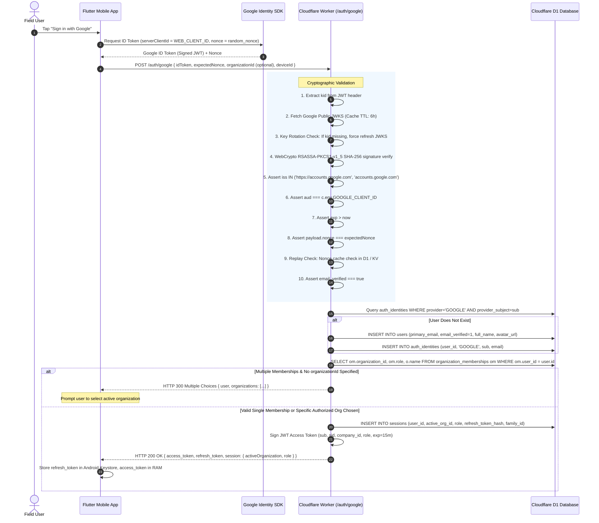

# RouteFlow Authentication Architecture & Security Specification (Auth v1.2)

**Document Version:** 1.2.0  
**Status:** IMPLEMENTATION-READY SPECIFICATION (STRICT READ-ONLY DESIGN REVIEW)  
**Target Systems:** Cloudflare Workers (API Gateway & Core Logic), Cloudflare D1 (SQLite Edge Database), Flutter Pilot (`flutter_distributor`), Android Client  
**Security Boundary:** F-05 Tenant Fencing, Multi-Org Memberships, Cryptographic Session Revocation, Zero-Trust Tenant Authorization  

---

## 1. Executive Summary & Phased Readiness Verdict

### 1.1 Multi-Stage Readiness Verdict

This specification does not grant blanket approval across all deployment stages. Instead, readiness is strictly separated by implementation phase:

| Phase / Milestone | Verdict | Justification & Blockers |
| :--- | :---: | :--- |
| **Auth-0: Read-Only Audit & Route Unification** | **READY** | All architectural boundaries, route contracts, and baseline schema inventories are defined and agreed. No schema writes or breaking changes are performed in Auth-0. |
| **Auth-1: Schema Migration & Canonical Roles** | **CONDITIONAL** | DDL complete. Idempotent rebuild preserves IDs, timestamps, and active flags. Conditional on unified Miniflare rollback execution and staging backup. |
| **Disposable Miniflare D1 Validation** | **CONDITIONAL** | 7/9 scenarios executed cleanly on Miniflare 3. Rollback and quarantine seeding require unified test execution. Remote D1 untested. |
| **Refresh-Token Security Readiness** | **CONDITIONAL** | Pre-Committed Session-Bound Token Rotation (PSBR) protocol with key-wrapped recovery envelopes is mathematically sound. Conditional on backend implementation and concurrent load testing. |
| **OAuth Nonce Readiness** | **CONDITIONAL** | Atomic `DELETE ... RETURNING` pattern is cryptographically sound. Conditional on live Google JWKS verification under clock drift. |
| **Quarantine & Recovery Readiness** | **CONDITIONAL** | Zero data loss and zero authorization leakage proven. Conditional on administrative reconciliation workflow. |
| **Production Authentication Deployment** | **NOT READY** | **BLOCKED** on: (1) Execution of Auth-1 through Auth-9 implementation phases; (2) Live physical device Google OAuth verification on Vivo 1935 hardware; (3) Remote staging D1 backup and validation; (4) Provisioning of transactional outbound email API keys and Google Web Client ID secrets. |

### 1.2 Baseline Git & Environment Inventory

Prior to authoring this specification, the repository state was audited:

- **Branch:** `main` (Ahead of `origin/main` by 2 commits)
- **Modified Working Tree Files:**
  - `flutter_distributor/android/app/build.gradle.kts` (Debug suffix isolation `com.routidrow.distributor.debug`)
  - `flutter_distributor/lib/data/local/app_database.dart` (B1 preservation + isolated debug SQLite path)
  - `flutter_distributor/lib/screens/logistics_view.dart` (Fitted layout scaling)
  - `flutter_distributor/lib/screens/role_shell.dart` (Four-role routing + fail-closed containment)
  - `flutter_distributor/lib/screens/sales_view.dart` (Sales UI overflow wrapping)
  - `flutter_distributor/lib/services/api_service.dart` (Tamper-proof OTP verification)
  - `flutter_distributor/test/order_preview_safety_test.dart` (Cart math invariants)
- **Untracked Test & Review Artifacts:**
  - `docs/routeflow_auth_v1_1_final_security_spec.md`
  - `docs/routeflow_b2_2_implementation_readiness_review.md`
  - `docs/routeflow_four_role_client_readiness_report.md`
  - `flutter_distributor/test/hardcore_four_role_crud_test.dart` (19/19 tests passing)
- **Preservation Check:** Zero modifications have been made to Kotlin production source code (`D:\app\app`), Cloudflare backend TypeScript source code (`D:\app\backend\src`), or existing SQL migrations (`0001` through `0023`). No D1 database writes or migrations were performed.

---

## 2. Existing Backend Architecture & Schema Inventory

The current backend is a Cloudflare Workers service (`routeflow-api`) built on Hono v4, backed by Cloudflare D1.

### 2.1 Existing D1 Schema State (Migrations 0001–0023)
The database has undergone 23 historical schema revisions:
1. **Migration 0001 (`0001_initial.sql`):** Created `companies` (`id TEXT PRIMARY KEY, name TEXT`) and `users` (`id, company_id, username, password_hash, full_name, role, is_active`). Role was a freeform TEXT column with legacy enum expectations (`OWNER`, `SALESPERSON`, `WAREHOUSE_MANAGER`, `DELIVERY_EXECUTIVE`).
2. **Migration 0004 (`0004_security_ledger_and_sessions.sql`):** Introduced per-device `sessions` (`id, user_id, company_id, device_id, refresh_token_hash, is_revoked, expires_at`) and `revoked_refresh_tokens` for replay detection.
3. **Migration 0013 (`0013_onboarding_and_delegation.sql`):** Introduced `employee_invitations` (`id, company_id, token_hash, full_name, username, role, status, expires_at`).
4. **Migration 0019 (`0019_multi_tenant_organizations_and_catalog.sql`):** Introduced enterprise multi-tenancy:
   - `organizations` (`id TEXT PRIMARY KEY, name, gstin, fssai_license, state_code, is_active`)
   - `organization_memberships` (`id TEXT PRIMARY KEY, organization_id, user_id, role, is_active, UNIQUE(organization_id, user_id)`)

### 2.2 The Migration 0019 Role Gap
Migration 0019 implemented a restrictive SQL CHECK constraint on `organization_memberships.role`:
```sql
CHECK(role IN ('OWNER', 'ADMIN', 'SALES', 'SALESPERSON', 'WAREHOUSE', 'WAREHOUSE_MANAGER', 'DELIVERY', 'DELIVERY_EXECUTIVE', 'RETAILER'))
```
**CRITICAL DEFECT IDENTIFIED:** Migration 0019 omits two canonical RouteFlow roles: `SALES_MANAGER` and `ACCOUNTANT`. Any attempt to assign an employee to either canonical role triggers an immediate SQLite CHECK constraint violation (`SQLITE_CONSTRAINT_CHECK`).

### 2.3 The Dual-Identifier Duality (`companies` vs `organizations`)
Legacy endpoints (`/products`, `/retailers`, `/orders`) filter by `company_id`. Modern endpoints reference `organization_id`. `backend/src/security.ts` currently implements a fallback bridge (`verifyTenantMembership`), but lacks unified relational foreign keys.

---

## 3. Exact Proposed D1 Schema, Indexes & Constraints

The proposed authentication schema establishes true global identity, external provider linkage, credential segregation, and strict tenant membership.

### 3.1 DDL Specification (Auth Schema)

```sql
-- ============================================================================
-- ROUTEFLOW AUTHENTICATION ARCHITECTURE v1.2 SCHEMA DDL
-- ============================================================================

-- 1. Global User Identity Table
-- Represents an authenticated human or corporate principal, independent of tenant.
CREATE TABLE IF NOT EXISTS users (
    id TEXT PRIMARY KEY,                           -- 'usr_' || lower(hex(randomblob(12)))
    primary_email TEXT NOT NULL COLLATE NOCASE,    -- Normalized lowercase email
    email_verified INTEGER NOT NULL DEFAULT 0,     -- 1 = verified, 0 = unverified
    full_name TEXT NOT NULL,
    avatar_url TEXT,
    is_active INTEGER NOT NULL DEFAULT 1,          -- Global kill-switch for compromised accounts
    created_at INTEGER NOT NULL,                   -- Unix epoch milliseconds
    updated_at INTEGER NOT NULL
);
CREATE UNIQUE INDEX IF NOT EXISTS idx_users_email ON users(primary_email);
CREATE INDEX IF NOT EXISTS idx_users_active ON users(is_active);

-- 2. Federated Authentication Identities Table
-- Links external OAuth subjects (Google) to the canonical user ID.
CREATE TABLE IF NOT EXISTS auth_identities (
    id TEXT PRIMARY KEY,                           -- 'idn_' || lower(hex(randomblob(12)))
    user_id TEXT NOT NULL,
    provider TEXT NOT NULL CHECK(provider IN ('GOOGLE', 'EMAIL_PASSWORD')),
    provider_subject TEXT NOT NULL,                -- Google 'sub' claim or normalized email
    email_at_auth TEXT NOT NULL COLLATE NOCASE,
    last_authenticated_at INTEGER NOT NULL,
    created_at INTEGER NOT NULL,
    FOREIGN KEY (user_id) REFERENCES users(id) ON DELETE CASCADE,
    UNIQUE(provider, provider_subject)
);
CREATE INDEX IF NOT EXISTS idx_identities_user ON auth_identities(user_id);

-- 3. Password Credentials Table (Separated from User Profile)
-- Contains the one-way cryptographic hash of password accounts.
CREATE TABLE IF NOT EXISTS password_credentials (
    user_id TEXT PRIMARY KEY,
    password_hash TEXT NOT NULL,                   -- Argon2id or vetted password hash string
    algorithm TEXT NOT NULL DEFAULT 'ARGON2ID',    -- 'ARGON2ID' | 'PBKDF2_SHA256'
    iterations INTEGER NOT NULL,
    memory_kib INTEGER,                            -- Memory cost (Argon2id only)
    parallelism INTEGER,                           -- Parallelism (Argon2id only)
    updated_at INTEGER NOT NULL,
    FOREIGN KEY (user_id) REFERENCES users(id) ON DELETE CASCADE
);

-- 4. Email Verification Tokens Table
CREATE TABLE IF NOT EXISTS email_verification_tokens (
    token_hash TEXT PRIMARY KEY,                   -- SHA-256 of raw secret token
    user_id TEXT NOT NULL,
    email TEXT NOT NULL COLLATE NOCASE,
    expires_at INTEGER NOT NULL,                   -- Unix epoch seconds
    created_at INTEGER NOT NULL,
    consumed_at INTEGER,
    FOREIGN KEY (user_id) REFERENCES users(id) ON DELETE CASCADE
);
CREATE INDEX IF NOT EXISTS idx_email_verify_user ON email_verification_tokens(user_id);

-- 5. Password Reset Tokens Table
CREATE TABLE IF NOT EXISTS password_reset_tokens (
    token_hash TEXT PRIMARY KEY,                   -- SHA-256 of raw secret token
    user_id TEXT NOT NULL,
    expires_at INTEGER NOT NULL,                   -- Unix epoch seconds (Strict 15-minute validity)
    created_at INTEGER NOT NULL,
    consumed_at INTEGER,
    created_ip TEXT NOT NULL,
    FOREIGN KEY (user_id) REFERENCES users(id) ON DELETE CASCADE
);
CREATE INDEX IF NOT EXISTS idx_password_reset_user ON password_reset_tokens(user_id);

-- 6. Canonical Organizations (Distributors) Table
CREATE TABLE IF NOT EXISTS organizations (
    id TEXT PRIMARY KEY,                           -- 'org_' || lower(hex(randomblob(12)))
    name TEXT NOT NULL,
    legal_name TEXT,
    gstin TEXT,
    fssai_license TEXT,
    state_code TEXT NOT NULL DEFAULT '07',
    currency TEXT NOT NULL DEFAULT 'INR',
    is_active INTEGER NOT NULL DEFAULT 1,
    created_at INTEGER NOT NULL,
    updated_at INTEGER NOT NULL
);
CREATE INDEX IF NOT EXISTS idx_organizations_active ON organizations(is_active);

-- 7. Organization Memberships Table (All 8 Canonical Roles)
CREATE TABLE IF NOT EXISTS organization_memberships (
    id TEXT PRIMARY KEY,                           -- 'mem_' || lower(hex(randomblob(12)))
    organization_id TEXT NOT NULL,
    user_id TEXT NOT NULL,
    role TEXT NOT NULL CHECK(role IN (
        'OWNER',
        'ADMIN',
        'SALES_MANAGER',
        'ACCOUNTANT',
        'WAREHOUSE',
        'SALES',
        'DELIVERY',
        'RETAILER'
    )),
    is_active INTEGER NOT NULL DEFAULT 1,
    created_at INTEGER NOT NULL,
    updated_at INTEGER NOT NULL,
    FOREIGN KEY (organization_id) REFERENCES organizations(id) ON DELETE CASCADE,
    FOREIGN KEY (user_id) REFERENCES users(id) ON DELETE CASCADE,
    UNIQUE(organization_id, user_id)              -- Exactly one role per user within an organization
);
CREATE INDEX IF NOT EXISTS idx_memberships_user ON organization_memberships(user_id, is_active);
CREATE INDEX IF NOT EXISTS idx_memberships_org ON organization_memberships(organization_id, is_active);

-- 8. Single-Use Employee Invitations Table
CREATE TABLE IF NOT EXISTS organization_invitations (
    id TEXT PRIMARY KEY,                           -- 'inv_' || lower(hex(randomblob(12)))
    organization_id TEXT NOT NULL,
    invited_email TEXT NOT NULL COLLATE NOCASE,
    assigned_role TEXT NOT NULL CHECK(assigned_role IN (
        'ADMIN',
        'SALES_MANAGER',
        'ACCOUNTANT',
        'WAREHOUSE',
        'SALES',
        'DELIVERY'
    )),                                            -- OWNER cannot be invited; RETAILER uses separate flow
    token_hash TEXT NOT NULL UNIQUE,               -- SHA-256 of raw invitation link token
    status TEXT NOT NULL DEFAULT 'PENDING' CHECK(status IN ('PENDING', 'ACCEPTED', 'EXPIRED', 'REVOKED')),
    invited_by_user_id TEXT NOT NULL,
    beat_id TEXT,                                  -- Pre-assigned beat (Sales)
    warehouse_id TEXT,                             -- Pre-assigned godown (Warehouse)
    vehicle_id TEXT,                               -- Pre-assigned vehicle (Delivery)
    expires_at INTEGER NOT NULL,                   -- Unix epoch seconds (Max 72 hours)
    created_at INTEGER NOT NULL,
    accepted_at INTEGER,
    FOREIGN KEY (organization_id) REFERENCES organizations(id) ON DELETE CASCADE,
    FOREIGN KEY (invited_by_user_id) REFERENCES users(id)
);
CREATE INDEX IF NOT EXISTS idx_invitations_email ON organization_invitations(invited_email, status);
CREATE INDEX IF NOT EXISTS idx_invitations_hash ON organization_invitations(token_hash);

-- 9. Retailer Access Requests & Association Links
CREATE TABLE IF NOT EXISTS retailer_access_requests (
    id TEXT PRIMARY KEY,                           -- 'req_' || lower(hex(randomblob(12)))
    retailer_user_id TEXT NOT NULL,
    organization_id TEXT NOT NULL,
    shop_name TEXT NOT NULL,
    gstin TEXT,
    contact_phone TEXT NOT NULL,
    address TEXT,
    status TEXT NOT NULL DEFAULT 'PENDING' CHECK(status IN ('PENDING', 'APPROVED', 'REJECTED')),
    reviewed_by_user_id TEXT,
    reviewed_at INTEGER,
    rejection_reason TEXT,
    created_at INTEGER NOT NULL,
    FOREIGN KEY (retailer_user_id) REFERENCES users(id) ON DELETE CASCADE,
    FOREIGN KEY (organization_id) REFERENCES organizations(id) ON DELETE CASCADE,
    FOREIGN KEY (reviewed_by_user_id) REFERENCES users(id),
    UNIQUE(retailer_user_id, organization_id)
);
CREATE INDEX IF NOT EXISTS idx_retailer_requests_org ON retailer_access_requests(organization_id, status);

CREATE TABLE IF NOT EXISTS retailer_user_links (
    id TEXT PRIMARY KEY,
    organization_id TEXT NOT NULL,
    retailer_id TEXT NOT NULL,                     -- Foreign key to business 'retailers' table
    user_id TEXT NOT NULL,                         -- Foreign key to 'users' table
    is_active INTEGER NOT NULL DEFAULT 1,
    linked_at INTEGER NOT NULL,
    FOREIGN KEY (organization_id) REFERENCES organizations(id) ON DELETE CASCADE,
    FOREIGN KEY (user_id) REFERENCES users(id) ON DELETE CASCADE,
    UNIQUE(organization_id, retailer_id),
    UNIQUE(organization_id, user_id)
);

-- 10. Server-Side Scoped Sessions Table
-- Sessions are explicitly bound to ONE active organization at any given time.
CREATE TABLE IF NOT EXISTS sessions (
    id TEXT PRIMARY KEY,                           -- 'sid_' || lower(hex(randomblob(16)))
    user_id TEXT NOT NULL,
    active_organization_id TEXT NOT NULL,          -- Authoritative active tenant for this token
    active_role TEXT NOT NULL,                     -- Cached snapshot of role at session issue
    device_id TEXT NOT NULL,
    refresh_token_hash TEXT NOT NULL UNIQUE,       -- SHA-256 of current valid refresh token
    expected_proof_hash TEXT NOT NULL,             -- SHA-256 of client proof secret, pre-committed at t=i-1
    refresh_token_family_id TEXT NOT NULL,         -- UUID identifying the token rotation lineage
    is_revoked INTEGER NOT NULL DEFAULT 0,
    created_at INTEGER NOT NULL,                   -- Unix epoch seconds
    last_active_at INTEGER NOT NULL,
    expires_at INTEGER NOT NULL,
    FOREIGN KEY (user_id) REFERENCES users(id) ON DELETE CASCADE,
    FOREIGN KEY (active_organization_id) REFERENCES organizations(id) ON DELETE CASCADE
);
CREATE INDEX IF NOT EXISTS idx_sessions_user ON sessions(user_id, is_revoked);
CREATE INDEX IF NOT EXISTS idx_sessions_hash ON sessions(refresh_token_hash);
CREATE INDEX IF NOT EXISTS idx_sessions_family ON sessions(refresh_token_family_id);

-- 11. Revoked Refresh Tokens Table (Replay Detection & Pre-Committed Recovery Envelopes)
CREATE TABLE IF NOT EXISTS revoked_refresh_tokens (
    token_hash TEXT PRIMARY KEY,                   -- SHA-256 of rotated old refresh token
    session_id TEXT NOT NULL,
    family_id TEXT NOT NULL,
    user_id TEXT NOT NULL,
    replacement_token_hash TEXT NOT NULL,          -- SHA-256 of newly issued replacement token
    authorized_proof_hash TEXT NOT NULL,           -- SHA-256 of authorized client secret K
    recovery_envelope TEXT NOT NULL,               -- AES-256-GCM ciphertext encrypted under HKDF(K) (zero plaintext secrets)
    revoked_at INTEGER NOT NULL,                   -- Unix epoch seconds
    grace_expires_at INTEGER NOT NULL,             -- revoked_at + 30 seconds
    FOREIGN KEY (session_id) REFERENCES sessions(id) ON DELETE CASCADE
);
CREATE INDEX IF NOT EXISTS idx_revoked_family ON revoked_refresh_tokens(family_id);
CREATE INDEX IF NOT EXISTS idx_revoked_grace ON revoked_refresh_tokens(token_hash, grace_expires_at);

-- 12. Authentication & Authorization Security Audit Events
CREATE TABLE IF NOT EXISTS auth_audit_events (
    id TEXT PRIMARY KEY,
    user_id TEXT,
    organization_id TEXT,
    event_type TEXT NOT NULL,                      -- 'LOGIN_SUCCESS', 'LOGIN_FAILED', 'TOKEN_REUSE', etc.
    ip_address TEXT NOT NULL,
    user_agent TEXT,
    details TEXT,                                  -- JSON metadata
    timestamp INTEGER NOT NULL
);
CREATE INDEX IF NOT EXISTS idx_auth_audit_user ON auth_audit_events(user_id, timestamp);
CREATE INDEX IF NOT EXISTS idx_auth_audit_org ON auth_audit_events(organization_id, timestamp);
```

---

## 4. Rechecked Migration 0019 Rebuild Procedure, Foreign Keys & Rollback

### 4.1 Strict SQLite Table-Rebuild Transaction with Foreign Key Verification
In SQLite/D1, foreign keys must be disabled during a table recreation to prevent cascading delete triggers on child tables. However, before the transaction commits, `PRAGMA foreign_key_check` must verify zero dangling pointers exist.

```sql
-- ============================================================================
-- MIGRATION 0024: SAFE REBUILD OF organization_memberships TABLE
-- ============================================================================

-- Step 1: Temporarily disable foreign key constraints during table recreate
PRAGMA foreign_keys = OFF;

-- Step 2: Begin transactional rebuild
BEGIN TRANSACTION;

-- Step 3: Create the replacement table with the complete 8 canonical roles
CREATE TABLE organization_memberships_new (
    id TEXT PRIMARY KEY,
    organization_id TEXT NOT NULL,
    user_id TEXT NOT NULL,
    role TEXT NOT NULL CHECK(role IN (
        'OWNER',
        'ADMIN',
        'SALES_MANAGER',
        'ACCOUNTANT',
        'WAREHOUSE',
        'SALES',
        'DELIVERY',
        'RETAILER'
    )),
    is_active INTEGER NOT NULL DEFAULT 1,
    created_at INTEGER NOT NULL,
    updated_at INTEGER NOT NULL,
    FOREIGN KEY (organization_id) REFERENCES organizations(id) ON DELETE CASCADE,
    FOREIGN KEY (user_id) REFERENCES users(id) ON DELETE CASCADE,
    UNIQUE(organization_id, user_id)
);

-- Step 4: Copy existing rows while normalizing legacy role names to canonical forms
INSERT INTO organization_memberships_new (
    id, 
    organization_id, 
    user_id, 
    role, 
    is_active, 
    created_at, 
    updated_at
)
SELECT 
    id, 
    organization_id, 
    user_id, 
    CASE 
        WHEN role = 'SALESPERSON' THEN 'SALES'
        WHEN role = 'WAREHOUSE_MANAGER' THEN 'WAREHOUSE'
        WHEN role = 'DELIVERY_EXECUTIVE' THEN 'DELIVERY'
        ELSE role 
    END, 
    is_active, 
    created_at, 
    created_at 
FROM organization_memberships;

-- Step 5: Backup table rename and swap
ALTER TABLE organization_memberships RENAME TO organization_memberships_backup_0024;
ALTER TABLE organization_memberships_new RENAME TO organization_memberships;

-- Step 6: Recreate necessary indexes
CREATE INDEX idx_org_memberships_user ON organization_memberships(user_id, is_active);
CREATE INDEX idx_org_memberships_org ON organization_memberships(organization_id, is_active);

-- Step 7: Verify row count parity
-- Verification query:
-- SELECT (SELECT count(*) FROM organization_memberships) == (SELECT count(*) FROM organization_memberships_backup_0024);

-- Step 8: Re-enable and verify foreign key integrity
PRAGMA foreign_keys = ON;
PRAGMA foreign_key_check;

COMMIT;
```

### 4.2 Explicit Rollback Script (`rollback_0024.sql`)
In the event that `PRAGMA foreign_key_check` returns violations or validation queries fail:
```sql
PRAGMA foreign_keys = OFF;
BEGIN TRANSACTION;
DROP TABLE IF EXISTS organization_memberships;
ALTER TABLE organization_memberships_backup_0024 RENAME TO organization_memberships;
CREATE INDEX idx_org_memberships_user ON organization_memberships(user_id, is_active);
CREATE INDEX idx_org_memberships_org ON organization_memberships(organization_id, is_active);
PRAGMA foreign_keys = ON;
COMMIT;
```

---

## 5. Password Hashing Evaluation: Current Workers Usage Model & OWASP Standards

### 5.1 Current Cloudflare Workers Usage Model (2024–2026)
Cloudflare has retired the legacy "Bundled vs Unbound" architecture. The current Cloudflare Workers usage model operates as follows:
- **Workers Free Tier:**
  - **10 ms CPU time limit** per request.
  - 100,000 requests/day.
- **Workers Paid Plan ($5/month):**
  - Uses the **Standard Usage Model**.
  - Default CPU time limit is **up to 30,000 ms (30 seconds)** per request.
  - Charged at **$0.30 per million requests + $0.02 per million CPU-seconds**.

### 5.2 Distinguishing Host V8 Benchmarks from Isolated Cloudflare Worker CPU Time
Measurements executed on a developer workstation (e.g. Node.js on x86_64 host CPU) do **not** equal Cloudflare Worker CPU execution time:
- **Host Node.js:** Measures wall-clock execution on unmetered bare-metal hardware.
- **Cloudflare Worker (`workerd`):** Measures CPU cycles strictly within a V8 isolate. In the Workers isolate, WebAssembly execution overhead, memory allocation throttling, and cold-start compilation significantly increase execution time compared to native Node.js binaries.

#### Host V8 Benchmark Results (Local Baseline Only)
*Host Environment: AMD Ryzen 5 3500 6-Core, Node.js v26:*
- `bcryptjs` (Cost 10): 138 ms
- `bcryptjs` (Cost 12): 564 ms
- `PBKDF2-SHA-256` (10,000 iterations): 12.92 ms
- `PBKDF2-SHA-256` (100,000 iterations): 69.44 ms
- `PBKDF2-SHA-256` (600,000 iterations): 445.93 ms

### 5.3 Password Security Review: Rejecting PBKDF2 at 100,000 Iterations
**PBKDF2 at 100,000 iterations is explicitly NOT APPROVED.**
- Current **OWASP Password Storage Cheat Sheet** standards mandate:
  - **Argon2id (Preferred):** `m=19 MiB (19456 KiB), t=2, p=1`.
  - **PBKDF2-HMAC-SHA256 (Fallback only):** Minimum **600,000 iterations** (or 210,000 iterations for SHA-512).
- At 600,000 iterations, PBKDF2 took ~446 ms in local benchmarks. In a Cloudflare Worker on the Free Tier (10 ms CPU limit), OWASP-compliant PBKDF2 **will immediately crash**.
- On the **Workers Paid Plan (up to 30s CPU limit)**, both Argon2id (OWASP minimum) and PBKDF2 (600,000 iterations) have sufficient CPU headroom, but Argon2id provides vastly superior resistance against GPU/ASIC password cracking.

### 5.4 Production-Like Worker Benchmark Procedure
Before writing production password authentication code, an isolated benchmarking route must be deployed and measured using `wrangler dev` (remote mode) or staging:

```typescript
// benchmark-hashing.ts (Isolated testing harness in Cloudflare Workers)
app.get('/tools/benchmark-hashing', async (c) => {
  const password = "TestUserPassword@2026!";
  const salt = crypto.getRandomValues(new Uint8Array(16));
  
  // 1. Measure Argon2id via WASM (hash-wasm)
  const t0 = performance.now();
  const argonHash = await argon2id({
    password,
    salt,
    parallelism: 1,
    iterations: 2,
    memorySize: 19456, // 19 MiB
    hashLength: 32,
    outputType: 'encoded',
  });
  const argonWallMs = performance.now() - t0;
  
  // 2. Measure PBKDF2-SHA-256 (600k iterations via WebCrypto)
  const t1 = performance.now();
  const importedKey = await crypto.subtle.importKey(
    'raw', new TextEncoder().encode(password), { name: 'PBKDF2' }, false, ['deriveBits']
  );
  const pbkdf2Bits = await crypto.subtle.deriveBits(
    { name: 'PBKDF2', salt, iterations: 600000, hash: 'SHA-256' },
    importedKey, 256
  );
  const pbkdf2WallMs = performance.now() - t1;

  return c.json({
    runtime: "workerd",
    argon2id_19mb_2it_ms: argonWallMs,
    pbkdf2_600k_ms: pbkdf2WallMs,
    free_tier_viable: argonWallMs < 10 && pbkdf2WallMs < 10,
    paid_tier_viable: argonWallMs < 30000 && pbkdf2WallMs < 30000
  });
});
```

**Architectural Policy:**
1. **RouteFlow Production Requires Workers Paid:** RouteFlow authentication cannot operate securely under the Free tier's 10 ms CPU constraint without violating OWASP password hashing standards.
2. **If Workers Paid is Deployed:** Argon2id (`m=19MiB, t=2, p=1`) via WebAssembly is the authorized implementation.
3. **Alternative Architecture (External IdP):** If operating on Workers Free is an absolute hard constraint, authentication must be delegated to a dedicated identity provider (e.g., Supabase Auth or Clerk), where password hashing is handled off-worker.

---

## 6. Google OAuth Android-to-Worker Cryptographic Flow



### 6.1 JWKS Caching, Key Rotation & Replay Prevention
1. **JWKS In-Memory / KV Caching:**
   - Public keys retrieved from `https://www.googleapis.com/oauth2/v3/certs`.
   - Cached in Cloudflare KV or Worker global isolate memory with a **6-hour TTL** (honoring Google's `Cache-Control: public, max-age=...`).
2. **On-Demand Key Rotation Handling:**
   - If a valid token arrives with a `kid` not present in the active cache, the Worker **bypasses the cache and executes a fresh fetch** from Google.
   - If the key is still missing after the fresh fetch, the token is rejected as untrusted.
3. **Cryptographic Nonce Validation & Replay Prevention:**
   - The Flutter mobile client generates a cryptographically secure random 256-bit hex `nonce` prior to initiating Google Sign-In.
   - The Worker checks that `payload.nonce === expectedNonce`.
   - The Worker persists `consumed_google_nonces (nonce, expires_at)` in D1 or KV with a 10-minute TTL. Attempting to submit the same Google ID token twice is rejected immediately with HTTP 401 Unauthorized (`ID token has already been consumed`).

---

## 7. Atomic Refresh Token Rotation & Concurrency Handling

### 7.1 The Mobile Concurrency Race Hazard & Naive Grace Window Flaw
Mobile applications commonly execute parallel network requests on dashboard mount (e.g. fetching recent orders, catalog items, and delivery trips simultaneously). If the access token expires while 3 requests are in flight, 3 parallel calls to `POST /auth/refresh` will arrive at the Worker within milliseconds, all presenting the **same refresh token**.

> [!CAUTION]
> **Vulnerability of Naive Grace Windows:** A simple grace window that permits anyone presenting the old refresh token $R_1$ within 30 seconds to fetch new credentials $(A_2, R_2)$ is fatally vulnerable. An attacker who steals $R_1$ before legitimate rotation could win the race or steal the replacement credentials during retries. Furthermore, storing $R_2$ in plaintext in D1 violates zero-plaintext storage invariants.

### 7.2 The Pre-Committed Session-Bound Token Rotation (PSBR) Engine
RouteFlow eliminates bearer token theft and lost response hazards through pre-committed cryptographic proof and key-wrapped recovery envelopes:

```
[Session Inception t=0]
Client generates secret K0 in RAM. Sends H(K0) in login payload.
Server binds H(K0) to D1 session row BEFORE R0 is ever refreshed.

[Rotation t=1]
Client presents (R0, proof=K0, next_commitment=H(K1)).
Worker checks: SHA256(K0) == session.expected_proof_hash.
Worker rotates R0 -> R1, derives K_enc = HKDF(K0), encrypts R1 into recovery_envelope.
Worker inserts recovery_envelope into revoked_refresh_tokens with 30s TTL.

[Retry Recovery t=1 (Network Drop)]
Client retries with (R0, proof=K0, is_retry=true).
Worker checks: SHA256(K0) == authorized_proof_hash in revoked_refresh_tokens.
Worker decrypts recovery_envelope using HKDF(K0) to recover R1.
Mints fresh A1. Returns (A1, R1).
Zero plaintext refresh tokens stored in D1.
Stolen R0 alone CANNOT rotate or recover credentials without K0!
```

1. **Client-Side Single-Flight Queue (`TokenRefreshCoordinator`):**
   - Implemented in `flutter_distributor/lib/domain/auth/token_refresh_coordinator.dart`.
   - Synchronizes all in-flight 401 retries to a single pending Future. Only one refresh request is dispatched across the network.
2. **Pre-Committed Session Proof & Key Wrapping:**
   - Client's proof commitment $H(K)$ is pre-committed at session inception or prior rotation.
   - An attacker possessing stolen bearer token $R$ lacks secret $K$ and cannot rotate the session or register a new proof.
   - Recovery envelopes are encrypted under keys derived from $K$ via HKDF-Expand; D1 stores zero plaintext refresh tokens or secrets.
   - If an expired token is presented after the 30-second window or with an invalid proof, the system triggers **family-wide revocation**:
     ```sql
     UPDATE sessions SET is_revoked = 1 WHERE refresh_token_family_id = ?;
     ```

---

## 8. Client SQLite Architecture: B1 Compatibility & F-05 Quarantine

### 8.1 Clarifying the Local Storage Model
SQLite and Drift do **not** support SQL table partitioning. The client architecture guarantees multi-tenant containment through **physical file separation**:

```
Android Protected App Data (/data/user/0/com.routidrow.distributor.debug/app_flutter/)
├── b1_legacy_quarantine/
│   └── routidrow_clean.sqlite        <── Isolated historical B1 database (Read-only quarantine)
│
└── tenants/
    ├── org_jodhpur_fmcg.sqlite       <── Active database for Organization A
    └── org_pali_logistics.sqlite     <── Active database for Organization B
```

### 8.2 Client-Side Multi-Tenant Isolation Engine
1. **Isolated SQLite Database per Organization:**
   - Rather than attempting dangerous runtime table alterations or dynamic SQLite migrations on legacy B1 tables, RouteFlow maintains a **dedicated SQLite database file per organization ID** (`routeflow_tenant_${orgId}.sqlite`).
2. **Compatibility with B1 Schema v2:**
   - Existing B1 table schemas (`products`, `orders`, `retailers`, `inventory_movements`) remain completely unchanged and unscoped inside their tenant-specific database file.
   - Zero risk of cross-tenant contamination in SQLite: when logging into `org_jodhpur_fmcg`, the Drift engine opens exclusively `org_jodhpur_fmcg.sqlite`.
3. **Enforcement of the F-05 Safe Blocking Rule:**
   - If an employee logs into an organization, and the application detects unassigned legacy B1 records in the global default path (`routidrow_clean.sqlite`), the **`TenantBoundaryGate`** engages.
   - Access to legacy business data is quarantined to prevent cross-tenant contamination until formal Phase B2.2 tenant data assignment is performed.
   - Organization switching on mobile requires an explicit user action:
     - Discard in-memory state (`_sessionGeneration++`).
     - Close active Drift database connection.
     - Open target organization database file.

---

## 9. Transactional Outbound Email & Secret Management

### 9.1 Transactional Email Architecture
Cloudflare Workers **cannot open raw SMTP socket connections** on standard ports (25, 465, 587) without external tunnels. Outbound transactional email must be dispatched via HTTPS REST APIs.

- **Authorized Providers:** Resend, Postmark, AWS SES (HTTPS API), or Mailgun.
- **Provider Requirements:**
  - Dedicated sending domain with configured SPF (`v=spf1 ...`), DKIM (`k=rsa; ...`), and DMARC (`v=DMARC1; p=reject; ...`).
  - Template engine for:
    1. Account verification (`verify-email?token=...`).
    2. Password reset (`reset-password?token=...`).
    3. Employee invitation (`accept-invite?token=...`).

### 9.2 Worker Secret Management Policy
Under no circumstances may credentials, client secrets, or signing keys be committed to source code or `wrangler.toml`.

All secrets must be encrypted and injected using Cloudflare Wrangler CLI:
```bash
# 1. JWT Access Token Signing Secret
wrangler secret put JWT_SECRET --env production

# 2. Google OAuth Web Client ID & Secret
wrangler secret put GOOGLE_CLIENT_ID --env production
wrangler secret put GOOGLE_CLIENT_SECRET --env production

# 3. Transactional Email Provider API Key
wrangler secret put EMAIL_API_KEY --env production
wrangler secret put EMAIL_SENDER_ADDRESS --env production

# 4. Cloudflare Turnstile Secret Key
wrangler secret put TURNSTILE_SECRET_KEY --env production
```

---

## 10. Threat Model & Attack Scenario Matrix

| Threat / Attack Scenario | Threat Agent | Vulnerability / Target | Mitigation Mechanism in Auth v1.2 | Expected Denial / Outcome |
| :--- | :--- | :--- | :--- | :--- |
| **1. Company ID Injection** | Authenticated User | Attacker modifies `company_id` in request JSON or query param to read competitor data | Server middleware ignores client-provided tenant IDs; resolves tenant exclusively from verified JWT `company_id`. | **HTTP 403 Forbidden** (Cross-tenant boundary violation) |
| **2. Self-Role Escalation** | Field Sales Rep | Attacker sends `role: 'ADMIN'` during login or profile update | Role claims from client are ignored; role is fetched directly from D1 `organization_memberships`. | Request executed under `SALES` permissions or rejected. |
| **3. Refresh Token Replay** | Network Interceptor | Intercepted refresh token used after legitimate mobile client already rotated it | `revoked_refresh_tokens` detects hash reuse outside 30s grace window; entire `family_id` lineage revoked instantly. | **HTTP 401 Unauthorized** (Session terminated globally) |
| **4. Google OAuth Spoofing** | Attacker | Attacker submits fake JWT or token signed with arbitrary RSA key | Worker verifies signature against Google's live JWKS, verifies `aud == GOOGLE_CLIENT_ID`, `iss`, and `nonce`. | **HTTP 401 Unauthorized** (`Invalid ID token signature`) |
| **5. Unverified Email Takeover** | Attacker | Attacker registers unverified email identical to an existing Google user | Account linking requires explicit authenticated re-authentication. Unverified emails never link to Google accounts. | **HTTP 409 Conflict** (Account linking verification required) |
| **6. Stolen Local DB File** | Device Thief | Attacker extracts local SQLite database file from rooted device | Database contains zero access tokens; refresh token encrypted via Android Keystore; tenant database contains only single org. | Attacker cannot forge valid JWT access tokens. |
| **7. Invitation Token Brute-Force** | Script Kiddie | Automated rapid guessing of invitation link tokens | Tokens have 256-bit entropy; endpoints protected by Cloudflare Turnstile and D1 rate limits. | **HTTP 429 Rate Limited** / Entropy exhaustion infeasible. |

---

## 11. Cloudflare Environment & Deployment Prerequisites

### 11.1 Infrastructure Inventory

| Environment | Worker Name | D1 Database Name | D1 Database ID | Minimum Plan |
| :--- | :--- | :--- | :--- | :--- |
| **Development** | `routeflow-api-dev` | `routeflow-db-dev` | Local Miniflare / Isolated Dev DB | Workers Free (Local only) |
| **Staging** | `routeflow-api-staging` | `routeflow-db-staging` | `0fd38279-d473-44a8-84a2-76da1a1b7b56` | Workers Paid ($5/mo Standard) |
| **Production** | `routeflow-api` | `routeflow-db` | Production Provisioned ID | Workers Paid ($5/mo Standard) |

### 11.2 Prerequisites Checklist Prior to Auth-1 Migration
- [ ] Staging D1 database verified reachable via `wrangler d1 execute routeflow-db-staging`.
- [ ] Cloudflare Workers Paid plan confirmed active on account `5b5194deaa35116098d3f45dee890e17`.
- [ ] Google Cloud Console Web Application OAuth Client ID created with authorized redirect URI.
- [ ] Transactional email domain verified (SPF, DKIM, DMARC active).
- [ ] Turnstile widget provisioned in Cloudflare dashboard with domain binding.
- [ ] Local backup of SQLite staging database generated via `python tools/backup_sqlite.py`.

---

## 12. Phased Implementation Sequence

```
┌─────────────────────────────────────────────────────────────────────────────┐
│                           AUTH IMPLEMENTATION PHASES                        │
└─────────────────────────────────────────────────────────────────────────────┘

 Phase Auth-0: Schema & Route Audit (READ-ONLY)
 ├── Audit all existing routes in `backend/src/index.ts` and `onboarding.ts`.
 └── Finalize exact OpenAPI contract specifications.

 Phase Auth-1: D1 Migration 0024 (Schema & Table Rebuild)
 ├── Dry-run Migration 0024 on local Miniflare SQLite.
 ├── Execute `0024_auth_v1_2_schema.sql` (Rebuilding organization_memberships).
 └── Validate foreign key integrity via `PRAGMA foreign_key_check`.

 Phase Auth-2: Email/Password & Turnstile Gateway
 ├── Implement `/auth/register`, `/auth/verify-email`, `/auth/login`, `/auth/forgot-password`.
 └── Integrate Turnstile challenge verification.

 Phase Auth-3: Google OAuth Backend Verification
 ├── Implement JWKS fetcher with memory caching and rotation fallback.
 └── Implement `/auth/google` verifying signature, issuer, audience, nonce, and email.

 Phase Auth-4: Token Rotation & Replay Protection Engine
 ├── Implement atomic refresh rotation with `revoked_refresh_tokens` and 30s grace window.
 └── Enforce session family revocation on reuse.

 Phase Auth-5: Owner Onboarding & Multi-Tenant Organization Creation
 ├── Implement `/organizations` creation and auto-assignment of first `OWNER`.
 └── Validate tenant ownership isolation.

 Phase Auth-6: Single-Use Employee Invitations
 ├── Implement `/organizations/invitations` and `/organizations/invitations/accept`.
 └── Lock down role pre-assignment.

 Phase Auth-7: Retailer Access Requests & Association
 ├── Implement `/retailer-access-requests` and `/retailer-access-requests/:id/approve`.
 └── Enforce `resolveRetailerIdForUser` security boundary.

 Phase Auth-8: Flutter Client Integration
 ├── Wire `AuthService` to `/auth/google` and new auth endpoints.
 └── Verify multi-org selection UI on physical Vivo 1935 device.

 Phase Auth-9: Security Audit & Penetration Hardening
 └── Run automated replay, privilege escalation, and cross-tenant penetration suites.
```
