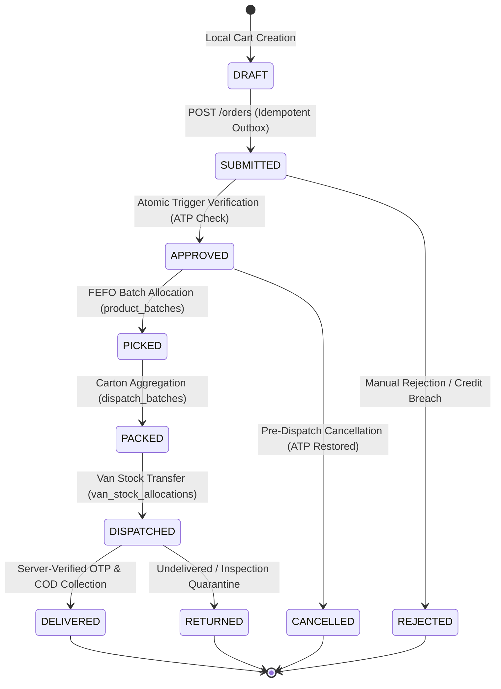
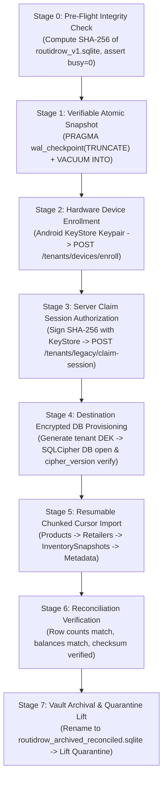

# RouteFlow Phase B2.2 — Implementation Readiness Review
## Organization-Partitioned Encrypted Persistence, Cloudflare D1 Reconciled Lifecycle & Zero-Trust Threat Model

**Document Version:** 1.0.0  
**Target Milestone:** Phase B2.2 Implementation Readiness Audit  
**Target Repository:** `D:\app`  
**Flutter Pilot Application:** `D:\app\flutter_distributor`  
**Cloudflare Backend:** `D:\app\backend`  
**Reference Architecture:** `routeflow_phase_b2_2_architecture_specification.md` (v1.2.7)  
**Evidence Standard:** Strict Codebase Source Inspection & Hardware Execution Baseline  
**Execution Boundary:** STRICTLY DOCUMENT-ONLY — IMPLEMENTATION NOT AUTHORIZED  

---

## Evidence Classification Legend

To maintain strict audit integrity and prevent confusing planned designs with existing code, all findings throughout this review are explicitly tagged with one of five evidence standards:

- `[VERIFIED FROM SOURCE INSPECTION]`: Verified by direct inspection of current source code, SQL migrations, Gradle configurations, or Drift table definitions in `D:\app`.
- `[REPORTED BY PREVIOUS ANTIGRAVITY TASKS]`: Established by test suite runs, APK builds, or device smoke tests executed during Phase B2.1.3 / B2.1.4.
- `[PROPOSED ARCHITECTURE]`: Specified in v1.2.7 architecture documentation; required for Phase B2.2 but not yet implemented.
- `[UNVERIFIED ASSUMPTIONS]`: Design claims or external vendor capabilities that lack empirical validation on physical target hardware.
- `[BLOCKING ISSUES]`: Known architectural vulnerabilities, unmerged migrations, or missing prerequisites that strictly block implementation authorization.

---

## 1. The Eight Canonical FMCG Roles

### 1.1 Identity Validity vs. Dashboard Implementation vs. Resource Scoping

A critical finding from source inspection is that **identity validity**, **dashboard support**, **capability permissions**, and **territory resource scoping** operate on different architectural layers:

`[VERIFIED FROM SOURCE INSPECTION]` In `backend/src/security.ts:36-89`, the Cloudflare Workers backend defines granular permissions for all **eight canonical roles**. An identity claim carrying any of these eight roles is a **valid server-authoritative identity**. It is an architectural error to classify a valid role (such as `OWNER` or `ACCOUNTANT`) as an "invalid identity" merely because the Flutter pilot client has not yet mounted a dedicated landing view for it.

The following matrix formally separates identity validity, client dashboard support, capabilities, and resource scoping:

| Canonical FMCG Role | Identity Validity (`security.ts`) | Flutter Client Dashboard Status (`role_shell.dart`) | Server Capabilities (`security.ts:36-89`) | Assignment & Resource Scoping | Tenant Ownership Level | Evidence Classification |
| :--- | :--- | :--- | :--- | :--- | :--- | :---: |
| **1. OWNER** | **Valid** (`OWNER`) | **Blocked Fail-Closed** ([`RoleBlockedView`](file:///d:/app/flutter_distributor/lib/screens/dashboards/role_blocked_view.dart)) | Full Super-Admin (`'*'`) | Entire Organization / Company | Statutory Tenant Owner | `[VERIFIED FROM SOURCE INSPECTION]` |
| **2. ADMIN** | **Valid** (`ADMIN`) | **Supported** ([`AdminDashboard`](file:///d:/app/flutter_distributor/lib/screens/dashboards/admin_dashboard.dart)) | Catalog, Order Approval, Dispatch, Retailers, Credit Overrides | Entire Organization / Company | Operational Administrator | `[VERIFIED FROM SOURCE INSPECTION]` |
| **3. SALES_MANAGER** | **Valid** (`SALES_MANAGER`) | **Blocked Fail-Closed** ([`RoleBlockedView`](file:///d:/app/flutter_distributor/lib/screens/dashboards/role_blocked_view.dart)) | Order Read/Approve/Reject, Route Plan/Publish, Team Read | Assigned Territory Beats (`manager_territory_beats`) | Tenant Member (Middle Mgmt) | `[VERIFIED FROM SOURCE INSPECTION]` |
| **4. ACCOUNTANT** | **Valid** (`ACCOUNTANT`) | **Blocked Fail-Closed** ([`RoleBlockedView`](file:///d:/app/flutter_distributor/lib/screens/dashboards/role_blocked_view.dart)) | Finance Read/Settle, Handover Ack, Collections, Credit Override | Organization Ledgers & Vouchers | Tenant Member (Financial Custody) | `[VERIFIED FROM SOURCE INSPECTION]` |
| **5. WAREHOUSE** | **Valid** (`WAREHOUSE`, `WAREHOUSE_MANAGER`) | **Supported** ([`WarehouseDashboard`](file:///d:/app/flutter_distributor/lib/screens/dashboards/warehouse_dashboard.dart)) | Inward, Stock Adjust, Pick, Pack, Dispatch, Van Load | Assigned Physical Godowns & Loading Bays | Tenant Member (Inventory Custody) | `[VERIFIED FROM SOURCE INSPECTION]` |
| **6. SALES** | **Valid** (`SALES`, `SALESPERSON`, `SALES_REP`) | **Supported** ([`SalesDashboard`](file:///d:/app/flutter_distributor/lib/screens/dashboards/sales_dashboard.dart)) | Order Create, Retailer Create, Beat Visit, Catalogue Read | Assigned Beat Kirana Stores (`rep_beat_assignments`) | Tenant Member (Field Sales) | `[VERIFIED FROM SOURCE INSPECTION]` |
| **7. DELIVERY** | **Valid** (`DELIVERY`, `DELIVERY_EXECUTIVE`, `DRIVER`) | **Supported** ([`DeliveryDashboard`](file:///d:/app/flutter_distributor/lib/screens/dashboards/delivery_dashboard.dart)) | Delivery Stops, Cash Collect, Van Stock View | Assigned Delivery Vehicle & Trip Stops | Tenant Member (Logistics Custody) | `[VERIFIED FROM SOURCE INSPECTION]` |
| **8. RETAILER** | **Valid** (`RETAILER`) | **Blocked Fail-Closed** ([`RoleBlockedView`](file:///d:/app/flutter_distributor/lib/screens/dashboards/role_blocked_view.dart)) | Self Order Create, Order History, Own Khata Balance Read | Strictly Own Retailer Shop (`resolveRetailerIdForUser`) | External Counterparty (Customer) | `[VERIFIED FROM SOURCE INSPECTION]` |

### 1.2 Analysis of Missing Roles in Legacy D1 Migration 0019
`[VERIFIED FROM SOURCE INSPECTION]` Inspection of `backend/migrations/0019_multi_tenant_organizations_and_catalog.sql:26` revealed a critical schema divergence:
```sql
-- backend/migrations/0019_multi_tenant_organizations_and_catalog.sql:26
CHECK (role IN ('OWNER', 'ADMIN', 'SALES', 'SALESPERSON', 'WAREHOUSE', 'WAREHOUSE_MANAGER', 'DELIVERY', 'DELIVERY_EXECUTIVE', 'RETAILER'))
```
`SALES_MANAGER` and `ACCOUNTANT` were implemented in application middleware (`security.ts`) but **omitted** from the SQL `CHECK` constraint of `organization_memberships`.
`[BLOCKING ISSUES]` Any attempt to assign a user to `SALES_MANAGER` or `ACCOUNTANT` via standard multi-tenant organization membership will fail at the database level with a SQLite constraint violation until an updated schema migration (`0024` or higher) expands this constraint.

---

## 2. Tenant Isolation and Local Persistence Architecture

### 2.1 Current State Analysis
1. **`TenantBoundaryGate`:**  
   `[VERIFIED FROM SOURCE INSPECTION]` [`TenantBoundaryGate`](file:///d:/app/flutter_distributor/lib/domain/auth/tenant_boundary_gate.dart#L24) evaluates the local SQLite database at `AuthService.login()` and `initialize()`. If the database contains unassigned legacy B1 records (where table rows lack a `company_id` column), it quarantines synchronization with `UNASSIGNED_LEGACY`.
2. **Session Generation Fencing:**  
   `[VERIFIED FROM SOURCE INSPECTION]` [`AuthService`](file:///d:/app/flutter_distributor/lib/services/auth_service.dart#L32) maintains `_sessionGeneration`. Every explicit logout, token expiration, refresh collision, or tenant switch increments this generation counter. All async callbacks capture their launch generation and discard late results if `capturedGen != _sessionGeneration`.
3. **Transient Memory State:**  
   `[VERIFIED FROM SOURCE INSPECTION]` [`ApiService`](file:///d:/app/flutter_distributor/lib/services/api_service.dart) holds in-memory lists for `_products`, `_retailers`, `_orders`, and `_deliveryStops`. When `AuthService.logout()` executes, `api.clearAllData()` purges in-memory state, preventing stale records from surviving in RAM.
4. **Drift Schema v2 Limitations:**  
   `[VERIFIED FROM SOURCE INSPECTION]` Drift Schema v2 in [`app_database.dart`](file:///d:/app/flutter_distributor/lib/data/local/app_database.dart) is single-tenant: tables (`Products`, `Retailers`, `InventorySnapshots`, `InventoryMovements`, `DatabaseMetadata`) possess no tenant scoping columns.
5. **Database File State:**  
   - `routidrow_v1.sqlite`: Preserved original B1 database. Holds 28 legacy records. Quarantined by `TenantBoundaryGate`.
   - `routidrow_clean.sqlite`: Temporary clean test database configured in `_openConnection()` during Phase B2.1.3 smoke testing.

### 2.2 Same-Tenant Restart vs. Cross-Tenant Fresh Login

`[PROPOSED ARCHITECTURE]` Phase B2.2 transitions from a single global SQLite file to **Physical Database Isolation per Tenant**:
```text
/data/user/0/com.routidrow.distributor/databases/
  ├── legacy_vault/
  │   └── routidrow_v1.sqlite              <-- READ-ONLY IMMUTABLE B1 VAULT
  └── tenants/
      ├── tenant_comp_rajasthan_01.sqlite  <-- SQLCipher Encrypted (Company A)
      └── tenant_comp_gujarat_02.sqlite    <-- SQLCipher Encrypted (Company B)
```

1. **Same-Tenant Restart Protocol:**
   - Client authenticates with Tenant A. Active organization ID is resolved as `comp_rajasthan_01`.
   - Storage manager locates `tenants/tenant_comp_rajasthan_01.sqlite`.
   - KeyStore unwraps DEK for Tenant A. Database is opened, verified via `PRAGMA cipher_version;`, and mounted.
   - `TenantBoundaryGate` verifies that the active database belongs exclusively to `comp_rajasthan_01`. Normal operations resume.
2. **Cross-Tenant Fresh Login Protocol:**
   - User signs out of Tenant A. Session generation increments ($N \to N+1$). RAM is wiped.
   - Connection to `tenant_comp_rajasthan_01.sqlite` executes `PRAGMA wal_checkpoint(TRUNCATE);` and closes cleanly.
   - User logs into Tenant B (`comp_gujarat_02`).
   - Storage manager mounts `tenants/tenant_comp_gujarat_02.sqlite` under fresh generation $N+1$.
   - **Zero Cross-Tenant Leakage:** Data from Tenant A is physically residing in a completely separate, differently keyed encrypted SQLite file.

### 2.3 Legacy Record Reconciliation without Data Deletion or Silent Reassignment
`[BLOCKING ISSUES]` A fundamental security violation in naive implementations is "silent reassignment" (running `UPDATE products SET company_id = active_company_id`). If an attacker logs into an unpartitioned device with a rogue organization account, silent reassignment would steal the legacy distributor's records.

`[PROPOSED ARCHITECTURE]` Phase B2.2 establishes legitimate ownership via **Cryptographically Authenticated Legacy Claim Sessions** (Specification v1.2.7 §6):
1. **Device Public Key Registration:** During initial corporate setup, the distributor `OWNER` enrolls their Android hardware KeyStore public key via `POST /tenants/devices/enroll`.
2. **Snapshot Checksum Challenge:** The client creates a consistent snapshot via `PRAGMA wal_checkpoint(TRUNCATE);` and `VACUUM INTO 'legacy_vault/snapshot.sqlite'`. It computes raw `SHA256(snapshot.sqlite)`.
3. **Owner Signature:** Client signs `SHA256(vault_sha256 || timestamp || nonce)` using the Android KeyStore private key and submits it to `POST /tenants/legacy/claim-session`.
4. **Server Validation:** Server verifies:
   - Claimant is verified `OWNER` of the target `company_id`.
   - Public key matches the enrolled hardware device.
   - `vault_sha256` has never been claimed by any company (`UNIQUE(vault_sha256)`).
5. **Import & Reconciliation:** Once authorized by edge server, records are read via read-only cursor from `snapshot.sqlite` and imported into `tenant_comp_rajasthan_01.sqlite`.
6. **Preservation:** `routidrow_v1.sqlite` is renamed to `routidrow_archived_reconciled.sqlite` and marked read-only on the device filesystem. It is **never deleted**.

---

## 3. Database and Encryption Architecture

### 3.1 Encryption-at-Rest vs. Token Storage Distinction
`[VERIFIED FROM SOURCE INSPECTION]` Currently, encryption in `flutter_distributor` is limited to [`FlutterSecureStorage`](file:///d:/app/flutter_distributor/lib/services/auth_service.dart#L18) (which uses Android KeyStore / SharedPreferences to protect auth tokens). **The local SQLite databases (`routidrow_v1.sqlite` and `routidrow_clean.sqlite`) are completely unencrypted plain SQLite files.**
`[BLOCKING ISSUES]` Opening either file in a standard hex editor exposes Kirana retailer phone numbers, outstanding debt, and order ledgers. Phase B2.2 must introduce full database-level encryption.

### 3.2 SQLCipher Integration Specification
`[PROPOSED ARCHITECTURE]` Required package baseline:
- `sqlcipher_flutter_libs: ^0.5.4`
- `sqlite3: ^2.4.0`
- `drift: ^2.35.3`

#### A. Dynamic Library Override Guarantee
To prevent Android from binding to the operating system's default `/system/lib64/libsqlite.so`, `main.dart` must execute dynamic override before any database access:
```dart
import 'dart:ffi';
import 'package:sqlite3/open.dart';

void configureSqlCipher() {
  open.overrideFor(OperatingSystem.android, () {
    return DynamicLibrary.open('libsqlcipher.so');
  });
}
```

#### B. Runtime Cipher Verification
Every connection open must assert SQLCipher identity immediately after applying encryption key:
```dart
final version = db.select('PRAGMA cipher_version;');
if (version.isEmpty || !version.first.values.first.toString().startsWith('4.')) {
  throw CryptographicEngineException('Plain SQLite detected. SQLCipher 4.x is required.');
}
```

#### C. Android Backup Restrictions
`[VERIFIED FROM SOURCE INSPECTION]` [`android/app/src/main/AndroidManifest.xml:12`](file:///d:/app/flutter_distributor/android/app/src/main/AndroidManifest.xml#L12) currently enforces `android:allowBackup="false"`. In Phase B2.2, this must be maintained alongside `android:dataExtractionRules` and `android:fullBackupContent` to prevent extraction via adb backup or cloud sync.

### 3.3 Key Rotation & Failure Recovery State Machine
`[PROPOSED ARCHITECTURE]` Executing `PRAGMA rekey` without crash recovery risks catastrophic data loss if the device loses power or is killed mid-rekey. RouteFlow specifies a **5-State Recoverable Key Rotation Machine**:
```text
┌────────────────────────────────────────────────────────────────────────┐
│                   5-STATE KEY ROTATION CRASH RECOVERY                  │
│                                                                        │
│   [STATE 0: IDLE] ──(Generate K2)──► [STATE 1: PENDING_ROTATION]       │
│                                                    │                   │
│                                             (Persist K2 in             │
│                                              Secure Storage)           │
│                                                    ▼                   │
│   [STATE 3: COMMITTED] ◄──(PRAGMA rekey)── [STATE 2: REKEYING]         │
│            │                                                           │
│     (Delete K1 from                                                    │
│      Secure Storage)                                                   │
│            ▼                                                           │
│   [STATE 0: IDLE (Active: K2)]                                         │
└────────────────────────────────────────────────────────────────────────┘
```
1. **Crash during State 1 (Pending):** Re-open with $K_1$; discard $K_2$.
2. **Crash during State 2 (Rekeying):** On reboot, test connection using `OpenMode.readWrite` (non-creating):
   - Try $K_2$: If successful, rekey finished before crash $\to$ advance to State 3.
   - Try $K_1$: If successful, rekey aborted before page 1 $\to$ re-execute `PRAGMA rekey` or rollback to $K_1$.
3. **Loss of KeyStore Key:** If hardware Keystore key is destroyed, client fails closed. Server-authorized disaster recovery requires multi-factor identity verification by Super-Admin.

---

## 4. Order and Inventory Lifecycle (Server-Authoritative Contract)

### 4.1 Ten-Stage Order & Inventory State Machine
`[PROPOSED ARCHITECTURE]` Specification v1.2.7 defines 10 atomic, server-authoritative lifecycle states:



### 4.2 Forensic Audit of Order Approval Trigger (Closing the Zero-Row Gap)
`[VERIFIED FROM SOURCE INSPECTION]` In `backend/src/index.ts:1013-1035`, order approval executes:
```typescript
const statements = [
  c.env.DB.prepare('UPDATE orders SET status = ?, updated_at = ? WHERE id = ?').bind('APPROVED', now, orderId),
  c.env.DB.prepare('INSERT INTO audit_logs ...').bind(...),
];
for (const [productId, required] of requiredMap.entries()) {
  statements.push(
    c.env.DB.prepare(
      'UPDATE products SET reserved_quantity = reserved_quantity + ? WHERE id = ? AND company_id = ? AND (stock_quantity - reserved_quantity) >= ?'
    ).bind(required, productId, user.company_id, required)
  );
}
await c.env.DB.batch(statements);
```

`[BLOCKING ISSUES]` **Critical Zero-Row Stock Reservation Vulnerability:**
1. In Cloudflare D1 (SQLite), an `UPDATE` that matches zero rows returns `{ meta: { changes: 0 } }`. **It does not raise an exception.**
2. `c.env.DB.batch()` only aborts when a statement encounters a SQL error.
3. If a product lacks stock, its conditional `UPDATE` silently affects 0 rows.
4. Meanwhile, Statement 1 (`UPDATE orders SET status = 'APPROVED'`) succeeds and commits!
5. **The order is marked `APPROVED` without reserving inventory, causing silent overselling.**

`[PROPOSED ARCHITECTURE]` To guarantee genuine atomicity, D1 Migration `0024_stock_reservation_guards.sql` must enforce database-level abort triggers:
```sql
-- D1 Migration: 0024_stock_reservation_guards.sql
CREATE TRIGGER IF NOT EXISTS trg_validate_order_approval_atomic
BEFORE UPDATE OF status ON orders
FOR EACH ROW
WHEN NEW.status = 'APPROVED' AND OLD.status = 'SUBMITTED'
BEGIN
    -- 1. Abort if any line item references missing, inactive, or wrong-company product
    SELECT RAISE(ABORT, 'ERR_INVALID_PRODUCT: Order line item references invalid or inactive product')
    WHERE EXISTS (
        SELECT 1 FROM order_items oi
        LEFT JOIN products p ON p.id = oi.product_id AND p.company_id = NEW.company_id
        WHERE oi.order_id = NEW.id
          AND (p.id IS NULL OR p.is_active = 0)
    );

    -- 2. Abort if available-to-promise stock is insufficient (aggregates duplicate lines via SUM)
    SELECT RAISE(ABORT, 'ERR_INSUFFICIENT_ATP: Available godown stock insufficient for order lines')
    WHERE EXISTS (
        SELECT oi.product_id
        FROM order_items oi
        JOIN products p ON p.id = oi.product_id AND p.company_id = NEW.company_id
        WHERE oi.order_id = NEW.id
        GROUP BY oi.product_id, p.stock_quantity, p.reserved_quantity
        HAVING (p.stock_quantity - p.reserved_quantity) < SUM(oi.quantity + oi.free_quantity)
    );
END;

CREATE TRIGGER IF NOT EXISTS trg_products_prevent_over_reservation
BEFORE UPDATE OF reserved_quantity ON products
FOR EACH ROW
WHEN NEW.reserved_quantity > NEW.stock_quantity
BEGIN
    SELECT RAISE(ABORT, 'ERR_INSUFFICIENT_STOCK: Reserved quantity exceeds physical stock');
END;
```

**Verification of the Atomic Invariant:**
- If any order line item lacks sufficient ATP stock, `trg_validate_order_approval_atomic` executes `RAISE(ABORT)`.
- SQLite aborts statement execution, throwing an exception back to D1.
- Cloudflare D1 rolls back the entire `batch()` transaction.
- The order status remains `SUBMITTED`, and zero inventory counts are altered.

---

## 5. Offline Sync, Outbox, and Idempotency Architecture

### 5.1 Outbox Schema and Client-Side Dispatch
`[PROPOSED ARCHITECTURE]` The client-side partitioned database must contain a durable `client_outbox_queue`:
```sql
CREATE TABLE client_outbox_queue (
    id TEXT PRIMARY KEY,
    company_id TEXT NOT NULL,
    idempotency_key TEXT NOT NULL,
    aggregate_type TEXT NOT NULL,
    aggregate_id TEXT NOT NULL,
    sequence_number INTEGER NOT NULL,
    endpoint TEXT NOT NULL,
    payload_json TEXT NOT NULL,
    payload_sha256 TEXT NOT NULL,
    status TEXT NOT NULL DEFAULT 'PENDING',
    attempt_count INTEGER NOT NULL DEFAULT 0,
    lease_token TEXT,
    lease_expires_at INTEGER,
    created_at INTEGER NOT NULL,
    UNIQUE(company_id, idempotency_key),
    UNIQUE(company_id, aggregate_type, aggregate_id, sequence_number)
);
```

### 5.2 Server-Side Idempotency Invariants (Migration 0027)
`[PROPOSED ARCHITECTURE]` On Cloudflare D1, table `server_idempotency_log` enforces:
1. **`PRIMARY KEY (company_id, idempotency_key)`:** Guarantees strict at-most-once execution across distributed isolates.
2. **Payload Hash Check:**
   - Same key + identical `payload_sha256`: Returns cached response (`response_code`, `response_body`).
   - Same key + altered `payload_sha256`: Rejects with `409 Conflict: Idempotency Key Payload Mismatch`.
3. **Monotonic Aggregate Sequencing:**
   - Evaluates `UNIQUE(company_id, aggregate_type, aggregate_id, sequence_number)`.
   - If incoming request arrives with `sequence_number != last_sequence + 1`, edge server rejects with `428 Precondition Required: Out of Sequence Mutation`. Prevents out-of-order execution during flaky connectivity.
4. **Lease Tokens (UUID):** Background sync workers claim a 30-second lease token. If worker stalls, lease expires. A delayed worker attempting to commit with an expired lease is rejected.
5. **Tenant Switch Fence:** If user switches organizations on device, sync worker's generation check terminates active outbox dispatch immediately.

---

## 6. Financial and Delivery Integrity

### 6.1 Server-Authoritative Delivery OTP Contract
`[REPORTED BY PREVIOUS ANTIGRAVITY TASKS]` In the current Flutter pilot, delivery OTP verification uses a locally generated demo timestamp string and previously contained a hardcoded bypass (`724185`). Both were audited and corrected to be explicitly demo-only.
`[PROPOSED ARCHITECTURE]` Production Phase B2.2 requires genuine **Server-Authoritative Cryptographic OTP**:

1. **OTP Issuance (Cloudflare Edge Worker):**
   - When order transitions to `DISPATCHED`, Cloudflare Worker generates a 6-digit numeric OTP via Web Crypto CSPRNG:
     ```typescript
     const buffer = new Uint32Array(1);
     crypto.getRandomValues(buffer);
     const otp = (100000 + (buffer[0] % 900000)).toString();
     ```
   - Server hashes OTP: `otp_hash = SHA256(otp + salt + order_id)`.
   - Stored in D1: `delivery_otp_vault` (`order_id`, `otp_hash`, `salt`, `expires_at`, `attempts_remaining`).
   - Plaintext OTP is sent via SMS gateway directly to the registered Kirana store phone number. **Plaintext OTP is never returned to the delivery driver's mobile app.**
2. **Driver Verification Protocol:**
   - Delivery driver collects cash, enters customer-provided OTP into app.
   - Driver app sends: `POST /delivery/orders/:id/verify-otp` with `{ entered_otp: "549210" }`.
   - Edge Worker fetches salt, hashes `entered_otp`, and compares in constant time (`crypto.subtle.timingSafeEqual`).
   - **Attempt Limits & Lockout:** 3 incorrect attempts decrement `attempts_remaining`. When 0, stop is locked for 30 minutes; requires Distributor Admin credit override.
   - **Replay Protection:** Once verified, `consumed_at = CURRENT_TIMESTAMP`. Re-submitting the same OTP returns cached success but **never re-triggers cash accounting**.

### 6.2 Balanced Double-Entry Cash Handover Ledger
`[PROPOSED ARCHITECTURE]` Cash collected by delivery drivers must be accounted for using immutable, balanced double-entry journals:

```text
EVENT 1: KIRANA DELIVERY CASH COLLECTION (At Customer Doorstep)
  DEBIT:  1050 Driver Cash in Custody (Driver: DRV_99, Stop: STP_04)   ₹4,500.00
  CREDIT: 1200 Retailer Accounts Receivable (Shop: RET_102)             ₹4,500.00
  Net Ledger Balance: ₹0.00

EVENT 2: END-OF-SHIFT DEPOT CASHIER HANDOVER (At Distributor Depot)
  DEBIT:  1010 Depot Cash Safe / Bank Clearing                         ₹4,500.00
  CREDIT: 1050 Driver Cash in Custody (Driver: DRV_99, Stop: STP_04)   ₹4,500.00
  Net Ledger Balance: ₹0.00
```
- **Driver Cash Custody Preservation:** In [`DeliveryHandoverView`](file:///d:/app/flutter_distributor/lib/screens/views/delivery_subviews.dart#L353-L425), handover cannot reset `driverCashCustodyPaise` locally.
- **Settlement Acknowledgement:** Handover is committed **only** when an authorized `ACCOUNTANT` or `ADMIN` signs off on the settlement voucher via `POST /finance/handover/acknowledge`.

---

## 7. Migration and Rollout Plan

### 7.1 Safe Staged Migration Protocol (Zero Data Loss)
`[PROPOSED ARCHITECTURE]` Staged transition from unpartitioned B1 data to Phase B2.2 partitioned persistence:



### 7.2 Stable Table Migration Mappings
`[VERIFIED FROM SOURCE INSPECTION]` Based on source Drift schema in `app_database.dart`:

1. **`Products` Table:**
   - Primary Key: `id` (Text). Stable Cursor: `WHERE id > :last_id ORDER BY id ASC LIMIT 50`.
   - Imported into: `distributor_private_products` in tenant database. Never creates fake SKUs in global catalog.
2. **`Retailers` Table:**
   - Primary Key: `id` (Text). Stable Cursor: `WHERE id > :last_id ORDER BY id ASC LIMIT 50`.
   - Imported into: `retailers` in tenant database. If assigned beat does not exist in master data, `beat_id = NULL` and flagged `NEEDS_RECONCILIATION = 1`.
3. **`InventorySnapshots` Table:**
   - Primary Key: `productId` (Text) — *Note: Does NOT have an `id` column!*
   - Stable Cursor: `WHERE productId > :last_productId ORDER BY productId ASC LIMIT 50`.
   - Converted to integer base pieces:
     $$Q_{\text{godown}} = (\text{godownCartons} \times \text{boxQty}) + \text{godownLoosePieces}$$
     $$Q_{\text{van}} = (\text{carCartons} \times \text{boxQty}) + \text{carLoosePieces}$$
   - Godown and vehicle stock balances remain strictly separated.
4. **`InventoryMovements` Table:**
   - Primary Key: `id` (Text). Stable Cursor: `WHERE id > :last_id ORDER BY id ASC LIMIT 50`.
   - Imported into `legacy_movement_audit_log` as immutable historical records. **Never re-applied against opening balances (prevents double-counting).**

---

## 8. Comprehensive Work Package Acceptance Matrix

| Work Package | Code Areas Involved | Preconditions | Threat Addressed | Automated Test Deliverables | Physical Device Test (Vivo 1935) | Rollback Strategy | Acceptance Criteria |
| :--- | :--- | :--- | :--- | :--- | :--- | :--- | :--- |
| **WP-01: D1 Migrations (0024–0027)** | `backend/migrations/` | Access to Cloudflare D1 staging database | T-01: Zero-row order approval over-reservation | `test/migrations_0024_0027.test.ts` | Staging wrangler migration dry-run | Rollback SQL down migrations | Triggers abort zero-row ATP updates; tables `device_enrollments`, `legacy_claim_sessions`, `server_idempotency_log` created. |
| **WP-02: Backend API Updates** | `backend/src/index.ts`, `backend/src/security.ts` | WP-01 deployed | T-01: Atomic approval failure handling; T-02: Rogue claims | `test/approval_atomic_batch.test.ts`, `test/claim_api.test.ts` | Multi-device concurrent approval tap race | Revert Worker script deployment via Cloudflare versioning | `c.env.DB.batch()` rolls back when trigger raises error; returns 409 on hash mismatch. |
| **WP-03: SQLCipher Cryptographic Core** | `flutter_distributor/pubspec.yaml`, `android/app/build.gradle.kts`, `lib/main.dart` | NDK & C++ build tools installed | Device theft data extraction | `test/sqlcipher_binding_test.dart` | Assert `PRAGMA cipher_version` on ARM64 Vivo 1935 | Revert pubspec.yaml and dynamic override | DB files encrypted; raw bytes 0-15 non-SQLite; `allowBackup=false` verified. |
| **WP-04: Tenant Storage Manager** | `lib/data/local/`, `lib/services/auth_service.dart` | WP-03 complete | T-04: Cross-tenant data leakage | `test/tenant_partition_lifecycle_test.dart` | Rapid Org A $\to$ Org B switch under UI fling | Revert to single-tenant clean DB | Separate `.sqlite` files per org; generation fencing discards delayed Org A callbacks. |
| **WP-05: Legacy Vault Migration Engine** | `lib/data/migration/`, `lib/domain/auth/tenant_boundary_gate.dart` | WP-02, WP-04 complete | Corrupted migration mid-flight | `test/vacuum_into_migration_test.dart` | Full migration of 28 B1 records on Vivo 1935 | Retain `routidrow_v1.sqlite` read-only | `VACUUM INTO` produces valid snapshot; row counts and stock balances match 100%. |
| **WP-06: Atomic Order & ATP Engine** | `lib/services/api_service.dart`, `lib/models/` | WP-01, WP-02 complete | T-01: Overselling | `test/atp_reservation_test.dart` | Concurrent booking on 0-stock product | Local cart retains failed items; no order created | Stock equation $P \equiv A + R$ holds; overbooking throws `StateError`. |
| **WP-07: Offline Outbox & Sequencing** | `lib/services/sync/`, `lib/data/local/` | WP-01, WP-04 complete | T-05: Stale worker commits | `test/outbox_monotonic_test.dart` | Airplane mode toggle during order sync | Outbox retries with exponential backoff | Monotonic sequence enforced; duplicate submission returns cached response. |
| **WP-08: Server OTP & Balanced Cash** | `lib/screens/views/delivery_subviews.dart`, `backend/src/delivery.ts` | WP-02 complete | Driver cash theft; fake delivery claims | `test/server_otp_settlement_test.dart` | Live OTP SMS delivery on test SIM | Stop remains locked if 3 wrong OTPs entered | Plaintext OTP not on driver app; cash handover disabled without accountant ack. |

---

## 9. Critical Blockers & Unresolved Architectural Decisions

1. **CRITICAL BLOCKER — Missing Cloudflare D1 Migrations (0024–0027):**  
   `[BLOCKING ISSUES]` The atomic approval trigger `trg_validate_order_approval_atomic`, device enrollment table, legacy claim session table, and idempotency table do not exist in `backend/migrations/`. Implementation of B2.2 cannot proceed until these D1 migrations are created and tested in staging.
2. **CRITICAL BLOCKER — Backend Role Constraint Divergence:**  
   `[BLOCKING ISSUES]` `organization_memberships` in migration `0019` does not permit `SALES_MANAGER` or `ACCOUNTANT`. Backend migrations must update this `CHECK` constraint before those roles can participate in tenant persistence.
3. **CRITICAL BLOCKER — Zero-Row Batch Vulnerability in Worker Handler:**  
   `[BLOCKING ISSUES]` The approval handler in `backend/src/index.ts:1013-1035` relies on post-batch checks that fail under concurrent execution. Must be refactored to catch trigger exceptions from D1 batch.
4. **UNRESOLVED DECISION — APK Binary Packaging & ABI Splitting:**  
   `[UNVERIFIED ASSUMPTIONS]` Adding `sqlcipher_flutter_libs` introduces compiled C/C++ native binaries (`libsqlcipher.so`) for `arm64-v8a`, `armeabi-v7a`, `x86_64`. This increases APK size by ~14 MB. Need architectural decision on whether to adopt Android App Bundles (AAB) or maintain fat universal APKs for pilot distribution.
5. **UNRESOLVED DECISION — Hardware Attestation Compatibility in Rural Pilot:**  
   `[UNVERIFIED ASSUMPTIONS]` `KeyInfo.isInsideSecureHardware()` requires a certified hardware Keystore (TEE or StrongBox). Low-end budget Android devices (sub-₹7,000) sometimes lack hardware-backed KeyStore. Need fallback policy for whether to allow software-backed KeyStore with an audit flag or enforce hardware attestation strictly.

---

## 10. Final Implementation Readiness Verdict

> [!CAUTION]
> ### FINAL VERDICT: NOT READY FOR IMPLEMENTATION
> 
> While the **client-side Flutter pilot baseline** is stable (106/106 automated tests passing, role routing fences operational, order preview invariants verified), Phase B2.2 is **NOT READY FOR IMPLEMENTATION** due to four unfulfilled external prerequisites:
> 
> 1. **D1 Migrations 0024–0027 have not been created or applied.**
> 2. **The Cloudflare Workers order approval handler in `backend/src/index.ts` remains vulnerable to zero-row overselling.**
> 3. **The `organization_memberships` schema constraint in D1 rejects `SALES_MANAGER` and `ACCOUNTANT`.**
> 4. **Native SQLCipher packaging and Android KeyStore hardware attestation have not been tested on the physical device.**
> 
> **MANDATORY NEXT STEP:**  
> Author and apply Tier 1 backend migrations (0024–0027) on a local/staging Cloudflare D1 environment and verify trigger abort behavior before any code in `flutter_distributor` is modified.  
> **Phase B2.2 source-code implementation remains STRICTLY UNAUTHORIZED.**
