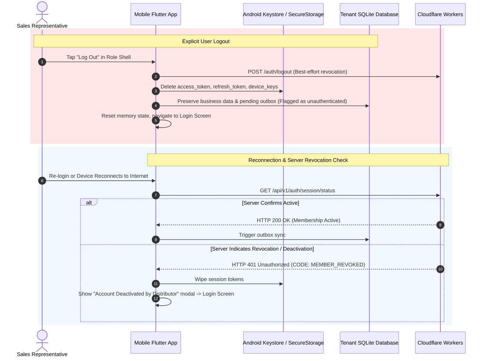

# RouteFlow — Persistent Session and Offline-First Architecture Specification

**Document Version:** 1.0.0  
**Phase:** Architecture Design & Operational Blueprint (Strict Documentation & Planning Only)  
**Execution Boundary:** Zero code modifications, zero schema changes, zero migrations applied, zero git commits or pushes.  
**Target Clients:** Flutter Android Pilot (`flutter_distributor`), Android Vivo 1935  
**Target Backend:** Cloudflare Workers (`routeflow-api`) + Cloudflare D1 (`routeflow-db`)  
**Storage Backing:** `flutter_secure_storage` (Android Keystore / EncryptedSharedPreferences) + Drift/SQLite  

---

## 1. Executive Overview & Core Invariants

RouteFlow is designed for wholesale FMCG and pharmaceutical distribution, where sales representatives, warehouse managers, and delivery drivers operate in wholesale markets, basements, and semi-rural delivery routes with intermittent, poor, or nonexistent cellular connectivity.

```
┌──────────────────────────────────────────────────────────────────────────────────┐
│                             CORE ARCHITECTURAL RULE                              │
│                                                                                  │
│   Network failure is a normal operating condition, NOT an error or logout event.  │
│   The mobile client executes operational workflows 100% locally from SQLite.     │
│   Cloudflare Workers + D1 remain the authoritative master ledger for financial    │
│   sequencing, inventory reservations, and identity verification.                 │
└──────────────────────────────────────────────────────────────────────────────────┘
```

---

## A. Persistent Login Architecture

### A.1 Session Persistence Across Lifecycle Events
Once an authenticated session is established, the user **must remain signed in** across:
1. **App Closure & Task Swiping:** Swiping the application from the Android recent tasks list kills the Flutter engine and host OS process; the persistent session must survive.
2. **Process Termination by OS:** Background memory eviction (e.g. Android LMK - Low Memory Killer) must not terminate the session.
3. **Device Reboots & Power Cycles:** Hardware power-off and restart must preserve session credentials.
4. **Temporary Internet Disconnection:** Cellular network drops, airplane mode, or zero-reception dead zones must **NEVER** trigger a logout.

### A.2 Automated Reopening to Last Active Organization & Role
Upon application launch (`main()` initialization):
- The app checks for a valid session token in `flutter_secure_storage`.
- If present, the app reads the cached `active_organization_id`, `active_role`, and `user_id`.
- The UI initializes directly into the designated role dashboard (e.g., `SalesView`, `LogisticsView`, `WarehouseView`, or `AdminView`).
- **No credential prompt or login screen is displayed.**

#### Eviction / Invalidation Conditions (When Login Screen IS Required):
1. The user explicitly presses **Logout** in the role shell.
2. Device cryptographic keys or Android Keystore aliases are invalidated or wiped.
3. The server actively rejects or revokes the session during online synchronization (e.g. `HTTP 401 Unauthorized` with `SESSION_REVOKED` or `MEMBER_DEACTIVATED`).
4. Session age exceeds the maximum 30-day refresh token window without online renewal.

### A.3 Secure Storage Boundaries (Zero Plaintext Tokens)
- **Strict Storage Segregation:**
  - `access_token`, `refresh_token`, and device private signing keys are stored **strictly in `flutter_secure_storage`** (backed by Android Keystore and `EncryptedSharedPreferences`).
  - Access tokens, refresh tokens, and passwords must **NEVER be written to SQLite, Drift, ordinary `SharedPreferences`, or console logs**.
- **Context Storage:**
  - `active_organization_id`, `active_role`, `user_id`, and `display_name` are stored as session context in secure storage and the tenant's local SQLite database metadata.
- **Online Revalidation:**
  - Whenever network connectivity is available, the mobile client verifies role permissions and organization membership asynchronously in the background (`GET /auth/me` or `/api/membership/verify`).
  - If permissions changed on the server (e.g. Sales rep reassigned to Warehouse), the client updates its local cached role and transitions UI smoothly without data loss.

### A.4 Network Timeout Isolation
- A network timeout (`SocketException`, `TimeoutException`, HTTP 502/504) indicates an unreachable server or flaky cell tower.
- **It is strictly prohibited to treat a network timeout as an authentication failure or session expiration.**
- The app enters **Offline Mode**, displays a non-intrusive offline status banner, and enables full local SQLite workflows.

---

## B. Offline-First Operation: Local Drift/SQLite Authority

```
[Mobile Device - Offline Field Operation]
┌────────────────────────────────────────────────────────┐
│  Flutter UI (Sales / Warehouse / Delivery Dashboards)   │
└──────────────────────────┬─────────────────────────────┘
                           │ Reads & Writes
                           ▼
┌────────────────────────────────────────────────────────┐
│  Drift Local Database (routeflow_tenant_${orgId}.sqlite)│
│  ├── Local Products Catalog (Cached with pricing)      │
│  ├── Local Retailers Ledger (Credit limits, balances)  │
│  ├── Local Daily Planned Routes & Beats                │
│  ├── Local Inventory Movements (Van Stock Snapshots)   │
│  └── Durable Local Outbox Table (Pending Mutations)    │
└────────────────────────────────────────────────────────┘
```

### B.1 Offline-Supported Operational Workflows
After the initial organization catalog is synchronized, the user can execute the following workflows without internet access:

1. **Product and Retailer Catalog Browsing:**
   - Full search, category filtering, Hindi product names, piece/strip/box unit calculations, and MRP displays.
2. **Sales Route & Visit Management:**
   - Visiting retailers on the assigned daily beat, tracking visit duration, and updating visit check-in counts.
3. **Order Draft Creation & Editing:**
   - Adding products to the order cart, configuring quantities, computing trade discounts, and calculating GST breakdowns locally.
4. **Pending Order Submission:**
   - Committing the order locally. The order is assigned a local provisional UUID, marked as `status = PROVISIONAL_PENDING`, and committed to the local database.
   - Outstanding retailer balance is updated provisionally in local memory/database.
5. **Collection Recording as Pending:**
   - Recording cash, cheque, or UPI reference collections. Marked locally as `PENDING_SYNC`.
6. **Warehouse & Logistics Checks:**
   - Reviewing godown stock snapshots and recording van stock allocations locally.

### B.2 Provisional Status Transparency
- Offline orders and collections are explicitly displayed with a distinct **"Pending Sync (Offline)"** badge.
- The UI never misleads the sales rep into believing an offline order has been confirmed by the distributor godown or that tax invoices have been generated.

---

## C. Durable Outbox & Synchronization Engine

### C.1 Drift Outbox Table Schema Extension (Proposed for Auth-2)
To guarantee that mutations are never lost across crashes, restarts, or battery death:

```dart
// Proposed Drift Outbox Schema
@DataClassName('OutboxEntry')
class OutboxMutations extends Table {
  TextColumn get id => text()();                          // Local UUID: 'out_' || uuid_v4()
  TextColumn get organizationId => text()();              // Tenant fence: ensures zero cross-org leaks
  TextColumn get idempotencyKey => text()();              // Stable UUID: prevents duplicate execution
  TextColumn get mutationType => text()();                // 'CREATE_ORDER', 'RECORD_COLLECTION', 'VAN_HANDOVER'
  TextColumn get payloadJson => text()();                 // Full serialized request payload
  IntColumn get sequenceOrder => integer()();             // Strictly increasing FIFO sequence counter
  TextColumn get syncStatus => text()();                  // 'PENDING', 'SYNCING', 'SYNCED', 'CONFLICT', 'FAILED'
  IntColumn get retryCount => integer().withDefault(const Constant(0))();
  TextColumn get lastError => text().nullable()();        // Last error message from Cloudflare Worker
  DateTimeColumn get createdAt => dateTime()();
  DateTimeColumn get syncedAt => dateTime().nullable()();

  @override
  Set<Column> get primaryKey => {id};
}
```

### C.2 Outbox Processing Rules
1. **FIFO Execution Order:**
   - Mutations depending on prior operations (e.g., `CREATE_ORDER` followed by `RECORD_COLLECTION` for that order) must be transmitted strictly in the order they were committed locally (`ORDER BY sequenceOrder ASC`).
2. **Stable Idempotency Keys:**
   - Every mutation is assigned a globally unique `idempotencyKey` (UUIDv4) upon creation.
   - If a network timeout drops the response after the Cloudflare Worker processed the write, the client retries with the **identical idempotency key**.
   - Cloudflare D1 recognizes the idempotency key, skips duplicate insertion, and returns the previous result safely.
3. **Zero Silent Discard:**
   - An outbox entry remains in `PENDING` or `FAILED` until the server explicitly acknowledges receipt.
   - Network timeouts increment `retryCount` with exponential backoff (2s, 4s, 8s, up to 60s max) but **NEVER discard the item**.
4. **Handling Expired Sessions Without Deleting Outbox:**
   - If the refresh token expires or session key is revoked while 5 orders are queued in the outbox:
     - **The outbox mutations are NOT deleted.**
     - The user is prompted to re-authenticate (via password or Google OAuth).
     - Once re-authenticated under the same user and organization, the sync engine resumes processing the queued outbox items.
5. **Conflict Resolution:**
   - If Cloudflare rejects an order due to a hard business violation (e.g. retailer credit stop placed by admin while sales rep was offline):
     - The outbox item enters `CONFLICT` status.
     - The sales rep and distributor admin receive a prominent conflict notification.
     - The sales rep can adjust the order or request an administrative override.

---

## D. Server Authority: Cloudflare Workers + D1 Boundaries

The phone operates as an autonomous operational node, but **Cloudflare Workers + D1 remain the sole authoritative master of record**:

```
┌─────────────────────────────────┬───────────────────────────────────────────────────────────────┐
│ System Area                     │ Master Authority & Governance Rules                           │
├─────────────────────────────────┼───────────────────────────────────────────────────────────────┤
│ Identity & Roles                │ Cloudflare D1 determines active memberships and permissions.  │
│ Stock Allocation & Reservation  │ Cloudflare D1 allocates stock across all competing vans.      │
│ Order Approval & Tax Invoicing  │ Cloudflare generates legal GST invoice numbers (HSN, CGST).   │
│ Effective Wholesale Pricing     │ Cloudflare enforces master distributor price lists.           │
│ Credit Limits & Overdue Stops   │ Cloudflare enforces organization-wide credit hard stops.      │
│ Delivery Finalization           │ Cloudflare records formal delivery OTP confirmation.          │
│ Cash & Financial Reconciliation │ Cloudflare reconciles ledger accounts against godown cash.    │
└─────────────────────────────────┴───────────────────────────────────────────────────────────────┘
```

> [!IMPORTANT]
> **No Offline Financial Finalization:**
> An offline sales rep cannot assign legal tax invoice numbers, approve credit overrides, or finalize godown stock deductions. The mobile client creates **provisional operational requests**; Cloudflare transforms them into **authoritative financial records**.

---

## E. Physical Multi-Tenant File Isolation

SQLite and Drift do not support native SQL row partitioning. Multi-tenancy on the mobile device is enforced through **physical database file separation**:

```
Android App Protected Directory (/data/user/0/com.routidrow.distributor.debug/app_flutter/)
├── b1_legacy_quarantine/
│   └── routidrow_clean.sqlite        <── Isolated historical B1 database (Read-only quarantine)
│
├── tenant_databases/
│   ├── routeflow_tenant_org_alpha.sqlite  <── Organization Alpha operational data & outbox
│   └── routeflow_tenant_org_beta.sqlite   <── Organization Beta operational data & outbox
│
└── shared_secure_storage/ (EncryptedSharedPreferences / Android Keystore)
    ├── active_organization_id: "org_alpha"
    ├── session_token_org_alpha: "..."
    └── session_token_org_beta: "..."
```

### E.1 Organization Switching Invariants
1. **Fencing Outstanding Writes:**
   - Switching from Organization Alpha to Organization Beta immediately closes the `routeflow_tenant_org_alpha.sqlite` Drift connection.
   - The active database connection switches to `routeflow_tenant_org_beta.sqlite`.
2. **Zero Cross-Tenant Leakage:**
   - Products, retailers, and prices from Organization Alpha cannot be queried or rendered when Organization Beta is active.
3. **Outbox Preservation:**
   - Any pending outbox orders belonging to Organization Alpha remain safely stored inside Alpha's SQLite file.
   - When the user switches back to Alpha (or when an authorized background worker runs), Alpha's outbox synchronizes to Alpha's Cloudflare backend.
4. **Server Authorization Check:**
   - Activating a different organization requires the Worker to verify that the user possesses an active membership for that tenant before issuing the tenant-scoped device token.

---

## F. Logout, Revocation & Reconnection Protocol



1. **Explicit Logout:**
   - Purges transient authentication tokens and private keys from secure storage.
   - Clears in-memory view models and reactive Drift streams.
   - Preserves offline outbox records in the local tenant database so work is not lost if the user re-authenticates.
2. **Reconnection & Server Revocation:**
   - When network connectivity resumes after an extended offline period, the client validates the session status before transmitting protected outbox transactions.
   - If the distributor owner revoked the employee's membership while they were offline, the client **fails closed immediately**, revokes local credentials, and blocks outbox submission.

---

## G. Physical Device Verification Plan (Vivo 1935 / Android 10)

Before offline-first production readiness can be certified, the following 9 integration scenarios must be executed and evidenced on the connected Vivo 1935 hardware (`4bc99b28`):

| Test # | Test Scenario | Execution Procedure | Expected Behavior & Pass Criteria |
| :---: | :--- | :--- | :--- |
| **G.1** | **Login as SALES** | Authenticate with sales credentials over active Wi-Fi. | Enrolls device key, caches session in secure storage, mounts `SalesView` dashboard with full catalog. |
| **G.2** | **App Closure & Reopen** | Swipe app from Android recent tasks list; relaunch app. | Launches directly into `SalesView` without showing login screen. Products and retailers visible. |
| **G.3** | **Device Restart** | Execute `adb reboot`; relaunch app upon boot. | Session credentials recovered from Keystore; launches directly into `SalesView`. Zero credential prompt. |
| **G.4** | **Offline App Launch** | Enable Airplane mode (`adb shell svc wifi disable; svc data disable`); launch app. | App opens seamlessly into `SalesView`. Displays non-intrusive "Offline Mode" indicator. Zero crashes. |
| **G.5** | **Offline Order Creation** | In Airplane mode, select Retailer, add 3 items to cart, and tap "Submit Order". | Order saved locally with provisional UUID; status marked `PROVISIONAL_PENDING`; outbox entry created. |
| **G.6** | **Network Recovery & Sync** | Re-enable Wi-Fi. Await background sync. | Outbox processor dispatches order with stable idempotency key; server confirms; status updates to `SYNCED`. |
| **G.7** | **Failed Sync Simulation** | Simulate 500/timeout error during sync. | Outbox entry retains `PENDING` with incremented `retryCount`; zero data loss; user notified of pending queue. |
| **G.8** | **Explicit Logout Protection** | Tap "Log Out" in role shell; confirm logout. | Session tokens deleted from Keystore; login screen mounted; attempting back-navigation blocked. |
| **G.9** | **Tenant Switching Isolation** | Login to Org Alpha, draft an order, switch to Org Beta. | Org Alpha database closed; Org Beta mounted with zero Org Alpha products or retailer leakage. Alpha outbox preserved. |

---

## 8. Governance Commitment

> [!IMPORTANT]
> **Strict Documentation Boundary:**
> This specification establishes architectural standards for Auth-2 through Auth-8. 
> - No application source code has been altered.
> - No database migrations have been executed.
> - No Cloudflare deployments or Git commits have been made.
> - All existing B1/B2.1 code, untracked test scripts, and local databases remain completely preserved.
