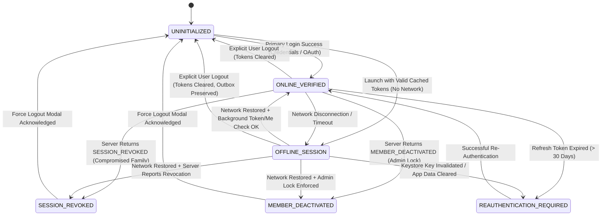
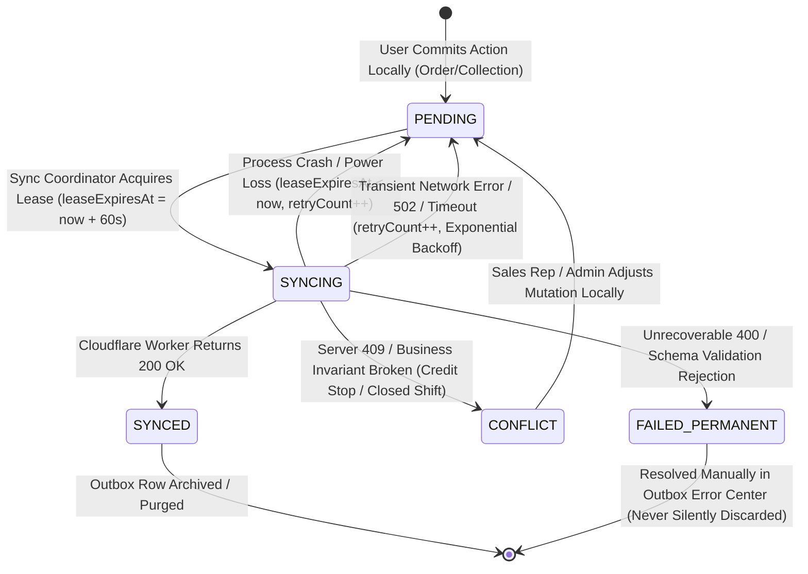

# RouteFlow — Persistent Session & Offline-First Specification (v1.1)

**Document Version:** 1.1.0  
**Phase:** Core Product & Architectural Specification (Strict Document-Only Review)  
**Execution Boundary:** Zero code modifications, zero schema changes, zero migrations applied, zero git commits or pushes.  
**Target Hardware:** Vivo 1935 (`4bc99b28`, Qualcomm Snapdragon 665, Android 10 / API 29, Keymaster 4.0 TEE)  
**Target Platform:** Flutter Pilot (`flutter_distributor`), Android Keystore, Drift/SQLite  
**Target Backend:** Cloudflare Workers API Gateway (`routeflow-api`) + Cloudflare D1 Database (`routeflow-db`)  
**Storage Architecture:** `flutter_secure_storage: ^11.2.0` (Hardware Keystore / EncryptedSharedPreferences) + Multi-Tenant SQLite Database Files  

---

## 1. Executive Summary & Architecture Changes from v1.0

Version 1.0 established baseline persistent login and offline-first guidelines. Version 1.1 resolves the critical operational and cryptographic gaps identified during security review:

| Area | Version 1.0 Baseline | Version 1.1 Refinement |
| :--- | :--- | :--- |
| **Logout & Outbox Data** | Ambiguous outbox preservation on logout | **Strict Tenant & User Partitioning:** Pending outbox records are bound to `(user_id, organization_id)`. Logout wipes session tokens but guarantees zero deletion of business records. Original user re-authentication securely resumes outbox submission under fresh device keys. |
| **Outbox Crash Safety** | Basic FIFO queue concept | **Lease-Based Crash Recovery:** Explicit `SYNCING` state with worker lease timeouts (60s). Stale in-flight records are automatically recovered upon process kill, reboot, or battery failure. Exponential backoff and poison-pill permanent failure isolation. |
| **Identity States** | Binary Online / Offline | **Five Explicit Identity States:** `ONLINE_VERIFIED`, `OFFLINE_SESSION`, `SESSION_REVOKED`, `MEMBER_DEACTIVATED`, and `REAUTHENTICATION_REQUIRED`. Cached roles permit local rendering only; zero server financial authority is claimed offline. |
| **Org Switching** | General file separation | **Transactional Boundary Switching:** Active sync aborts cleanly, connections close atomically, pending outboxes remain isolated in their respective tenant SQLite files, and cross-tenant leakage is physically impossible. |
| **Financial Boundaries** | General prohibition | **Authoritative State Mapping:** Explicit offline-to-online lifecycle matrix for order drafts, pending orders, stock reservations, delivery proofs, collections, and cash handovers. |
| **Device Lifecycle** | Basic restart persistence | **Nine Lifecycle Failure Permutations:** Defines exact system behavior for force-stop, LMK termination, reboot, airplane mode, token expiries, Keystore erasure, and app reinstall. |

---

## 2. State-Transition Diagrams

### 2.1 Identity and Session Authorization State Machine



### 2.2 Crash-Safe Outbox Mutation Lifecycle



---

## 3. Database and Outbox Requirements

### 3.1 Physical Multi-Tenant File Isolation
SQLite and Drift do not support native row-level security. Tenant containment is enforced via **physical file separation**:

```
Android App Directory: /data/user/0/com.routidrow.distributor.debug/app_flutter/
├── b1_legacy_quarantine/
│   └── routidrow_clean.sqlite        <── Isolated historical B1 database (Read-only quarantine)
│
├── tenant_databases/
│   ├── routeflow_tenant_org_alpha.sqlite  <── Organization Alpha operational data & outbox
│   └── routeflow_tenant_org_beta.sqlite   <── Organization Beta operational data & outbox
│
└── shared_secure_storage/ (Android Keystore / EncryptedSharedPreferences)
    ├── active_organization_id: "org_alpha"
    ├── session_token_org_alpha: "..."
    └── device_signing_key_alias: "rf_device_key"
```

### 3.2 Drift Outbox Table Specification (Auth-2 Schema)

```dart
@DataClassName('OutboxEntry')
class OutboxMutations extends Table {
  TextColumn get id => text()();                          // Local UUID: 'out_' || uuid_v4()
  TextColumn get organizationId => text()();              // Tenant Boundary Fence
  TextColumn get userId => text()();                      // Bound to Creator Identity
  TextColumn get idempotencyKey => text()();              // Stable UUID: Deduplication on Cloudflare
  TextColumn get mutationType => text()();                // 'CREATE_ORDER', 'RECORD_COLLECTION', 'CASH_HANDOVER'
  TextColumn get payloadJson => text()();                 // Canonical serialized JSON request payload
  IntColumn get sequenceOrder => integer()();             // Strictly increasing FIFO sequence counter
  TextColumn get syncStatus => text()();                  // 'PENDING', 'SYNCING', 'SYNCED', 'CONFLICT', 'FAILED_PERMANENT'
  IntColumn get retryCount => integer().withDefault(const Constant(0))();
  DateTimeColumn get leaseExpiresAt => dateTime().nullable()(); // Crash recovery lease timeout
  TextColumn get leaseOwner => text().nullable()();       // Unique instance identifier of sync worker
  TextColumn get lastError => text().nullable()();        // Error message / server response payload
  DateTimeColumn get createdAt => dateTime()();
  DateTimeColumn get syncedAt => dateTime().nullable()();

  @override
  Set<Column> get primaryKey => {id};
}
```

### 3.3 Outbox Execution Invariants
1. **FIFO Dependency Ordering:**
   - Dependent mutations (e.g. `CREATE_ORDER` followed by `RECORD_COLLECTION` for that order) must be executed strictly in order: `ORDER BY sequenceOrder ASC`.
   - If mutation $N$ fails with a retryable network error, dependent mutation $N+1$ is blocked from transmitting until $N$ succeeds.
2. **Worker Lease and Crash Recovery:**
   - Before dispatching an HTTP call, the sync engine sets:
     `syncStatus = 'SYNCING'`, `leaseExpiresAt = DateTime.now().add(Duration(seconds: 60))`.
   - If the app is killed by Android LMK, crashes, or suffers sudden power loss mid-flight:
     - Upon next launch, the sync coordinator queries:
       `WHERE syncStatus = 'SYNCING' AND leaseExpiresAt < :now`.
     - Stale records are reset to `PENDING` with `retryCount = retryCount + 1`.
3. **Exponential Backoff:**
   - Retry intervals follow: $T_{\text{wait}} = \min(2^{\text{retryCount}} \times 1\text{s} + \text{jitter}, 60\text{s})$.
4. **Permanent Failure Isolation:**
   - Hard validation errors (HTTP 400 Bad Request, malformed JSON) transition the record to `FAILED_PERMANENT`.
   - The item is flagged in the Outbox Error Center. **It is never silently deleted.**

---

## 4. Security & Governance Invariants

### 4.1 Logout & Outbox Recovery Policy (No Data Loss Guarantee)
When a sales representative logs out while unsynchronized mutations exist in the outbox:
1. **Zero Data Discard:** The local SQLite file (`routeflow_tenant_${orgId}.sqlite`) is closed cleanly. **Zero outbox rows are deleted.**
2. **Identity Fencing:** Outbox records remain explicitly stamped with `organizationId` and `userId`.
3. **No Cross-User Leakage:** If User B logs into the same physical phone, User B's session mounts User B's tenant database. User B cannot see, modify, or transmit User A's pending outbox records.
4. **Original-User Recovery:** When User A re-authenticates on the device:
   - A fresh device session is established.
   - The sync engine identifies pending records where `userId == active_user_id AND organizationId == active_org_id`.
   - The sync coordinator packages the pending mutations under the **new session's authenticated credentials and device key signatures**.
   - Pending operations are transmitted and committed to Cloudflare D1 without loss.
5. **Signing-Key Deletion Compatibility:**
   - Explicit logout wipes the session access/refresh tokens and deletes the session key alias.
   - Outbox records store the raw business intent (`payloadJson`). They do not store expired session signatures.
   - When User A logs in again, the newly enrolled hardware key signs the fresh refresh/sync challenge, seamlessly authorizing the queued outbox payload.

### 4.2 Offline Identity vs. Server Authority
- **Cached Role Permissions:** The mobile app caches the user's role (`SALES`, `WAREHOUSE`, `DELIVERY`, `ADMIN`) in secure storage and SQLite metadata. This permits the local Flutter shell to render the correct UI screens and calculate cart totals while offline.
- **Zero Server Claim:** Cached identity permits *local provisional operations only*. It **never** constitutes legal, financial, or tax authorization.
- **Revalidation on Reconnect:** Whenever network is available, the app verifies active membership (`GET /api/v1/auth/session/status`). If the distributor owner revoked the user or changed their role, the client enforces server revocation immediately.

### 4.3 Organization Switching Invariants
1. **Immediate Connection Fencing:** Switching from Org Alpha to Org Beta closes `routeflow_tenant_org_alpha.sqlite` and opens `routeflow_tenant_org_beta.sqlite`.
2. **Sync Cancellation:** Any active sync worker task for Org Alpha is immediately aborted. Stale leases expire cleanly.
3. **Zero Data Leakage:** Products, retailers, prices, and orders from Org Alpha cannot be queried or rendered in Org Beta.
4. **Server Authorization:** Activating Org Beta requires the Worker to verify that the user holds an active canonical role in Org Beta before issuing the tenant-scoped token.

---

## 5. Financial & Inventory State Boundaries

```
┌────────────────────────────────────────────────────────────────────────────────────────┐
│                              FINANCIAL INTEGRITY INVARIANT                             │
│                                                                                        │
│   The phone must never independently finalize shared financial or inventory state      │
│   while offline. Offline entries are provisional operational promises; Cloudflare D1   │
│   transforms them into immutable legal and financial ledger entries upon sync.         │
└────────────────────────────────────────────────────────────────────────────────────────┘
```

### 5.1 Offline vs. Online State Matrix

| Transaction Type | Offline State on Mobile Device | Authoritative Online State on Cloudflare D1 | Reconciliation & Sync Action |
| :--- | :--- | :--- | :--- |
| **Order Drafts** | Editable local cart in SQLite; local trade discount calculation. | Does not exist on server. | Committed when user taps Submit Order. |
| **Submitted Orders** | `status = PROVISIONAL_PENDING`; assigned local UUID (`ord_local_...`). | `status = CONFIRMED`; assigned legal GST invoice number (`INV-2026-00142`). | Cloudflare validates credit limit, assigns invoice sequence, and reserves stock. |
| **Inventory Stock** | Local van stock decrement (provisional balance for sales rep). | Godown master stock and van stock balance in D1 ledger. | Cloudflare verifies batch expiration and commits atomic decrement in `van_stock_deductions`. |
| **Delivery Proofs** | Local timestamp, recipient signature, and GPS coordinates stored in SQLite. | Formal `delivery_trips` marked `COMPLETED`; delivery ledger entry committed. | Cloudflare verifies OTP/signature, reconciles trip manifest, and releases COD collection. |
| **Collections (Cash/UPI)**| `status = PENDING_SYNC`; provisional reduction in retailer outstanding balance. | Official receipt issued; payment ledger entry committed in D1. | Cloudflare validates payment reference, credits retailer account, and updates distributor balance. |
| **Cash Handovers** | Provisional handover slip generated on phone. | Godown cashier / Admin signed reconciliation record in D1. | Cloudflare matches delivery rep handover against cashier physical cash count. |

---

## 6. Persistent Session and Device Lifecycle Matrix

The system reacts deterministically across all hardware, OS, and network lifecycle permutations:

| Lifecycle Event | Secure Storage State | Local Database State | UI Experience on Launch | Action Upon Network Restoration |
| :--- | :--- | :--- | :--- | :--- |
| **1. Force-Stop App** | Unchanged (Keystore intact) | Unchanged (SQLite intact) | Reopens directly into last active role dashboard. | Silent background sync of any pending outbox items. |
| **2. OS Process Death (LMK)** | Unchanged | Unchanged | Reopens directly into last active role dashboard. | Resets expired syncing leases; resumes outbox sync. |
| **3. Device Reboot** | Unchanged | Unchanged | Reopens directly into last active role dashboard. Zero credential prompt. | Sync coordinator starts; syncs pending outbox. |
| **4. Airplane Mode / Dead Zone** | Unchanged | Unchanged | Opens in **Offline Mode** with banner. Full catalog browsing and order entry enabled. | Detects connectivity; triggers single-flight sync. |
| **5. Access Token Expiry (15m)**| Expired access token; valid refresh token | Unchanged | User works uninterrupted. Next network call invokes background token refresh. | `TokenRefreshCoordinator` executes CCCR rotation transparently. |
| **6. Refresh Token Expiry (30d)**| Refresh token expired | Preserved (Outbox intact) | Shows "Session Expired — Please Re-Authenticate" dialog. Redirects to Login. | User logs in; pending outbox operations sync under new session. |
| **7. Keystore Key Invalidation** | Keystore keys erased by OS | Preserved | Fails signature check. Shows "Security Keys Reset" dialog. Redirects to Login. | Re-authentication enrolls new device key; outbox preserved. |
| **8. App Reinstall** | Sandbox wiped (Keys gone) | Database wiped | Clean first-time launch. Shows Login Screen. | Fresh initial sync after login. Historical data restored from D1. |
| **9. Clear App Data (Settings)**| Sandbox wiped | Database wiped | Clean first-time launch. Shows Login Screen. | Fresh initial sync after login. Historical data restored from D1. |

---

## 7. Expanded Vivo 1935 Physical Device Verification Matrix

To certify offline-first operational readiness, the following 10 empirical tests must be executed on the connected Vivo 1935 hardware (`4bc99b28`, Android 10 / API 29):

```
┌────────────────────────────────────────────────────────────────────────────────────────┐
│                              VIVO 1935 TEST HARNESS MATRIX                             │
└────────────────────────────────────────────────────────────────────────────────────────┘
```

### Test 1: Offline Logout with Pending Orders
- **Setup:** Log in as SALES on Vivo 1935 over Wi-Fi. Disable Wi-Fi.
- **Action:** Create 2 offline orders (assigned `ord_local_1`, `ord_local_2`). Tap "Log Out" in role shell. Confirm logout.
- **Expected DB State:** Secure storage tokens wiped. Outbox records in `routeflow_tenant_${orgId}.sqlite` remain intact with `syncStatus = 'PENDING'` and `userId = 'usr_sales_1'`.
- **Expected UI State:** Returns to Login Screen. Back-navigation blocked.

### Test 2: Reauthentication and Outbox Recovery
- **Setup:** Continuation of Test 1. Re-enable Wi-Fi.
- **Action:** Log in with same sales credentials (`usr_sales_1`).
- **Expected DB State:** New session and device key enrolled in Keystore. Sync coordinator detects 2 pending orders matching user/tenant. Transmits with stable idempotency keys. Outbox updates to `syncStatus = 'SYNCED'`.
- **Expected UI State:** Mounts `SalesView`. Orders display official server invoice numbers with green "Synced" badges.

### Test 3: Process Death During Active Sync
- **Setup:** Queue 5 offline orders. Re-enable network.
- **Action:** While sync is transmitting (simulate via `adb shell am kill com.routidrow.distributor.debug`), kill app process. Relaunch app.
- **Expected DB State:** In-flight record had `syncStatus = 'SYNCING'`. Upon restart, lease timeout detected (`leaseExpiresAt < now`). Record reset to `PENDING` with `retryCount = 1`.
- **Expected UI State:** App opens smoothly into `SalesView`. Sync coordinator resumes; all 5 orders sync with zero duplicates.

### Test 4: Device Reboot During Pending Sync
- **Setup:** Queue 3 offline collections. Leave phone offline.
- **Action:** Execute `adb reboot`. Wait for Android 10 boot to complete. Launch app.
- **Expected DB State:** All 3 collection outbox rows survive reboot in SQLite with `syncStatus = 'PENDING'`. Keystore credentials intact.
- **Expected UI State:** Directly mounts `SalesView` without asking for password.

### Test 5: Idempotent Duplicate Retry
- **Setup:** Mock server response timeout on order sync (server committed write, but TCP ACK dropped).
- **Action:** App retries sync with identical `idempotencyKey`.
- **Expected DB State:** Cloudflare D1 catches idempotency key collision, returns original invoice payload. Mobile outbox updates to `SYNCED`.
- **Expected UI State:** Order shows synced. Total distributor order count does NOT increment twice.

### Test 6: Partial Batch Failure Handling
- **Setup:** Queue 3 orders: Order 1 (valid), Order 2 (contains discontinued SKU rejected by server), Order 3 (valid).
- **Action:** Trigger sync.
- **Expected DB State:** Order 1 updates to `SYNCED`. Order 2 updates to `FAILED_PERMANENT` with server rejection error. Order 3 updates to `SYNCED`.
- **Expected UI State:** Orders 1 and 3 show green synced checkmarks. Order 2 shows red error pill with "Item Discontinued — Tap to Edit" in Outbox Error Center.

### Test 7: Organization Switch During Pending Sync
- **Setup:** User belongs to Org Alpha and Org Beta. Offline in Org Alpha with 2 pending orders.
- **Action:** Enable Wi-Fi. Immediately tap "Switch Organization" $\to$ Org Beta.
- **Expected DB State:** Active sync worker for Org Alpha cancelled. `routeflow_tenant_org_alpha.sqlite` closed. Org Beta database opened. Org Alpha outbox preserved safely on disk.
- **Expected UI State:** Org Beta mounts with zero Org Alpha products or orders. Switching back to Org Alpha resumes its pending sync cleanly.

### Test 8: Revoked Session Reconnect
- **Setup:** Sales rep takes orders offline. Admin revokes sales rep's access on Cloudflare D1 dashboard (`is_active = 0`).
- **Action:** Sales rep device reconnects to Wi-Fi.
- **Expected DB State:** Background session revalidation catches `MEMBER_DEACTIVATED`. Secure storage tokens wiped. Pending outbox preserved in SQLite with unauthenticated flag.
- **Expected UI State:** Shows modal: "Your access has been deactivated by the distributor administrator." Redirects to Login Screen.

### Test 9: Financial Collection Reconciliation
- **Setup:** In offline mode, record Rs 15,000 cash collection from Retailer A. Retailer balance locally reduces by Rs 15,000.
- **Action:** Connect to network and sync.
- **Expected DB State:** Cloudflare D1 receives payment record, generates legal receipt number, updates master retailer ledger, and credits van cash-in-hand ledger. Mobile record marked `SYNCED`.
- **Expected UI State:** Retailer ledger shows confirmed receipt number with server timestamp.

### Test 10: App Force-Stop & Reopen
- **Setup:** Sales rep logged in.
- **Action:** Execute `adb shell am force-stop com.routidrow.distributor.debug`. Relaunch app from launcher.
- **Expected DB State:** Unchanged.
- **Expected UI State:** Directly mounts `SalesView` without showing splash login.

---

## 8. Known Limitations

1. **Server-Side Hardware Attestation:** As established in Auth-1.6, the client utilizes local hardware Keystore keys (`keyInfo.isInsideSecureHardware == true`). Server-verifiable X.509 Google Hardware Attestation root chaining is not implemented in this phase.
2. **Real-Time Stock Depletion:** While offline, a sales rep cannot know if another sales rep on a different van sold the last carton of a shared SKU. RouteFlow mitigates this by allocating **van-specific stock limits** so reps only sell from their physically loaded van inventory.
3. **Credit Hard Stops:** If a distributor admin places a credit stop on a retailer while a sales rep is in a cellular dead zone, the rep may book an offline order. The system handles this gracefully upon sync: the order enters `CONFLICT` status and requires administrative override before godown dispatch.

---

## 9. Implementation Dependencies & Phasing Sequence

```
┌─────────────────────────────────────────────────────────────────────────────────┐
│                          IMPLEMENTATION ROADMAP (AUTH-2 TO AUTH-8)              │
├─────────────────────────────────────────────────────────────────────────────────┤
│ Phase Auth-2: Staging D1 Migration 0024 & Automated Backup Script               │
│ Phase Auth-3: Cloudflare Workers CCCR Challenge & Verification Engine           │
│ Phase Auth-4: Drift Multi-Tenant SQLite Database File Router                    │
│ Phase Auth-5: Drift Outbox Schema & Lease-Based Synchronization Service         │
│ Phase Auth-6: TokenRefreshCoordinator Single-Flight CCCR Integration            │
│ Phase Auth-7: Outbox Error Center & Conflict Resolution UI                      │
│ Phase Auth-8: Physical Device Execution & Verification on Vivo 1935             │
└─────────────────────────────────────────────────────────────────────────────────┘
```

---

## 10. Governance Commitment

> [!IMPORTANT]
> **Strict Non-Implementation Guarantee:**
> This document is an architectural blueprint.
> - No application source code in `backend/src/` or `flutter_distributor/` has been altered.
> - No database schemas have been migrated.
> - No remote Cloudflare staging or production operations have been performed.
> - Git working tree state is strictly preserved with zero commits or pushes.
