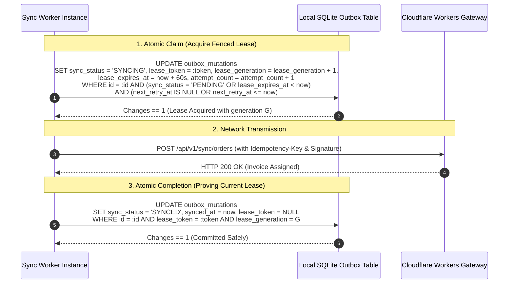

# RouteFlow — Persistent Session & Offline-First Specification (v1.2 Gap Closure)

**Document Version:** 1.2.0  
**Phase:** Core Product & Architectural Specification (Strict Document-Only Review)  
**Execution Boundary:** Zero code modifications, zero schema changes, zero migrations applied, zero git commits or pushes.  
**Target Hardware:** Vivo 1935 (`4bc99b28`, Qualcomm Snapdragon 665, Android 10 / API 29, Keymaster 4.0 TEE)  
**Target Platform:** Flutter Pilot (`flutter_distributor`), Android Keystore, Drift/SQLite  
**Target Backend:** Cloudflare Workers API Gateway (`routeflow-api`) + Cloudflare D1 Database (`routeflow-db`)  
**Storage Architecture:** `flutter_secure_storage: ^11.2.0` (Hardware Keystore / EncryptedSharedPreferences) + Multi-Tenant SQLite Database Files  

---

## 1. Local User Isolation & Logout Recovery Architecture

### 1.1 Android App Sandboxing vs. Per-User Local Authorization

> [!CAUTION]
> **Fundamental Security Boundary:**
> Android application sandboxing (Linux UID segregation) prevents *external* applications from accessing RouteFlow's app data directory. However, **app sandboxing provides ZERO protection against different users logging into the same application on a shared physical phone**. Columns such as `(user_id, organization_id)` in SQLite are logical filters; they do not constitute physical or cryptographic isolation at rest.

To prevent User B from reading, exporting, or submitting pending records left by User A:

```
Shared Physical Device (Vivo 1935)
│
├── App Container (Linux UID: u0_a142)
│   ├── flutter_secure_storage (Android Keystore MasterKey: MasterKeys.AES256_GCM_SPEC)
│   │   ├── Active User ID: "usr_alice"
│   │   ├── Active Tenant ID: "org_alpha"
│   │   └── Per-User Data Encryption Key: DEK_alice (Wrapped in Keystore)
│   │
│   └── Multi-Tenant SQLite Databases
│       ├── routeflow_tenant_org_alpha.sqlite
│       │   └── outbox_mutations (payload_encrypted BLOB encrypted under DEK_alice)
│       └── routeflow_tenant_org_beta.sqlite
```

1. **Physical File Separation per Tenant:**
   Each organization operates on its own dedicated SQLite file: `routeflow_tenant_${orgId}.sqlite`. Data from Organization Alpha is physically separated on the filesystem from Organization Beta.
2. **Application-Level Outbox Payload Encryption:**
   - Sensitive outbox transaction payloads (cash collections, retailer orders, customer contact info) are encrypted at the application level before being written to SQLite:
     $$\text{payload\_encrypted} = \text{AES-256-GCM}(\text{DEK}_{\text{user}}, \text{iv}, \text{payload\_json}, \text{aad})$$
   - $\text{DEK}_{\text{user}}$ is a 256-bit symmetric Data Encryption Key generated upon user login, stored exclusively in `flutter_secure_storage` under a key alias bound to `usr_${userId}`.
3. **Multi-User Isolation Enforcement on Shared Devices:**
   - When User A logs out, `flutter_secure_storage` purges the transient session tokens.
   - If User B logs into the application on the same physical phone, User B does **NOT** possess `DEK_alice`.
   - Even if User B belonged to the same organization and opened `routeflow_tenant_org_alpha.sqlite`, User B cannot decrypt User A's outbox payloads (`payload_encrypted` fails GCM authentication).
   - The Drift DAO strictly queries:
     ```sql
     SELECT * FROM outbox_mutations 
     WHERE organization_id = :active_org AND user_id = :active_user;
     ```
   - User B cannot view, export, or transmit User A's records.

### 1.2 Original User Reauthentication & Outbox Recovery
When User A re-authenticates with primary credentials (password or Google OAuth):
1. User A proves identity to Cloudflare Workers.
2. The client unseals User A's `DEK_alice` (or generates a fresh DEK and re-keys local data if a password reset occurred).
3. The sync engine identifies pending records where `user_id = 'usr_alice' AND organization_id = 'org_alpha'`.
4. The newly enrolled device hardware key signs the fresh sync challenge.
5. The pending outbox records are decrypted using `DEK_alice` and transmitted to Cloudflare Workers with zero data loss.

### 1.3 Device Lifecycle & Credential Erasure Failure Modes
- **Device-Key Invalidation:** (e.g. Android lockscreen disabled or biometric credentials wiped). The Android Keystore invalidates key aliases. The local SQLite database files remain on disk. The user must re-authenticate with primary credentials to generate a fresh device key and re-authorize outbox submission.
- **App Reinstall or App-Data Deletion:** The Android OS completely wipes `/data/user/0/com.routidrow.distributor.debug/`. **All local SQLite files and unsynchronized outbox records are permanently erased.** This is a physical constraint of mobile operating systems and is acknowledged as a residual risk.

---

## 2. Fenced Outbox Leases & Crash-Safe Queue Architecture

### 2.1 Proposed Drift Outbox Schema Extension

```dart
@DataClassName('OutboxEntry')
class OutboxMutations extends Table {
  TextColumn get id => text()();                          // Local UUID: 'out_' || uuid_v4()
  TextColumn get organizationId => text()();              // Tenant Boundary Fence
  TextColumn get userId => text()();                      // Bound to Creator Identity
  TextColumn get idempotencyKey => text()();              // Stable UUID: Deduplication on Cloudflare
  TextColumn get mutationType => text()();                // 'CREATE_ORDER', 'RECORD_COLLECTION', 'CASH_HANDOVER'
  TextColumn get payloadJson => text()();                 // Encrypted or plaintext canonical payload
  IntColumn get sequenceOrder => integer()();             // Strictly increasing FIFO sequence counter
  TextColumn get syncStatus => text()();                  // 'PENDING', 'SYNCING', 'SYNCED', 'CONFLICT', 'FAILED_PERMANENT'
  
  // Fenced Lease Extensions
  TextColumn get leaseToken => text().nullable()();       // UUIDv4 identifying current worker lease
  IntColumn get leaseGeneration => integer().withDefault(const Constant(0))(); // Monotonic fencing counter
  DateTimeColumn get leaseExpiresAt => dateTime().nullable()(); // Timestamp when lease becomes stale
  IntColumn get attemptCount => integer().withDefault(const Constant(0))();
  TextColumn get lastErrorCode => text().nullable()();    // HTTP status / server error code
  DateTimeColumn get nextRetryAt => dateTime().nullable()(); // Exponential backoff scheduling
  
  DateTimeColumn get createdAt => dateTime()();
  DateTimeColumn get syncedAt => dateTime().nullable()();

  @override
  Set<Column> get primaryKey => {id};
}
```

### 2.2 Atomic Outbox Operations



#### Lease Fencing Guarantees:
1. **Stale Worker Rejection:** If Worker 1 hangs for 65 seconds due to OS background throttling, Worker 2 claims the item (generation $G+1$). When Worker 1 wakes up and attempts to update SQLite, its query `WHERE lease_generation = G` matches **0 rows**. Worker 1 cannot overwrite Worker 2's state.
2. **Wall-Clock Skew Immunity:** In addition to timestamp expiration, the monotonically increasing integer `lease_generation` guarantees fencing even if the Android system clock jumps.
3. **Crash Recovery:** If the app is killed by Android LMK or loses power while `syncStatus = 'SYNCING'`, upon app restart, any row where `lease_expires_at < now` is reset to `PENDING` with an incremented `attemptCount`.
4. **Exponential Backoff:** If the server returns a transient 502/504 or network timeout, the worker updates:
   $$\text{next\_retry\_at} = \text{now} + \min(2^{\text{attemptCount}} \times 1\text{s} + \text{jitter}, 60\text{s})$$
5. **FIFO Ordering Protection:** Dependent operations on the same entity (e.g. `CREATE_ORDER` followed by `RECORD_COLLECTION`) follow `sequenceOrder ASC`. If mutation $N$ fails, mutation $N+1$ is blocked from claiming a lease until $N$ completes.

---

## 3. Server-Side Idempotency Architecture (Cloudflare D1)

### 3.1 D1 Idempotency Ledger Schema
Client-side UUID generation alone is insufficient for idempotency. The server must enforce scoped uniqueness and canonical payload comparison:

```sql
CREATE TABLE IF NOT EXISTS idempotency_records (
    organization_id TEXT NOT NULL,
    actor_id TEXT NOT NULL,
    idempotency_key TEXT NOT NULL,
    request_hash TEXT NOT NULL,         -- SHA-256 of canonical JSON payload
    status TEXT NOT NULL CHECK(status IN ('PROCESSING', 'COMMITTED')),
    response_status INTEGER,
    response_body TEXT,
    created_at INTEGER NOT NULL,
    expires_at INTEGER NOT NULL,        -- created_at + 86400000 (24 hours retention)
    PRIMARY KEY (organization_id, actor_id, idempotency_key),
    FOREIGN KEY (organization_id) REFERENCES organizations(id) ON DELETE CASCADE,
    FOREIGN KEY (actor_id) REFERENCES users(id) ON DELETE CASCADE
);
CREATE INDEX IF NOT EXISTS idx_idempotency_expires ON idempotency_records(expires_at);
```

### 3.2 Server Execution Logic & Replay Verification
When a request arrives at `POST /api/v1/sync/orders`:

```typescript
const requestHash = await sha256(canonicalizeJson(payload));

// 1. Atomic reservation
const insertResult = await db.prepare(`
  INSERT INTO idempotency_records (
    organization_id, actor_id, idempotency_key, request_hash, status, created_at, expires_at
  ) VALUES (
    :org_id, :actor_id, :idempotency_key, :request_hash, 'PROCESSING', :now, :now + 86400000
  ) ON CONFLICT(organization_id, actor_id, idempotency_key) DO NOTHING
`).bind({ ... }).run();

if (insertResult.meta.changes === 0) {
  // Key already exists -> Retrieve existing record
  const record = await db.prepare(`
    SELECT request_hash, status, response_status, response_body 
    FROM idempotency_records 
    WHERE organization_id = :org_id AND actor_id = :actor_id AND idempotency_key = :idempotency_key
  `).bind({ org_id, actor_id, idempotency_key }).first();

  if (record.request_hash !== requestHash) {
    // SAME KEY, DIFFERENT PAYLOAD -> HARD REJECTION
    return c.json({ 
      error: "Conflict: Idempotency key reused with differing request payload",
      code: "IDEMPOTENCY_KEY_COLLISION"
    }, 409);
  }

  if (record.status === 'COMMITTED') {
    // SAME KEY, SAME PAYLOAD, PREVIOUSLY COMMITTED -> REPLAY ORIGINAL RESPONSE
    return c.json(JSON.parse(record.response_body), record.response_status);
  }

  // STATUS == 'PROCESSING' -> Concurrent duplicate request
  return c.json({ error: "Duplicate request in flight; retry shortly", code: "CONCURRENT_REQUEST" }, 429);
}

// 2. First Execution -> Execute business logic inside D1 transaction
try {
  const resultPayload = await executeBusinessOrder(db, payload);

  // 3. Commit response atomically
  await db.prepare(`
    UPDATE idempotency_records 
    SET status = 'COMMITTED', response_status = 200, response_body = :body 
    WHERE organization_id = :org_id AND actor_id = :actor_id AND idempotency_key = :idempotency_key
  `).bind({ body: JSON.stringify(resultPayload), org_id, actor_id, idempotency_key }).run();

  return c.json(resultPayload, 200);
} catch (err) {
  // Roll back idempotency lock on application failure
  await db.prepare(`
    DELETE FROM idempotency_records 
    WHERE organization_id = :org_id AND actor_id = :actor_id AND idempotency_key = :idempotency_key
  `).bind({ org_id, actor_id, idempotency_key }).run();
  throw err;
}
```

---

## 4. Tenant-Switch Fencing & Request Generation Control

To prevent background sync tasks from leaking data between organizations:

```
[Flutter UI - Organization Switch Triggered]
1. User taps "Switch to Org Beta"
2. Increment Memory Counter: active_tenant_generation_id = active_tenant_generation_id + 1
3. Abort all in-flight HTTP requests for Org Alpha (Cancel Token)
4. Await active Drift SQLite write transactions to drain on routeflow_tenant_org_alpha.sqlite
5. Close routeflow_tenant_org_alpha.sqlite database connection
6. Mount routeflow_tenant_org_beta.sqlite connection
7. Transmit X-Tenant-Id: "org_beta" and X-Tenant-Generation: active_tenant_generation_id
```

### 4.1 Fencing Invariants
1. **Generation Stamping:** Every background sync worker task captures `tenant_generation_id` at inception. If a response returns after the user switched tenants, the response handler detects `response.generation != current_generation` and **discards the response immediately**.
2. **Local Transaction Drain:** The application database router awaits all open transactions before closing the SQLite file handle, preventing database corruption.
3. **Old-Tenant Outbox Isolation:** Pending outbox items belonging to Org Alpha remain dormant inside `routeflow_tenant_org_alpha.sqlite`. They are not visible to Org Beta.
4. **Server Authorization Enforcement:** The Cloudflare Worker validates:
   `jwt.active_organization_id === request.header('X-Tenant-Id')`.
   If a client attempts to submit data to Org Beta using an Org Alpha token, the Worker rejects the call with `HTTP 403 Forbidden`.

---

## 5. Comprehensive Identity-State Transition Table

| State Name | Entry Events | Exit Events | Allowed Local Actions | Allowed Server Requests | Sync Permissions | Credential Handling |
| :--- | :--- | :--- | :--- | :--- | :--- | :--- |
| **`ONLINE_VERIFIED`** | Primary login success; successful token refresh; verified `/auth/me` within 15m. | Network loss; access token expiry; server revocation signal. | Full operational UI; catalog browsing; order drafting; collection entry. | All authorized API endpoints (`/sync/*`, `/orders`, `/catalog`). | Outbox sync active; immediate push enabled. | Valid short-lived access token in RAM; refresh token in Keystore. |
| **`OFFLINE_SESSION`** | Network disconnection; socket timeout; 502/504 gateway timeout. | Network restored + token refresh / session check returns HTTP 200. | Full offline UI; local cart; order booking (`PROVISIONAL_PENDING`); collections (`PENDING_SYNC`). | Zero outbound requests permitted (short-circuited by network monitor). | Outbox sync paused; mutations queue in local SQLite outbox. | Cached role permits local Drift operations; credentials held safely; zero logout. |
| **`SESSION_REVOKED`** | Server returns `SESSION_REVOKED` (refresh token family reused / compromised). | Explicit acknowledgement of force-logout dialog by user. | **BLOCKED:** UI locks immediately; presents force-logout modal. | Zero protected requests allowed. | Outbox sync aborted; unsynced items locked in tenant SQLite. | Access tokens wiped from RAM; Keystore tokens deleted. Clean redirect to Login. |
| **`MEMBER_DEACTIVATED`**| Server returns `MEMBER_DEACTIVATED` (distributor admin revoked access). | User acknowledges deactivation notice. | **BLOCKED:** UI locks immediately; presents "Access Deactivated" dialog. | Zero protected requests allowed. | Outbox sync aborted; unsynced items locked in tenant SQLite. | Session tokens deleted from Keystore. Clean redirect to Login. |
| **`REAUTHENTICATION_REQUIRED`**| Refresh token exceeds 30-day max TTL; Keystore key erased; lockscreen removed. | Successful re-authentication via password or Google OAuth. | Read-only inspection of local history; outbox creation disabled. | Authentication endpoints only (`/auth/login`, `/auth/google`). | Outbox sync paused until identity re-verified. | Prompts user for credentials. Upon login, outbox resumes under fresh session. |

> [!IMPORTANT]
> **Network Invariant:** Network connection drops or server timeouts **NEVER** transition the system to `SESSION_REVOKED` or `MEMBER_DEACTIVATED`.

---

## 6. Financial & Operational Consistency Matrix

```
┌────────────────────────────────────────────────────────────────────────────────────────┐
│                              FINANCIAL INTEGRITY INVARIANT                             │
│                                                                                        │
│   Offline cash collections and orders must NEVER be represented as settled, credited,  │
│   or legal tax invoices until Cloudflare Workers + D1 explicitly acknowledge them.     │
└────────────────────────────────────────────────────────────────────────────────────────┘
```

| Operation | Local Provisional State | Required Mobile Evidence | Server Validation (D1) | Authoritative Final State | Conflict Handling | Duplicate Submission Behavior | Reconciliation & Audit |
| :--- | :--- | :--- | :--- | :--- | :--- | :--- | :--- |
| **Order Draft** | Cart in Drift SQLite memory. | SKU IDs, selected packaging units, quantities. | None (local to device). | None (exists only on device). | Re-checks local van stock before submission. | Overwrites local draft. | None. |
| **Pending Order** | `status = PROVISIONAL_PENDING`; provisional UUID. | Geolocation timestamp, retailer ID, item breakdown. | Validates retailer credit limit, item active status, distributor margin rules. | `status = CONFIRMED`; assigned legal GST invoice number. | If credit stop exceeded, enters `CONFLICT`; flagged for admin override. | Cloudflare catches idempotency key; returns existing invoice number. | Server emits `order_audit_events` with invoice sequence. |
| **Stock Reservation** | Provisional decrement in local van stock display. | Order line item allocation. | Verifies master van stock balance in D1 ledger. | `van_stock_deductions` committed atomically. | If van stock exhausted by concurrent order, rejected with `INVENTORY_DEFICIT`. | Skipped via idempotency ledger. | Immutable stock ledger movement record created. |
| **Delivery Proof** | Recipient signature, GPS lat/long, timestamp in SQLite. | Signature SVG/PNG path, delivery rep user ID. | Validates trip assignment, active shift status. | `delivery_trips` marked `COMPLETED`; delivery proof confirmed. | Delivery window expired: requires dispatcher override. | Idempotent ACK returned. | Audit record bound to order invoice. |
| **Cash Collection** | `status = PENDING_SYNC`; provisional reduction in Khata balance. | Amount in paise, payment mode (`CASH`), retailer receipt slip. | Validates shift active status, retailer association. | Official receipt issued; payment credited in `payment_ledger`. | Retailer account frozen: enters `CONFLICT`. | Returns original receipt number; ledger credited once only. | Binds collection to sales rep shift ledger. |
| **Cash Handover** | Provisional handover slip generated by sales rep. | Cashier ID, total cash sum, denomination breakdown. | Physical cashier / Admin confirms cash count in godown. | `cash_handovers` status `RECONCILED` with cashier signature. | Physical cash count discrepancy recorded as shortfall in ledger. | Rejected if handover already reconciled. | Permanent audit entry in distributor cash ledger. |

---

## 7. Deterministic Failure Testing Specification

The following 10 failure tests define exact conditions for verifying the crash-safe outbox and persistent session architecture:

```
┌────────────────────────────────────────────────────────────────────────────────────────┐
│                              DETERMINISTIC TEST SUITE                                  │
└────────────────────────────────────────────────────────────────────────────────────────┘
```

### Test 1: Two Workers Claiming the Same Outbox Item
- **Setup:** Outbox record in `PENDING` state.
- **Action:** Worker 1 and Worker 2 concurrently execute lease claim query.
- **Expected DB State:** SQLite serializes write. Worker 1 receives `changes == 1`, `lease_generation = 1`. Worker 2 receives `changes == 0`.
- **Expected UI State:** Exactly one transmission occurs; zero duplicate HTTP calls.

### Test 2: Stale Worker Completing After Lease Reclamation
- **Setup:** Worker 1 claims item (generation 1). Worker 1 is paused for 65s (simulating OS process freeze).
- **Action:** Lease expires. Worker 2 claims item (generation 2) and successfully syncs it. Worker 1 resumes and attempts completion.
- **Expected DB State:** Worker 1's `UPDATE ... WHERE lease_generation = 1` matches 0 rows. Worker 2's `SYNCED` state is preserved.
- **Expected UI State:** Item shows synced with green checkmark. Zero state corruption.

### Test 3: Lost Response After Server Commit
- **Setup:** Mobile sends order sync. Server commits order to D1 and assigns `INV-2026-0045`. Connection drops before HTTP response reaches phone.
- **Action:** Mobile timeout triggers retry with identical `idempotencyKey`.
- **Expected DB State:** Server detects idempotency key in `COMMITTED` status. Returns cached `INV-2026-0045` without re-executing order write.
- **Expected UI State:** Mobile updates outbox record to `SYNCED` with invoice `INV-2026-0045`. Total order count on server does not increment twice.

### Test 4: Same Idempotency Key with Changed Payload
- **Setup:** Mobile attempts to transmit Order B using the `idempotencyKey` previously committed for Order A.
- **Action:** Worker compares `request_hash`.
- **Expected DB State:** Hashes do not match. Server returns `HTTP 409 Conflict (IDEMPOTENCY_KEY_COLLISION)`.
- **Expected UI State:** Outbox item transitions to `FAILED_PERMANENT` with error description; surfaced in Outbox Error Center.

### Test 5: Two Users on One Device with Pending Outbox Records
- **Setup:** User A creates 2 offline orders in Org Alpha. User A logs out. User B logs in.
- **Action:** User B opens Sales Dashboard.
- **Expected DB State:** User B cannot read `routeflow_tenant_org_alpha.sqlite` outbox records. User A's payloads remain encrypted under `DEK_alice`.
- **Expected UI State:** User B sees clean dashboard with zero records from User A. User A's outbox remains safely queued on disk.

### Test 6: Device Key Invalidation Handling
- **Setup:** Sales rep offline with 3 pending orders. Device lockscreen is disabled in Android Settings (purging Keystore keys).
- **Action:** App launched. Sync attempted.
- **Expected DB State:** Secure storage read throws `KeystoreInaccessibleException`. Outbox in SQLite remains intact.
- **Expected UI State:** App displays "Security Environment Reset — Please Log In" dialog. After login with password, new key enrolled; outbox syncs.

### Test 7: Tenant Switch During In-Flight Response
- **Setup:** Sync in flight for Org Alpha.
- **Action:** User taps "Switch to Org Beta" before response returns.
- **Expected DB State:** `tenant_generation_id` incremented. Org Alpha database connection closed. Org Beta connection mounted. Org Alpha response arrives and is dropped by generation filter.
- **Expected UI State:** Org Beta mounts immediately. Zero Org Alpha data leaks into Org Beta UI.

### Test 8: Revoked Membership While Offline
- **Setup:** Sales rep books 5 orders offline. Distributor admin deactivates sales rep in Cloudflare D1.
- **Action:** Sales rep device reconnects to network.
- **Expected DB State:** Sync call returns `HTTP 401 (MEMBER_DEACTIVATED)`. Session tokens deleted from Keystore. Outbox items retained on disk with unauthenticated flag.
- **Expected UI State:** Screen locks with modal: "Your access has been deactivated by the distributor administrator." Redirects to Login Screen.

### Test 9: Partial Batch Success Handling
- **Setup:** Batch contains Order 1 (valid) and Order 2 (discontinued product).
- **Action:** Sync executed.
- **Expected DB State:** Order 1 reaches `SYNCED`. Order 2 rejected by server and moves to `FAILED_PERMANENT` with error message.
- **Expected UI State:** Order 1 shows green synced status. Order 2 displays red error pill in Outbox Error Center with option to replace product.

### Test 10: Process Death at Each Sync Stage
- **Setup:** Test kills process via `kill -9` at: (a) pre-transmission, (b) mid-transmission, (c) post-commit pre-local update.
- **Action:** App relaunched after each termination.
- **Expected DB State:** In all cases, SQLite WAL atomic transactions ensure outbox is never left in half-written state. Stale leases expire and reset cleanly.
- **Expected UI State:** App launches smoothly into `SalesView` and recovers sync queue.

---

## 8. Threat Model & Residual Risks

| Threat Scenario | Attacker Capability | Mitigation in Spec 1.2 | Residual Risk Assessment |
| :--- | :--- | :--- | :--- |
| **Shared Phone Data Snoop** | User B borrows phone after User A logs out. | Per-user SQLite query fencing; application-level outbox payload encryption under `DEK_user`. | **LOW:** User B cannot read or transmit User A's uncommitted payloads. |
| **Physical Flash Extraction** | Attacker dumps raw flash memory from unencrypted partition. | Android hardware file-based encryption (FBE); `flutter_secure_storage` backed by TEE/Keymaster. | **MINIMAL:** Protected by hardware SoC encryption (Qualcomm Snapdragon 665). |
| **Replay of Stolen Idempotency Key** | Attacker intercepts idempotency key from network proxy. | D1 scopes idempotency records to `(organization_id, actor_id, idempotency_key)` and checks `request_hash`. | **ZERO:** Replaying key returns existing response only to authenticated actor. |
| **Stale Lease Takeover Race** | Slow worker attempts to overwrite recovered worker. | Fenced `lease_generation` integer check on all outbox updates. | **ZERO:** Stale worker's update matches 0 rows. |
| **App Uninstall / Clear Data** | User or Android Settings clears app storage. | Local SQLite files and Keystore keys erased by Android OS. | **UNAVOIDABLE:** Unsynchronized offline data is permanently lost. Mitigated by prominent sync status warnings. |

---

## 9. Migration & Backward-Compatibility Implications

1. **Drift Schema Migration (v2 $\to$ v3):**
   - The current Drift schema is Version 2 (`flutter_distributor/lib/data/local/app_database.dart`).
   - Introducing `OutboxMutations` table requires a Drift migration to **Version 3**:
     ```dart
     onUpgrade: (Migrator m, int from, int to) async {
       if (from < 3) {
         await m.createTable(outboxMutations);
       }
     }
     ```
   - This migration is purely additive and does not modify existing `Products`, `Retailers`, or `InventorySnapshots` tables.
2. **B1 Quarantine Compatibility:**
   - The F-05 quarantine rule isolates historical B1 data in `routidrow_clean.sqlite`.
   - The multi-tenant outbox router operates strictly within modern tenant database files (`routeflow_tenant_${orgId}.sqlite`), preserving historical B1 data quarantine completely.

---

## 10. Implementation Dependencies & Phasing Sequence

```
┌─────────────────────────────────────────────────────────────────────────────────┐
│                          IMPLEMENTATION ROADMAP (AUTH-2 TO AUTH-8)              │
├─────────────────────────────────────────────────────────────────────────────────┤
│ Phase Auth-2: Staging D1 Migration 0024 & Automated Backup Script               │
│ Phase Auth-3: Cloudflare D1 Idempotency Ledger Schema (`idempotency_records`)   │
│ Phase Auth-4: Cloudflare Workers CCCR Challenge & Verification Route            │
│ Phase Auth-5: Drift Multi-Tenant SQLite Database File Router                    │
│ Phase Auth-6: Drift Schema v3 Additive Outbox Table & Fenced Lease Service      │
│ Phase Auth-7: Outbox Error Center & Tenant-Switch Generation Router             │
│ Phase Auth-8: Physical Device Execution of Deterministic Failure Suite on Vivo  │
└─────────────────────────────────────────────────────────────────────────────────┘
```

---

## 11. Exact Files Inspected & Git Status Verification

### 1.1 Inspected Files:
- `docs/routeflow_persistent_session_and_offline_first_spec_1_1.md`
- `flutter_distributor/lib/data/auth/secure_token_storage.dart`
- `flutter_distributor/lib/data/local/app_database.dart`
- `flutter_distributor/lib/domain/auth/tenant_boundary_gate.dart`
- `flutter_distributor/lib/services/api_service.dart`
- `backend/src/security.ts`
- `backend/migrations/0004_security_ledger_and_sessions.sql`
- `backend/wrangler.toml`

### 1.2 Git Status Audit:
```
On branch main (ahead of 'origin/main' by 2 commits)
Changes not staged for commit (Preserved untouched):
  flutter_distributor/android/app/build.gradle.kts
  flutter_distributor/lib/data/local/app_database.dart
  flutter_distributor/lib/screens/logistics_view.dart
  flutter_distributor/lib/screens/role_shell.dart
  flutter_distributor/lib/screens/sales_view.dart
  flutter_distributor/lib/services/api_service.dart
  flutter_distributor/test/order_preview_safety_test.dart

Untracked files:
  docs/routeflow_auth_0_read_only_audit.md
  docs/routeflow_auth_1_1_security_correction.md
  docs/routeflow_auth_1_2_final_security_proof.md
  docs/routeflow_auth_1_3_gap_closure.md
  docs/routeflow_auth_1_4_protocol_review.md
  docs/routeflow_auth_1_5_android_crypto_review.md
  docs/routeflow_auth_1_6_1_staging_preflight.md
  docs/routeflow_auth_1_6_final_security_closure.md
  docs/routeflow_auth_1_migration_proposal.md
  docs/routeflow_auth_v1_1_final_security_spec.md
  docs/routeflow_auth_v1_2_final_security_spec.md
  docs/routeflow_b2_2_implementation_readiness_review.md
  docs/routeflow_four_role_client_readiness_report.md
  docs/routeflow_persistent_session_and_offline_first_spec.md
  docs/routeflow_persistent_session_and_offline_first_spec_1_1.md
  docs/routeflow_persistent_session_and_offline_first_spec_1_2.md
  [...]
```

---

## 12. Final Governance Commitment

> [!IMPORTANT]
> **Strict Non-Implementation Guarantee:**
> This document is an architectural blueprint.
> - No application source code in `backend/src/` or `flutter_distributor/` has been modified.
> - No database migrations have been executed.
> - No remote Cloudflare staging or production operations have been performed.
> - Git working tree state is strictly preserved with zero commits or pushes.
