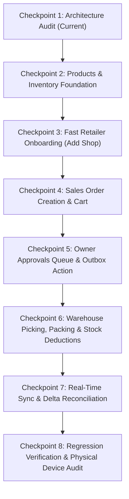

# RouteFlow — Phase 4 Comprehensive Audit & Architecture Blueprint
## Real-Time Distributor Operations Engine: Sales + Add Shop + Inventory

**Project:** RouteFlow / Routidrow  
**Phase:** Phase 4 — Real-Time Distributor Operations Engine  
**Frozen Baseline:** `e41de27` (Phase 3 Real Road Route Engine & Verified Acceptance Audit)  
**Target Branch:** `feature/sales-inventory-shop`  
**Reference Physical Hardware:** Vivo 1935 (Android 10, API 29, ID `4bc99b28`)  
**Audit Date:** November 13, 2026  
**Status:** AUDIT COMPLETE — PENDING CHECKPOINT IMPLEMENTATION PLAN APPROVAL

---

## 1. Executive Overview

This audit establishes the architectural foundation for Phase 4 of RouteFlow. The goal is to connect the three critical operational pillars of an Indian FMCG distribution business into one cohesive, synchronized system:

```
┌────────────────────────────────────────────────────────────────────────┐
│                        FMCG OPERATIONAL LIFECYCLE                      │
└────────────────────────────────────────────────────────────────────────┘
  [1. Sales Rep / Field]       [2. Owner / Admin]       [3. Warehouse / Depot]
   • Add / Search Retailer      • Approvals Inbox        • Picking Queue (FIFO)
   • Beat Route Navigation      • Credit Limits Check    • Mixed-Unit Picking
   • Multi-Unit Cart Booking    • Stock Reservation      • Carton Packing
   • Submit Order (Durable)  ─► • Approve / Reject   ─►  • Handover to Driver
                                       │                        │
                                       ▼                        ▼
                          [4. Authoritative Backend]  [5. Stock Deductions]
                           • Atomic D1 Transactions    • Auditable Movement Ledger
                           • Overselling Prevention    • Location Quantities
                           • Idempotent Outbox Sync    • Godown & Van Allocation
```

Phase 3 is strictly frozen at commit `e41de27`. All GIS navigation, road polyline calculations, GPS jitter suppression, and turn-by-turn platform channels remain 100% untouched.

---

## 2. Area 1: Sales Operations Audit

### 2.1 Existing Functionality (Working)
- **Sales Dashboard & Beat Route:** `SalesDashboard` provides interactive Google Maps with custom numbered pins, cluster badges, GPS blue dot, compact map controls, and floating `RouteInfoPanel`.
- **Shop Profile:** `ShopProfileScreen` displays shop name, owner, phone, area, classification (A, B, C, D, NEW), GPS coordinates, GSTIN, credit limit, and outstanding balance.
- **Order Taking Experience:** `SalesOrderBookingView` in `sales_subviews.dart` supports category filtering, search, multi-unit packaging tier selection (Piece, Strip, Box, Carton), and live cart quantity manipulation.
- **Cart & Pricing Math:** `CompoundCartMap` calculates wholesale price in paise, taxable base, GST (12% / 18%), and line totals.
- **Durable Order Submission:** `confirmOrderDurable` in `api_service.dart` validates positive quantities, checks against available stock, generates an idempotency key (`checkoutIdempotencyKey`), writes an atomic `CREATE_ORDER` record to Drift SQLite `outbox_mutations`, updates in-memory `_orders`, and notifies listeners.
- **Offline Outbox Queueing:** `SyncWorker` monitors `outbox_mutations`, acquires lease tokens, and serializes mutations to `POST /sync/push`.

### 2.2 Incomplete & Mocked Functionality
- **Order State Disconnect:** When `confirmOrderDurable` creates an order, its lifecycle stage is marked as `booking` (`effectiveWarehouseStage == waitingApproval`). When synced to the backend, backend marks it as `SUBMITTED`. However, when Owner approves the order, the status change is not pushed to backend or reconciled across multiple devices.
- **Credit Exposure Gate:** While `api_service.dart` checks `availableGodownPieces`, it evaluates credit limit in-memory rather than validating outstanding khata ledger against server rules before confirmation.
- **Duplicate Order Cart Submissions:** If a sales rep taps "Place Order" repeatedly under slow network conditions, the in-memory cart relies on `isSubmitting` flag in `sales_subviews.dart`. If the modal sheet is dismissed and reopened, a new idempotency key is generated unless explicitly passed.

### 2.3 Reusable Components
- `SalesOrderBookingView` in `flutter/lib/screens/views/sales_subviews.dart`.
- `CompoundCartMap` & `CartItem` in `flutter/lib/models/models.dart`.
- `confirmOrderDurable` in `flutter/lib/services/api_service.dart`.
- `OutboxDao.insertOrderMutationAtomic` in `flutter/lib/data/local/daos/outbox_dao.dart`.

---

## 3. Area 2: Shop Onboarding Audit (Add Shop)

### 3.1 Existing Functionality (Working)
- **Add Shop Sheet:** `AddShopSheet` in `flutter/lib/screens/views/add_shop_sheet.dart` provides full modal UI with required fields: Shop Name, Owner Name, 10-Digit Mobile Phone, Address, Area.
- **Duplicate Detection Engine:** `api.checkDuplicateRetailer` performs client-side fuzzy matching:
  - Exact match on sanitized 10-digit phone number.
  - Case-insensitive name similarity in same delivery area.
  - GSTIN match.
  - Coordinate proximity check ($\le 50\text{ m}$).
- **GPS Coordinates & Location Capture:** Supports both live `Geolocator.getCurrentPosition` and visual pin dropping via `MapPinPickerDialog`.
- **Durable Persistence:** `createRetailerDurable` generates a provisional ID (`ret_{epoch}_{hex}`), writes an atomic `CREATE_RETAILER` outbox mutation, saves to Drift SQLite `retailers` table, and appends to the selected route.
- **Backend Retailer Sync:** `backend/src/sync.ts` accepts `CREATE_RETAILER`, validates tenant boundary, checks user role, maps provisional ID to permanent ID, and commits to Cloudflare D1.

### 3.2 Incomplete & Gaps
- **Server-Side Duplicate Validation:** If two salespeople add the same phone number offline, the backend `CREATE_RETAILER` handler in `backend/src/sync.ts` does not reject duplicate phone numbers atomically at the database constraint level.
- **Provisional ID Promotion:** When the server returns permanent retailer IDs in the push response, `SyncWorker` must atomically update the local database so future orders refer to the canonical server ID.
- **Add Shop Navigation Hook:** In `SalesDashboard`, tapping `+ Add Shop` launches `AddShopSheet`. On success, the map updates markers, but needs an explicit trigger to recalculate the road route if the shop was inserted in the active beat.

---

## 4. Area 3: Inventory Foundation & Warehouse Queue Audit

### 4.1 Existing Functionality (Working)
- **Product Packaging Multi-Tier System:** `ProductPackagingUnit` and `UnitPrices` in SQLite and D1 support arbitrary tiers (Piece, Strip, Box, Carton) with base multipliers and wholesale pricing.
- **Warehouse Dashboard:** `WarehouseDashboard` provides a 4-tab operational cockpit:
  1. *Operations Cockpit:* KPI cards for orders to pick, packed ready, low stock, and expiring batches.
  2. *Godown Stock:* `WarehouseStockView` listing SKUs, batch numbers, cartons, loose pieces, and reorder levels.
  3. *Pick & Pack:* `WarehousePickingView` locking unapproved orders (`waitingApproval`) and surfacing approved orders (`approvedToPick`).
  4. *Handover to Driver:* `WarehouseLoadingView` recording delivery truck allocation and driver handover.
- **Stock Movement Ledger:** `InventoryMovements` in SQLite and `stock_movements` in D1 record every inward, adjustment, damage, and dispatch with `productId`, `movementType`, `cartonDelta`, `loosePieceDelta`, `reason`, and `timestamp`.
- **Overselling Protection:** Backend migration `0026_overselling_protection_trigger.sql` enforces `trg_products_prevent_overselling`:
  $$\text{reserved\_quantity} \le \text{stock\_quantity}$$
  Any concurrent reservation exceeding available stock is aborted at the SQLite/D1 engine level.

### 4.2 Critical Gaps Identified
- **No Order Approval UI in Admin Dashboard:** While `api.approveOrderByOwner(orderId)` exists in code, `AdminOrdersView` in `admin_subviews.dart` renders orders as read-only cards without **Approve** or **Reject** action buttons! The owner currently has no interactive button to release orders into the warehouse queue.
- **Approval Sync Outbox Mutation:** `api.approveOrderByOwner` only mutates in-memory state (`_orders[idx].isOwnerApproved = true`). It does not persist to local SQLite or dispatch `POST /orders/:id/approve` or an outbox mutation to the backend.
- **Picking and Packing Sync:** `completePickingOrder` and `completePackingOrder` in `api_service.dart` record damaged items locally, but do not synchronize the order's transition to `PACKED` / `DISPATCHED` with the backend server.
- **Physical vs Reserved Stock in SQLite:** `InventorySnapshots` table tracks `godownCartons` and `carCartons`, but does not have a `reservedCartons` / `reservedLoosePieces` column. Local stock calculation only checks physical stock, not reserved stock.

---

## 5. Area 4: Backend & Synchronization Audit

### 5.1 Existing Endpoints in Cloudflare D1 Backend (`backend/src/`)
- `POST /auth/login`, `POST /auth/refresh`, `POST /auth/switch-organization`
- `GET /products`, `POST /products`, `GET /products/:id`
- `GET /retailers`, `POST /retailers`, `PUT /retailers/:id`
- `POST /orders` (Full order creation with server-side price/tax recalculation and idempotency)
- `GET /orders`, `GET /orders/pending`, `GET /orders/:id`
- `POST /orders/:id/approve` (Owner approval with atomic stock reservation)
- `POST /orders/:id/reject` (Owner rejection with automatic reservation release)
- `POST /warehouse/orders/:id/start-picking`
- `POST /warehouse/orders/:id/scan-pick`
- `POST /warehouse/orders/:id/mark-packed`
- `POST /orders/:id/dispatch` (Deducts physical stock and clears reservation)
- `POST /sync/push` (Processes batch outbox mutations: `CREATE_RETAILER`, `CREATE_ORDER`, `RECEIVE_GRN`, `STOCK_INWARD`, `STOCK_ADJUSTMENT`)
- `POST /sync/pull` (Delta synchronization for products, retailers, units, and order status updates)

### 5.2 Synchronization Gaps
1. **Pull Delta Completeness:** `POST /sync/pull` returns `orderStatusUpdates` (`serverOrderId`, `newStage`, `total_amount_paise`), but does not return new orders created by other users on other devices. When the Owner logs into their device, orders created by sales reps are only loaded if `GET /orders` is fetched or full order payloads are included in pull delta.
2. **Missing Outbox Mutations for Approvals & Picking:**
   - `APPROVE_ORDER` mutation type is missing in `backend/src/sync.ts`.
   - `REJECT_ORDER` mutation type is missing in `backend/src/sync.ts`.
   - `PACK_ORDER` / `DISPATCH_ORDER` mutation types are missing in `backend/src/sync.ts`.
   Currently, these operations only exist as direct REST calls in `backend/src/index.ts`, but are not hooked into the offline outbox pipeline.

---

## 6. Data Integrity & Concurrency Risks

| Risk | Description | Mitigation Strategy |
| :--- | :--- | :--- |
| **Race Condition on Last Stock Unit** | Two salespeople submit orders for the same 5 remaining cartons simultaneously. | Server-side atomic reservation in D1 transaction: `(stock_quantity - reserved_quantity) >= required` with database trigger `trg_products_prevent_overselling`. The second order fails with `INSUFFICIENT_STOCK`. |
| **Duplicate Order Submission** | Rep double-taps "Place Order" or network drops during submission. | Unique idempotency key (`idempotency_key`) enforced in SQLite outbox and backend `idempotency_records` table. Replays return original order without double reservation. |
| **Silent Stock Overwrite** | Adjusting stock balance directly overwrites current quantity without an audit trail. | Forbid direct updates to balance columns. Require all adjustments to pass through `InventoryMovements` / `stock_movements` ledger with movement type, reason, and actor ID. |
| **Stale Server Overwrite of Local Edits** | `SyncWorker.processPullDelta` receives old server snapshot while a local outbox mutation is pending. | Verified in `sync_worker.dart:284-295`: Pending outbox IDs are gathered into `pendingShopIds` and `pendingProductIds`, explicitly bypassing server delta overwrites. |
| **Client-Side Price Tampering** | Modified APK alters wholesale price or GST rate in cart payload. | Backend `sync.ts` and `index.ts` independently recalculate price, GST, and totals from server master tables, rejecting mismatches. |

---

## 7. Phased Implementation Plan (Checkpoints 1–8)

To avoid regressions and preserve the Phase 3 frozen routing baseline (`e41de27`), Phase 4 must be executed in 8 disciplined checkpoints:



### Checkpoint 1 — Architecture Audit & Invariant Baseline (This Document)
- Complete comprehensive audit of Sales, Shops, Inventory, Backend, and Sync.
- Freeze Phase 3 code and establish regression baseline (40/40 tests).

### Checkpoint 2 — Products & Inventory Foundation (Module A)
- Expose reserved stock and available stock calculations in Drift SQLite (`InventorySnapshots.reservedPieces`).
- Support configurable stock locations: Main Godown, Sales Van, Damaged Quarantine.
- Implement auditable stock movements (`INWARD`, `ADJUSTMENT`, `DAMAGE`, `RESERVATION`, `DISPATCH`).
- Enforce FEFO (First Expiry, First Out) batch tracking for picking suggestions.

### Checkpoint 3 — Add Shop & Fast Onboarding (Module B)
- Streamline `AddShopSheet` for sub-60-second kirana onboarding (Shop Name, Owner Name, Phone, Area, GPS Pin).
- Verify duplicate phone & GSTIN warnings without blocking valid submissions.
- Ensure newly added shop immediately updates `SalesDashboard` markers and route stops without requiring an app restart.

### Checkpoint 4 — Sales Order Creation & Validation (Module C)
- Connect `SalesOrderBookingView` directly to selected shop profile from Today beat route.
- Enforce server-authoritative pricing (paise arithmetic, zero client-invented prices).
- Prevent ordering quantities exceeding `availableGodownPieces`.
- Persist order via `confirmOrderDurable` into atomic SQLite outbox.

### Checkpoint 5 — Owner Approvals Inbox (Module D)
- Upgrade `AdminDashboard` and `AdminOrdersView` to include a prominent **Owner Approvals Inbox** for pending orders.
- Provide interactive **Approve** (with credit/stock check) and **Reject** (with reason) buttons.
- Wire `approveOrderByOwner` and `rejectOrderByOwner` to create durable outbox mutations (`APPROVE_ORDER`, `REJECT_ORDER`) and sync with backend D1.

### Checkpoint 6 — Warehouse Picking, Packing & Stock Deductions (Module E)
- Lock unapproved orders in `WarehousePickingView` until approved by Owner.
- On approval, order moves to `approvedToPick`; stock is reserved.
- Implement pick verification: staff scans/confirms quantities and records damages.
- On packing completion (`packedReady`), move order to `readyStock`.
- On vehicle handover (`WarehouseLoadingView`), record driver handover, transition order to `dispatched` / `orderSend`, and deduct physical stock from godown.

### Checkpoint 7 — Real-Time Synchronization & Cross-Role Visibility (Module F)
- Expand `POST /sync/push` and `SyncWorker` to handle `APPROVE_ORDER`, `REJECT_ORDER`, and `DISPATCH_ORDER`.
- Ensure `POST /sync/pull` delivers full pending orders to Owner and Warehouse devices.
- Verify status transitions propagate cleanly: Rep Books $\rightarrow$ Owner Approves $\rightarrow$ Warehouse Picks/Packs $\rightarrow$ Driver Delivers.

### Checkpoint 8 — Regression Verification & Physical Device Testing (Vivo 1935)
- Run all 40 Phase 0–3 tests to ensure zero regressions.
- Add comprehensive Phase 4 tests for Add Shop, Order Booking, Owner Approval, Warehouse Picking, and Concurrency.
- Verify live on Vivo 1935: Salesperson adds shop, places order, switches to Owner to approve, switches to Warehouse to pick and pack, and verifies inventory balances.

---

## 8. Definition of Done for Phase 4

Phase 4 will be accepted only when the complete vertical slice succeeds on real hardware:
1. **Salesperson:** Adds a new Kirana shop $\rightarrow$ Shop appears on beat route $\rightarrow$ Salesperson books order for 2 boxes + 5 pieces.
2. **Persistence:** Order and shop persist in SQLite and sync via outbox to Cloudflare D1.
3. **Owner:** Owner sees the order in Approvals Inbox $\rightarrow$ Approves order $\rightarrow$ Available stock drops by reservation; physical stock remains until dispatch.
4. **Warehouse:** Warehouse staff opens Pick & Pack $\rightarrow$ Order unlocked in `approvedToPick` $\rightarrow$ Picks items $\rightarrow$ Packs cartons $\rightarrow$ Hands over to delivery vehicle.
5. **Auditable Inventory:** Physical stock decrements; reservation clears; movement logged in ledger.
6. **Zero Regressions:** Phase 3 GPS navigation, road geometry, map controls, and 40 automated tests remain 100% green.
