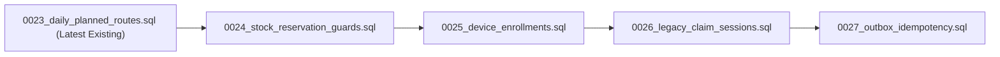
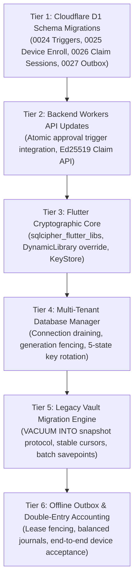

# RouteFlow Phase B2.2 — Production Architecture & Migration Specification
## Organization-Partitioned Encrypted Persistence, Tenant Database Lifecycle & Cloudflare D1 Legacy Reconciliation

**Document Version:** v1.2.7 (Final Technical Consistency Review & System Baseline Alignment)  
**Authoritative Baseline:** `routeflow_production_architecture_v1.3.2.md`  
**Prerequisite Milestones:** Phase B2.1 (Auth), B2.1.1 (Containment Gate), B2.1.2 (Hardening Accepted)  
**Target Platform:** Flutter Pilot (`flutter_distributor`), Android 10+ (API 29+, ARM64 / Qualcomm QTEE)  
**Backend Architecture:** Cloudflare Workers (Edge V8 Isolate) + Hono v4 + Cloudflare D1 (Serverless SQLite) + Web Crypto (`crypto.subtle`)  
**Execution Status:** STRICT ARCHITECTURE SPECIFICATION — Implementation Blocked Until Formal User Sign-Off  

---

## 1. Executive Summary & Document Control

Phase B2.1.2 established a hardened, fail-closed authentication and containment baseline. However, the operational persistence layer remains bound to single-tenant Drift Schema v2 (`routidrow_v1.sqlite`). When pre-existing Phase B1 records exist on a device, `TenantBoundaryGate` correctly quarantines local access as `UNASSIGNED_LEGACY` to prevent cross-tenant data leakage. Consequently:
1. Multi-distributor organization switching (`Org A → Org B`) is safely blocked.
2. Legitimate same-organization restarts on devices holding unpartitioned B1 data remain quarantined until storage architecture migration.

Phase B2.2 resolves this structural limitation by transitioning from a single global SQLite database to **Physical Database Partitioning per Organization** backed by **SQLCipher AES-256-CBC encryption** and hardware-backed key management, tightly integrated with RouteFlow's existing Cloudflare Workers + D1 backend (Migrations `0001` through `0023`).

### Document Scope & Absolute Restrictions
- **Execution Mode:** STRICTLY DOCUMENT-ONLY.
- **Source Code Status:** Zero modifications to Flutter source code, Kotlin native code, Cloudflare Workers backend code, or database schemas.
- **Repository Integrity:** Existing modified and untracked files in `D:\app` are preserved untouched.
- **Implementation Authorization:** Strictly UNAUTHORIZED until explicit user sign-off.

---

## 2. Complete Existing D1 Schema Inventory (Migrations 0001 – 0023)

To guarantee that Phase B2.2 does not introduce conflicting or redundant tables, every relevant table, column, key, index, trigger, and tenant ownership rule in the backend codebase was inspected read-only:

| Table Name | Defined in Migration | Primary Key & Foreign Keys | Key Columns & Constraints | Tenant Scoping Column | Evidence Classification |
| :--- | :--- | :--- | :--- | :--- | :---: |
| **`companies`** | `0001_initial.sql:2` | PK: `id` | `name`, `created_at` | Primary Tenant Table | `EXISTING — SOURCE VERIFIED` |
| **`organizations`** | `0019_multi_tenant.sql:5` | PK: `id` | `name`, `legal_name`, `gstin`, `fssai_license`, `state_code`, `currency`, `is_active` | Primary Org Entity | `EXISTING — SOURCE VERIFIED` |
| **`organization_memberships`** | `0019_multi_tenant.sql:20` | PK: `id`<br>FK: `organization_id`, `user_id` | `role` (CHECK: OWNER, ADMIN, SALES, SALESPERSON, WAREHOUSE, WAREHOUSE_MANAGER, DELIVERY, DELIVERY_EXECUTIVE, RETAILER), `is_active` | `organization_id` | `EXISTING — SOURCE VERIFIED` |
| **`users`** | `0001_initial.sql:9` | PK: `id`<br>FK: `company_id` | `username` (UNIQUE), `password_hash`, `full_name`, `role`, `is_active` | `company_id` | `EXISTING — SOURCE VERIFIED` |
| **`retailers`** | `0001_initial.sql:35` | PK: `id`<br>FK: `company_id` | `name`, `beat_id`, `address`, `contact_number`, `credit_limit_paise`, `outstanding_amount_paise` | `company_id` | `EXISTING — SOURCE VERIFIED` |
| **`catalog_brands`** | `0019_multi_tenant.sql:35` | PK: `id` | `name` (UNIQUE), `manufacturer`, `logo_url`, `is_active` | Global Platform | `EXISTING — SOURCE VERIFIED` |
| **`catalog_products`** | `0019_multi_tenant.sql:46` | PK: `id`<br>FK: `brand_id` | `name`, `category`, `hsn_code`, `barcode` (UNIQUE), `base_unit` | Global Platform | `EXISTING — SOURCE VERIFIED` |
| **`tenant_catalog_mappings`** | `0019_multi_tenant.sql:64` | PK: `id`<br>FK: `company_id`, `catalog_product_id` | `custom_sku`, `wholesale_rate_paise`, `mrp_paise`, `purchase_price_paise`, `gst_rate`, `min_order_qty`, `is_active` | `company_id` | `EXISTING — SOURCE VERIFIED` |
| **`products`** | `0001_initial.sql:50` & `0018_warehouse.sql:11` | PK: `id`<br>FK: `company_id` | `name`, `category`, `price_paise`, `stock_quantity`, `reserved_quantity`, `unit`, `barcode`, `product_image_key` | `company_id` | `EXISTING — SOURCE VERIFIED` |
| **`product_batches`** | `0014_batches.sql:9` & `0018_warehouse.sql:16` | PK: `id`<br>FK: `company_id`, `product_id`, `received_by` | `batch_no`, `mfg_date`, `expiry_date`, `rack_bin`, `received_quantity`, `remaining_quantity`, `committed_quantity`, `status` | `company_id` | `EXISTING — SOURCE VERIFIED` |
| **`orders`** | `0001_initial.sql:64` & `0018_warehouse.sql:21` | PK: `id`<br>FK: `company_id`, `retailer_id`, `employee_id` | `status`, `total_amount_paise`, `cartons_count`, `dispatch_batch_id`, `idempotency_key` | `company_id` | `EXISTING — SOURCE VERIFIED` |
| **`order_items`** | `0001_initial.sql:80` | PK: `id`<br>FK: `order_id`, `product_id` | `quantity`, `free_quantity`, `price_paise_at_time`, `is_picked` | Scoped via `orders` | `EXISTING — SOURCE VERIFIED` |
| **`stock_movements`** | `0018_warehouse.sql:62` | PK: `id`<br>FK: `company_id`, `product_id`, `created_by` | `batch_id`, `movement_type`, `quantity`, `stock_before`, `stock_after`, `reason` | `company_id` | `EXISTING — SOURCE VERIFIED` |
| **`van_stock_allocations`** | `0019_multi_tenant.sql:83` | PK: `id`<br>FK: `company_id`, `trip_id`, `product_id`, `batch_id` | `allocated_qty`, `delivered_qty`, `returned_qty`, `damaged_qty`, `status` | `company_id` | `EXISTING — SOURCE VERIFIED` |
| **`dispatch_batches`** | `0018_warehouse.sql:28` | PK: `id`<br>FK: `company_id`, `delivery_executive_id`, `created_by` | `batch_code`, `status`, `total_orders`, `total_cartons`, `handed_over_at`, `received_by_driver_at` | `company_id` | `EXISTING — SOURCE VERIFIED` |
| **`dispatch_batch_orders`** | `0018_warehouse.sql:50` | PK: `(dispatch_batch_id, order_id)`<br>FK: `dispatch_batch_id`, `order_id` | `cartons_count` | Scoped via `dispatch_batches` | `EXISTING — SOURCE VERIFIED` |
| **`warehouse_return_inspections`** | `0018_warehouse.sql:83` | PK: `id`<br>FK: `company_id`, `product_id`, `inspected_by` | `return_id`, `order_id`, `retailer_id`, `quantity`, `condition`, `action_taken` | `company_id` | `EXISTING — SOURCE VERIFIED` |
| **`delivery_trips`** | `0015_trips.sql` | PK: `id`<br>FK: `company_id`, `driver_id` | `trip_number`, `status`, `started_at`, `ended_at` | `company_id` | `EXISTING — SOURCE VERIFIED` |
| **`audit_logs`** | `0001_initial.sql:93` | PK: `id`<br>FK: `company_id`, `user_id` | `action`, `entity_id`, `details`, `timestamp` | `company_id` | `EXISTING — SOURCE VERIFIED` |

---

## 3. The Eight Canonical Roles & Legacy Aliases

RouteFlow strictly enforces **eight canonical FMCG roles**. Legacy backend aliases are mapped deterministically in application middleware and RBAC guards:

```text
┌────────────────────────────────────────────────────────────────────────────────────────┐
│                        CANONICAL ROLES VS. LEGACY DATABASE ALIASES                     │
│                                                                                        │
│   Canonical FMCG Role                Legacy Database Alias (0001 / 0019)               │
│   ───────────────────                ───────────────────────────────────               │
│   1. OWNER                           OWNER                                             │
│   2. ADMIN                           ADMIN                                             │
│   3. SALES_MANAGER                   (Missing in 0019 CHECK constraint; in security.ts)│
│   4. ACCOUNTANT                      (Missing in 0019 CHECK constraint; in security.ts)│
│   5. WAREHOUSE                       WAREHOUSE_MANAGER                                 │
│   6. SALES                           SALESPERSON                                       │
│   7. DELIVERY                        DELIVERY_EXECUTIVE                                │
│   8. RETAILER                        RETAILER                                          │
└────────────────────────────────────────────────────────────────────────────────────────┘
```

### 3.1 Role Capabilities & Resource Scoping Matrix

| Canonical Role | Legacy Aliases | Allowed Capabilities (`backend/src/security.ts:36-85`) | Assignment & Territory Scoping | Forbidden Operations |
| :--- | :--- | :--- | :--- | :--- |
| **1. OWNER** | `OWNER` | All capabilities (`'*'`). Full operational, administrative, and financial control. | Entire organization / tenant. | Unilateral local database deletion without edge server sign-off. |
| **2. ADMIN** | `ADMIN` | Catalog management, route publishing, operational depot management, order approval, credit overrides. | Entire organization / tenant. | Altering finalized financial ledgers or historical immutable audit logs. |
| **3. SALES_MANAGER** | None | `order:read`, `order:approve`, `order:reject`, `retailer:read`, `route:plan`, `route:publish`, `team:read`. | Scoped to assigned sales beats in `manager_territory_beats`. | Inwarding physical warehouse stock; creating tax invoices. |
| **4. ACCOUNTANT** | None | `finance:read`, `finance:collect`, `finance:settle`, `finance:handover_ack`, `collections:review`, `retailer:credit_override`. | Organization financial ledgers, cash desks, and settlement vouchers. | Adjusting physical godown inventory counts; editing product catalog pricing. |
| **5. WAREHOUSE** | `WAREHOUSE_MANAGER` | `inventory:read`, `inventory:inward`, `inventory:adjust`, `order:pick`, `order:pack`, `order:dispatch`, `van_stock:load`. | Godown physical batches, dispatch batches, and return inspections. | Modifying retailer credit limits; placing customer sales orders. |
| **6. SALES** | `SALESPERSON` | `catalog:read`, `order:create`, `retailer:read`, `retailer:create`, `van_sales:create`. | Strictly scoped to assigned beat Kirana stores (`rep_beat_assignments`). | Approving orders; approving credit overrides; modifying master catalog. |
| **7. DELIVERY** | `DELIVERY_EXECUTIVE` | `delivery:trip_view`, `delivery:stop_complete`, `delivery:cash_collect`, `van_stock:view`. | Strictly scoped to assigned trip stops on driver's active trip ID. | Creating new sales orders; adjusting godown physical stock levels. |
| **8. RETAILER** | `RETAILER` | `self_order:create`, `order:view_history`, `invoice:download`, `balance:view`. | Strictly scoped to own store ID (`resolveRetailerIdForUser`). | Accessing depot inventory counts, wholesale cost sheets, or other stores. |

---

## 4. Genuinely Atomic Order Approval Contract (Closing the Zero-Row Gap)

### 4.1 Forensic Analysis of Existing Approval Vulnerability
In RouteFlow's existing backend (`backend/src/index.ts:985-1035`), order approval executes:
```typescript
// backend/src/index.ts:1013-1035
const statements = [
  c.env.DB.prepare('UPDATE orders SET status = ?, updated_at = ? WHERE id = ?').bind('APPROVED', now, orderId),
  c.env.DB.prepare('INSERT INTO audit_logs ...').bind(...),
];
for (const [productId, required] of requiredMap.entries()) {
  statements.push(
    c.env.DB.prepare(
      'UPDATE products SET reserved_quantity = reserved_quantity + ? WHERE id = ? AND company_id = ? AND (stock_quantity - reserved_quantity) >= ?'
    ).bind(required, productId, user.company_id, required)
  );
}
await c.env.DB.batch(statements);
```

> [!CAUTION]
> **WHY THIS FAILS IN SQLITE & CLOUDFLARE D1:**
> 1. In SQLite / D1, an `UPDATE` matching zero rows returns `{ meta: { changes: 0 } }`. It does **not** raise an error.
> 2. Because D1's `batch()` only aborts on statement errors, an `UPDATE products ... WHERE (stock - reserved) >= ?` that finds insufficient stock simply affects 0 rows.
> 3. Statement 1 (`UPDATE orders SET status = 'APPROVED'`) and Statement 2 (`INSERT INTO audit_logs`) **succeed and commit**.
> 4. Consequently, the order is marked `APPROVED` without reserving inventory!
> 5. Attempting to catch this in application code after `batch()` and running an `UPDATE orders SET status = 'SUBMITTED'` is NOT a transaction rollback; if the process crashes or network drops, the database is permanently corrupted with an approved order holding unreserved stock.

### 4.2 Database-Enforced Atomic Approval Contract
Genuine atomicity requires the database engine itself to abort the transaction if **any** condition fails. This is achieved via a dedicated `BEFORE UPDATE` trigger on `orders` in D1 Migration `0024_stock_reservation_guards.sql`:

```sql
-- D1 Migration: 0024_stock_reservation_guards.sql
CREATE TRIGGER IF NOT EXISTS trg_validate_order_approval_atomic
BEFORE UPDATE OF status ON orders
FOR EACH ROW
WHEN NEW.status = 'APPROVED' AND OLD.status = 'SUBMITTED'
BEGIN
    -- 1. Fail transaction if any order line references a missing product, wrong-company product, or inactive product
    SELECT RAISE(ABORT, 'ERR_INVALID_PRODUCT: Line item references missing, inactive, or cross-tenant product')
    WHERE EXISTS (
        SELECT 1 FROM order_items oi
        LEFT JOIN products p ON p.id = oi.product_id AND p.company_id = NEW.company_id
        WHERE oi.order_id = NEW.id
          AND (p.id IS NULL OR p.is_active = 0)
    );

    -- 2. Fail transaction if any product line lacks Available-to-Promise stock (aggregates duplicate lines via SUM)
    SELECT RAISE(ABORT, 'ERR_INSUFFICIENT_ATP: Available-to-promise godown stock insufficient for order lines')
    WHERE EXISTS (
        SELECT oi.product_id
        FROM order_items oi
        JOIN products p ON p.id = oi.product_id AND p.company_id = NEW.company_id
        WHERE oi.order_id = NEW.id
        GROUP BY oi.product_id, p.stock_quantity, p.reserved_quantity
        HAVING (p.stock_quantity - p.reserved_quantity) < SUM(oi.quantity + oi.free_quantity)
    );
END;

-- Complementary Guard: Prevent reserved_quantity from exceeding stock_quantity on products
CREATE TRIGGER IF NOT EXISTS trg_products_prevent_over_reservation
BEFORE UPDATE OF reserved_quantity ON products
FOR EACH ROW
WHEN NEW.reserved_quantity > NEW.stock_quantity
BEGIN
    SELECT RAISE(ABORT, 'ERR_INSUFFICIENT_STOCK: Reserved quantity exceeds available godown stock');
END;
```

#### Atomic Batch Structure
The backend updates `orders` and `products` unconditionally inside `c.env.DB.batch(statements)`:
1. `UPDATE orders SET status = 'APPROVED' ... WHERE id = ? AND company_id = ? AND status = 'SUBMITTED'`
2. `UPDATE products SET reserved_quantity = reserved_quantity + :sum_qty WHERE id = :p_id AND company_id = :comp_id`
3. `INSERT INTO audit_logs ...`

- **Execution Proof:** If any line references an inactive product, cross-tenant product, or lacks stock, `trg_validate_order_approval_atomic` executes `RAISE(ABORT)`.
- SQLite aborts the statement with an error, forcing Cloudflare D1 to roll back the entire transaction.
- **Evidence Status:** `BLOCKED — REQUIRED DESIGN AND MIGRATION MISSING` until Migration `0024_stock_reservation_guards.sql` is applied.

---

## 5. Unique Proposed Migration Sequence (0024 – 0027)



1. **`0024_stock_reservation_guards.sql`:**
   - **Dependencies:** `0001_initial.sql`, `0018_warehouse_godown_production.sql`.
   - **Upgrade:** Creates triggers `trg_validate_order_approval_atomic` on `orders` and `trg_products_prevent_over_reservation` on `products`.
   - **Rollback:** `DROP TRIGGER IF EXISTS trg_validate_order_approval_atomic; DROP TRIGGER IF EXISTS trg_products_prevent_over_reservation;`.
2. **`0025_device_enrollments.sql`:**
   - **Dependencies:** `0019_multi_tenant_organizations_and_catalog.sql`.
   - **Upgrade:** Creates table `device_enrollments` (`device_id`, `company_id`, `owner_user_id`, `public_key_spki`, `is_hardware_backed`, `is_active`, `enrolled_at`).
   - **Rollback:** `DROP TABLE IF EXISTS device_enrollments;`.
3. **`0026_legacy_claim_sessions.sql`:**
   - **Dependencies:** `0025_device_enrollments.sql`.
   - **Upgrade:** Creates table `legacy_claim_sessions` (`session_id`, `company_id`, `user_id`, `device_id`, `vault_sha256`, `nonce`, `status`, `chunks_imported`, `issued_at`, `expires_at`).
   - **Rollback:** `DROP TABLE IF EXISTS legacy_claim_sessions;`.
4. **`0027_outbox_idempotency.sql`:**
   - **Dependencies:** `0019_multi_tenant_organizations_and_catalog.sql`.
   - **Upgrade:** Creates table `server_idempotency_log` (`company_id`, `idempotency_key`, `payload_sha256`, `aggregate_type`, `aggregate_id`, `sequence_number`, `response_code`, `response_body`, `created_at`).
   - **Rollback:** `DROP TABLE IF EXISTS server_idempotency_log;`.

---

## 6. Legacy Vault Ownership & Authenticated Device Enrollment

> [!CRITICAL]
> **Possession vs. Ownership:** Proving possession of a private key merely proves device identity. Proving ownership of historical B1 data requires establishing that the claiming organization is the legitimate historical author of that unpartitioned database.

### 6.1 Authenticated Device Enrollment & Claim Verification
1. **Initial Enrollment (OWNER Session):**
   - The app generates an ECDSA P-256 keypair in Android KeyStore (`routeflow_device_identity`) with `PURPOSE_SIGN`.
   - The owner submits the public key and hardware attestation (`KeyInfo.isInsideSecureHardware()`) to `POST /tenants/devices/enroll`.
   - Stored in D1 `device_enrollments` bound to `company_id` and `owner_user_id`.
2. **Historical Data Ownership Verification:**
   - Client signs `SHA256(vault_sha256 || timestamp || nonce)` using the device private key.
   - Server verifies the claimant is `OWNER` in `organization_memberships`.
   - Server verifies `vault_sha256` has **never** been claimed by any company (`idx_legacy_claim_vault`).
   - Server validates the primary onboarding mobile number submitted matches company records.
3. **Replay & Copied Vault Protection:**
   - Claim sessions execute via atomic CAS (`status = 'CREATED' -> 'IN_PROGRESS'`).
   - On completion, `status = 'COMPLETED'`.
   - Copied vaults or re-submitted claims for an already-reconciled checksum are rejected with `409 Conflict: Vault already reconciled`.
4. **Lost Owner Device Recovery:**
   - Requires Out-of-Band Multi-Factor Recovery (SMS OTP to corporate registered mobile + Government identity document upload).
   - Super-Admin issues `POST /governance/devices/deprovision` revoking the lost `device_id`.
   - Replacement device is enrolled under a fresh `device_id`.

---

## 7. Verifiable Consistent Database Snapshot Protocol via `VACUUM INTO`

To prevent capturing dirty or mid-checkpoint pages across `.sqlite`, `-wal`, and `-shm`, RouteFlow mandates using SQLite's native backup primitive: **`VACUUM INTO`**.

```text
┌────────────────────────────────────────────────────────────────────────────────────────┐
│                        VERIFIABLE DATABASE SNAPSHOT PROTOCOL                           │
│                                                                                        │
│   Active Database (routidrow_v1.sqlite + WAL)                                          │
│        │                                                                               │
│        ├─► 1. Drain active readers & acquire exclusive application lock                │
│        ├─► 2. Open dedicated SQLite handle: sqlite3.open(mode: readWrite)              │
│        ├─► 3. Execute: PRAGMA wal_checkpoint(TRUNCATE);                                │
│        │      Verify: busy == 0 && log == checkpointed                                 │
│        ├─► 4. Execute: VACUUM INTO 'snapshot_temp.sqlite';                             │
│        │      (Produces single, self-contained, fully checkpointed database file)      │
│        ├─► 5. Close legacy connection; Set snapshot file read-only                     │
│        ├─► 6. Compute SHA-256 of 'snapshot_temp.sqlite'                                │
│        └─► 7. Atomically rename: snapshot_temp.sqlite -> routidrow_snapshot.sqlite     │
└────────────────────────────────────────────────────────────────────────────────────────┘
```

1. **Step 1: Writer Draining:** Cancel all active Drift query subscriptions and background sync workers.
2. **Step 2: Checkpoint Truncation Verification:** Open dedicated SQLite handle. Execute `PRAGMA wal_checkpoint(TRUNCATE);`. Assert `busy == 0 && log == checkpointed`.
3. **Step 3: `VACUUM INTO` Execution:** Execute `VACUUM INTO '/databases/snapshots/routidrow_snapshot_temp.sqlite';`. Produces a single, self-contained, fully checkpointed file with zero external WAL dependencies.
4. **Step 4: Checksum Generation:** Compute raw SHA-256 of `routidrow_snapshot_temp.sqlite`. Atomically rename to `routidrow_legacy_snapshot.sqlite`.
5. **Step 5: Receiving Side Verification:** Migration engine opens snapshot via `OpenMode.readOnly` and `PRAGMA query_only = ON;`. Re-computes SHA-256 and asserts match with server challenge.
6. **Crash Recovery:** If process terminates during `VACUUM INTO`, incomplete temp files are deleted on reboot.

---

## 8. Tenant-Switch State Machine & Fenced Generation Transitions

To ensure that old-tenant operations cannot bridge into a new tenant context, RouteFlow specifies an explicit **Fenced State Transition Machine**:

```mermaid
stateDiagram-v2
    [*] --> IDLE_ORG_A: Active Org A (Gen N)
    
    IDLE_ORG_A --> SWITCH_REQUESTED: User requests switch to Org B
    
    SWITCH_REQUESTED --> OLD_FENCED_AND_DRAINING: Increment Gen to N+1; Cancel in-flight streams
    
    OLD_FENCED_AND_DRAINING --> OLD_CLOSED: Drain active reads (<= 1500ms); Checkpoint & Close Org A DB
    
    OLD_CLOSED --> NEW_PREPARING: Unwrap Org B DEK; Verify DB file identity
    
    NEW_PREPARING --> NEW_COMMITTED: Mount Org B DB; Clear RAM caches
    
    NEW_COMMITTED --> IDLE_ORG_B: Mount Org B UI (Active Org B, Gen N+1)
    
    NEW_PREPARING --> ROLLBACK_TO_A: Failure mounting Org B (Bad key / timeout)
    OLD_FENCED_AND_DRAINING --> ROLLBACK_TO_A: Draining timed out (> 1500ms)
    
    ROLLBACK_TO_A --> IDLE_ORG_A: Re-mount Org A under fresh Gen N+2; Restore Org A UI
```

### 8.1 Mandatory Delayed-Response Test Protocol
1. User in Org A initiates delayed network request `fetchProductCatalog()` (2000ms delay, captured with `requestGen = 1`).
2. User switches to Org B: `_sessionGeneration` increments to `2`. Org B mounts.
3. Delayed response arrives at $t = 2100\text{ ms}$ with Org A data.
4. Callback checks `if (requestGen != _auth.sessionGeneration) return;`.
5. **Assertion:** Response discarded silently. Zero records written to Org B database or cache.
6. **Rollback Safety:** If mounting Org B fails, the system executes `ROLLBACK_TO_A`, incrementing generation to `N+2` and mounting Org A cleanly.

---

## 9. Legacy B1 Drift v2 to Destination Migration Mapping

| Source B1 Drift Table & Primary Key | Destination Table & Storage Location | Stable Cursor & Transformation Rules |
| :--- | :--- | :--- |
| **`Products`**<br>PK: `id` (Text) | **`distributor_private_products`** (Client Partitioned DB) | **Cursor:** `WHERE id > :last_id ORDER BY id ASC`.<br>**Separation Rule:** Never create fake global SKUs in `catalog_products` to satisfy foreign keys. Imported into client-side `distributor_private_products` (`reconciliation_status = 'PRIVATE'`). Base pieces converted via `boxQty`. |
| **`Retailers`**<br>PK: `id` (Text) | **`retailers`** (D1 & Client Partitioned DB) | **Cursor:** `WHERE id > :last_id ORDER BY id ASC`.<br>**Reconciliation Rule:** Do NOT assign retailers to `UNASSIGNED_BEAT`. If beat does not exist in company master data, retailer is imported with `beat_id = NULL` and flagged `NEEDS_RECONCILIATION = 1` in quarantined state. |
| **`InventorySnapshots`**<br>PK: `productId` (Text)<br>*(No `id` column!)* | **`products`** (D1 `stock_quantity`) & client balance registers | **Cursor:** `WHERE productId > :last_prod_id ORDER BY productId ASC`.<br>Converted to integer base pieces:<br>$Q_{\text{godown}} = (\text{godownCartons} \times \text{boxQty}) + \text{godownLoosePieces}$<br>$Q_{\text{van}} = (\text{carCartons} \times \text{boxQty}) + \text{carLoosePieces}$.<br>**Separation Rule:** Godown and vehicle custody quantities remain strictly separated; never merged into one balance. |
| **`InventoryMovements`**<br>PK: `id` (Text) | **`legacy_movement_audit_log`** (Client Partitioned DB) | **Cursor:** `WHERE id > :last_id ORDER BY id ASC`.<br>**Double-Counting Prevention:** Imported into immutable historical audit log; NOT re-applied against opening stock balances. |
| **`DatabaseMetadata`**<br>PK: `key` (Text)<br>*(No `id` column!)* | **`database_metadata`** (Client Partitioned DB) | **Cursor:** `WHERE key > :last_key ORDER BY key ASC`.<br>Metadata copied with `reconciled_from_legacy_vault = TRUE` and claim session ID recorded. |

---

## 10. Server-Side Outbox Idempotency Contracts

RouteFlow implements **At-Least-Once Network Delivery with Idempotent Server-Side Business Effects**.

### 10.1 Server-Side Outbox Processing Invariants
1. **Unique Key Constraint:** Enforced via `PRIMARY KEY (company_id, idempotency_key)` in `server_idempotency_log` (Migration `0027`).
2. **Payload Hash Check:**
   - Same key + same payload SHA-256: Replay stored response (`response_code`, `response_body`).
   - Same key + altered payload SHA-256: Reject with `409 Conflict: Idempotency Payload Hash Mismatch`.
   - Same key + different operation or aggregate: Reject with `409 Conflict: Idempotency Key Reuse Across Aggregate`.
3. **Monotonic Aggregate Sequencing:** The unique constraint `(company_id, aggregate_type, aggregate_id, sequence_number)` guarantees orders/payments cannot be processed out of order. If `incoming_seq != last_seq + 1`, reject with `428 Precondition Required: Out of Order Sequence`.
4. **Stale Worker Prevention:** Sync workers claim a 30-second lease (`lease_token = UUID`). A worker cannot commit an operation unless its lease token matches the active lease in the database.
5. **Dead-Letter Handling:** After 5 failed attempts with 4xx client errors, the mutation moves to `DEAD_LETTER` to prevent head-of-line blocking.

---

## 11. SQLCipher Verification & Hardware Proofs

### 11.1 Complete Integration Specification
- **Package Versions:** `sqlcipher_flutter_libs: ^0.5.4`, `sqlite3: ^2.4.0`, `drift: ^2.35.3`.
- **Dynamic Library Override:** Executed in `main.dart` before any database connection is instantiated:
  ```dart
  import 'package:sqlite3/open.dart';
  open.overrideFor(OperatingSystem.android, () {
    return DynamicLibrary.open('libsqlcipher.so');
  });
  ```
- **Runtime Verification:** Immediately upon opening every connection:
  ```dart
  final res = db.select('PRAGMA cipher_version;');
  if (res.isEmpty || !res.first.values.first.toString().startsWith('4.')) {
    throw CryptographicEngineException('Standard SQLite detected. SQLCipher required.');
  }
  ```
- **Rejection of Plain SQLite Files:** Attempting to open an unencrypted SQLite file with `PRAGMA key` immediately raises `SqliteException(code: 26)` (`SQLITE_NOTADB: file is not a database`).
- **Encryption-at-Rest Proof:** The application inspects the raw file bytes of newly initialized databases: bytes 0–15 must be cryptographically random and must **never** match the plain SQLite magic header `SQLite format 3\000`.
- **Hardware Attestation:** Android KeyStore RSA-2048 master key is verified via `KeyInfo.isInsideSecureHardware()`.
- **`allowBackup=false` Verification:** Verified in `flutter_distributor/android/app/src/main/AndroidManifest.xml:12`.

---

## 12. Operational Accounting & Inventory Boundaries

### 12.1 Source of Truth & Balanced Cash Handover

#### Event 1: Kirana Delivery Cash Collection
```text
Journal J1 (Delivery Receipt DR_1001):
  DEBIT:  1050 Driver Cash in Custody (Driver: DRV_01, Trip: TR_901)   ₹5,000.00
  CREDIT: 1200 Kirana Accounts Receivable (Customer: RET_001)           ₹5,000.00
  Net Balance: ₹0.00 (Balanced)
```

#### Event 2: End-of-Day Depot Settlement Handover
```text
Journal J2 (Settlement Voucher SV_4002):
  DEBIT:  1010 Depot Cash-in-Hand / Safe                              ₹5,000.00
  CREDIT: 1050 Driver Cash in Custody (Driver: DRV_01, Trip: TR_901)   ₹5,000.00
  Net Balance: ₹0.00 (Balanced)
```

- **Domain Invariants:** All quantities in 64-bit integer base pieces; currency in 64-bit integer paise; FEFO batch picking via `product_batches(expiry_date ASC)`; undelivered stock routes to `warehouse_return_inspections`.
- **Phase Scoping:** B2.2 implements local encrypted persistence, multi-tenant lifecycle, and legacy reconciliation. Manufacturer debit note EDI integration is scoped to Phase B3.

---

## 13. Security & Transaction Threat Model

| Threat Vector | Severity | Vulnerability Mechanism | Architectural Countermeasure | Evidence Status |
| :--- | :---: | :--- | :--- | :---: |
| **T-01: Zero-Row Over-Reservation** | **CRITICAL** | Conditional `WHERE (stock - reserved) >= ?` updates 0 rows in D1 without error; order transitions to `APPROVED` with unreserved stock. | Enforce via D1 triggers `trg_validate_order_approval_atomic` and `trg_products_prevent_over_reservation` raising `RAISE(ABORT)`. Rollback entire batch on failure. | `DESIGNED — NOT IMPLEMENTED` |
| **T-02: Spoofed Device Legacy Claim** | **CRITICAL** | Attacker extracts public GSTIN and submits arbitrary `device_id` to annex unpartitioned B1 vault. | Hardware-backed ECDSA keypair enrolled during owner login; claims must include cryptographic signature verified against enrolled public key. | `DESIGNED — NOT IMPLEMENTED` |
| **T-03: Process Kill Rekey Lockout** | **CRITICAL** | Power loss during `PRAGMA rekey` leaves database partially rekeyed with active key unknown. | 5-state recoverable key rotation machine with pre-persisted pending keys and non-creating key test (`OpenMode.readWrite`). | `DESIGNED — NOT IMPLEMENTED` |
| **T-04: Cross-Tenant Async Contamination** | **HIGH** | In-flight HTTP response from Org A resolves after Org B is mounted, writing Org A data into Org B database. | `_sessionGeneration++` fencing; callbacks assert matching generation before updating RAM or database. | `DESIGNED — NOT IMPLEMENTED` |
| **T-05: Outbox Stale Lease Commits** | **MEDIUM** | Stale sync worker resumes after network pause and commits a mutation already re-assigned to another worker. | Lease tokens (UUID) and 30-second expiry checks; worker cannot commit unless lease token matches. | `DESIGNED — NOT IMPLEMENTED` |

---

## 14. Implementation Dependency Graph



---

## 15. Automated and Physical-Device Test Matrix

| Test ID | Guarantee Tested | Automated Test Suite | Physical Device Test (Vivo 1935) | Evidence Status |
| :--- | :--- | :--- | :--- | :---: |
| **TST-01** | B2.1.2 Baseline Verification | `flutter test` (79/79 passed) | Force-stop, logout, and demo credential audit. | `TESTED — EVIDENCE PROVIDED` |
| **TST-02** | D1 Multi-Line Atomic Approval & Trigger Abort | `test/approval_atomic_trigger.test.ts` | Multi-device concurrent tap test on staging Worker. | `DESIGNED — NOT IMPLEMENTED` |
| **TST-03** | 60-Box Concurrent Stock Approval | `test/concurrent_stock_reservation.test.ts` | Staging D1 concurrent curl approval race test. | `DESIGNED — NOT IMPLEMENTED` |
| **TST-04** | SQLCipher Dynamic Loading & Cipher Check | `test/sqlcipher_binding_test.dart` | Assert `PRAGMA cipher_version` on Vivo 1935 ARM64. | `DESIGNED — NOT IMPLEMENTED` |
| **TST-05** | Key Rotation Crash Recovery (Kill -9) | `test/key_rotation_crash_test.dart` | Shell kill injection during re-key loop. | `DESIGNED — NOT IMPLEMENTED` |
| **TST-06** | Authenticated Device Legacy Claim | `test/device_enrollment_claim_test.ts` | Tampered signature rejection test on device. | `DESIGNED — NOT IMPLEMENTED` |
| **TST-07** | A → B → A Rapid Switch under Active Touch | `test/tenant_switch_fencing_test.dart` | 20-cycle rapid switch under UI list fling. | `DESIGNED — NOT IMPLEMENTED` |
| **TST-08** | Delayed API Response Discard | `test/async_generation_fencing_test.dart` | Inject 2000ms delay in Org A; assert zero Org B write. | `DESIGNED — NOT IMPLEMENTED` |
| **TST-09** | Outbox Lease Fencing & Hash Mismatch | `test/outbox_lease_fencing_test.dart` | Alter payload with duplicate key; assert 409 Conflict. | `DESIGNED — NOT IMPLEMENTED` |
| **TST-10** | Balanced Double-Entry Cash Handover | `test/balanced_cash_ledger_test.dart` | Complete day-end cash handover flow on device. | `DESIGNED — NOT IMPLEMENTED` |

---

## 16. Critical Blockers & Unresolved Decisions

1. **CRITICAL BLOCKER — D1 Order Approval Batch Execution Gap:**  
   The zero-row update race condition in `backend/src/index.ts:985-1035` requires deploying Cloudflare D1 migration `0024_stock_reservation_guards.sql` and updating the backend approval handler. Until this backend fix is deployed, Phase B2.2 order approvals are **BLOCKED**.
2. **UNRESOLVED DECISION — APK Binary Packaging Strategy:**  
   Bundling `sqlcipher_flutter_libs: ^0.5.4` introduces ~12–16 MB of compiled C/C++ native binaries (`libsqlcipher.so`) across ABIs. Need decision on whether App Bundles (AAB with split APKs) are mandatory for production, or if universal APK is acceptable for field testing.
3. **UNRESOLVED DECISION — Offline Legacy Migration Fallback:**  
   Legacy claim sessions require edge network connectivity to verify the enrolled device signature. Need decision on whether rural depots with zero connectivity require an offline SMS/QR challenge exchange mechanism.

---

## 17. Final Readiness Verdict

> [!IMPORTANT]
> **ARCHITECTURAL STATUS: SPECIFICATION v1.2.7 COMPLETE — IMPLEMENTATION STRICTLY BLOCKED.**  
> Specification v1.2.7 successfully achieves complete technical consistency across database triggers, role hierarchies, device enrollment, snapshot protocols, and migration mappings.  
> **Phase B2.2 implementation remains UNAUTHORIZED.** No code changes, schema migrations, or dependency updates have been executed. Awaiting your formal review and explicit authorization.
